<p align="center">
  
</p>

<div align="center">

# Universidad Peruana de Ciencias Aplicadas

## Carrera de Ingeniería de Software

<br>

### 1ASI0730
### Aplicaciones Web

<br>

### NRC
## 8093

<br>

## Informe del Trabajo Final

<br>

### Docente
**Bautista Ubillús, Efrain Ricardo**

<br>

### Equipo
**TechnoLoad**

### Proyecto
**TechFlow**

<br>

### Integrantes

| Código | Apellidos y Nombres |
| :---: | :--- |
| u202410783 | Castillo Guevara, Mathias Alejandro |
| u202323911 | Díaz Caruzo, Edgard Daniel |
| u202412044 | Gutiérrez Lizarbe, Wilmer Sebastián |
| u202410728 | Tantalean Granda, Nicolas |

<br>

### Período 202620

<br>

### Noviembre 2026

</div>

---

# Registro de Versiones del Informe

El presente registro resume las modificaciones relevantes realizadas al informe durante el ciclo de vida del proyecto para las entregas de los hitos **AV1 (Semana 4)** y **AV2 (Semana 12 / Sprint 3)**.

| Versión | Fecha | Autor | Descripción de modificación |
| :---: | :---: | :--- | :--- |
| **1.0.0** | 2026-08-25 | Wilmer Gutierrez | Creación inicial del repositorio en GitHub y estructuración base de la plantilla Markdown para el informe de proyecto. |
| **1.1.0** | 2026-08-28 | Nicolas Tantalean | Elaboración del Capítulo I: Startup Profile, perfiles de los integrantes y definición de la problemática aplicando The 5 W's y 2 H's. |
| **1.2.0** | 2026-09-02 | Mathias Castillo | Desarrollo del marco Lean UX: Problem Statements, Assumptions, Hypothesis Statements y elaboración del Lean UX Canvas inicial. |
| **1.3.0** | 2026-09-06 | Edgard Diaz | Elaboración del Capítulo II: Competitive Analysis Landscape y diseño preliminar de guías de entrevistas a los segmentos objetivo. |
| **1.4.0** | 2026-09-10 | Wilmer Gutierrez, Nicolas Tantalean | Registro de entrevistas, análisis cualitativo y elaboración de artefactos de Needfinding en UXPressia (User Personas, User Task Matrix y Journey Maps). |
| **1.5.0** | 2026-09-13 | Mathias Castillo, Edgard Diaz | Elaboración de Empathy Maps, Big Picture Event Storming, glosario de Ubiquitous Language y especificación de User Stories en el Capítulo III. |
| **1.6.0** | 2026-09-15 | Wilmer Gutierrez | Elaboración del Impact Mapping, estructuración del Product Backlog priorizado y definición de Style Guidelines e Information Architecture en el Capítulo IV. |
| **1.7.0** | 2026-09-17 | Nicolas Tantalean, Mathias Castillo | Diseño de Wireframes, Mock-ups de alta fidelidad y prototipos en Figma; elaboración de diagramas de arquitectura C4 (Contexto, Contenedor y Componentes) y modelo relacional de base de datos. |
| **1.8.0** | 2026-09-18 | Wilmer Gutierrez, Edgard Diaz | Redacción del Capítulo V: Software Configuration Management, registro del Sprint 1 y despliegue del Landing Page en GitHub Pages. |
| **1.9.0** | 2026-09-19 | Todos los integrantes | Revisión general, incorporación de Conclusiones, Bibliografía según formato APA 7 y consolidación final del informe para la entrega AV1 (Semana 4). |
| **2.0.0** | 2026-10-08 | Todos los integrantes | Documentación del Sprint 2: planificación, backlog, evidencias de desarrollo y ejecución; registro del despliegue en Microsoft Azure App Service (Landing Page y Web App); validación de anclas del Índice (TOC) y depuración de referencias. |
| **2.1.0** | 2026-11-11 | Todos los integrantes | Estandarización de carátula según plantilla oficial (`1ASI0730`, NRC `8093`, orden alfabético por apellidos); adopción del formato oficial Scrum.org para los Sprint Goals en Sprint Planning 1, 2 y 3; actualización de URLs de despliegue en Microsoft Azure y repositorio `technoload-platform`. |
| **2.2.0** | 2026-11-14 | Todos los integrantes | Consolidación de AV2 (Sprint 3): actualización de Big Picture Event Storming (`2.3.5`) y diagramas renderizados de las secciones `4.4.4` a `4.8` (User Flows `UF-01`–`UF-06`, Design-Level Event Storming, C4, Diagramas de Clases DDD y Base de Datos sin bloques Mermaid sin renderizar); formato Anexo D en heurísticas, Video About-the-Product y About-the-Team, Student Outcome y corrección terminológica según Anexo E. |
| **2.3.0** | 2026-11-14 | Wilmer Gutierrez, Mathias Castillo | Actualización integral del Sprint 3 conforme al repositorio oficial `TechFlow-Backend`: backend DDD y CQRS en Java 21 / Spring Boot, 9 bounded contexts, 16 controladores RESTful documentados con OpenAPI / Swagger UI, Transactional Outbox (`outbox_events`), autenticación JWT stateless, 14 suites de pruebas unitarias de dominio, Docker Compose y pipeline CI/CD en GitHub Actions hacia Azure App Service. |

---

# Project Report Collaboration Insights

En esta sección, el equipo evidencia y detalla la dinámica de colaboración para la redacción, edición y consolidación del informe del proyecto durante los hitos **AV1 (Semana 4)** y **AV2 (Semana 12)**.

* **URL del repositorio del Project Report:** [https://github.com/TechnoLoad-TechFlow/TechFlow-report](https://github.com/TechnoLoad-TechFlow/TechFlow-report)

### Dinámica de colaboración y gestión del informe
La elaboración del informe se gestionó de forma colaborativa y continua bajo la plataforma **GitHub**, empleando Markdown como estándar de documentación técnica. Para garantizar la integridad y trazabilidad del documento, el equipo adoptó las siguientes prácticas de ingeniería:
1. **Flujo de trabajo basado en ramas (GitFlow):** La rama `main` se reservó para versiones estables e hitos consolidados. Los integrantes trabajaron en ramas dedicadas (`feature/report-chapter-i`, `feature/report-needfinding`, `feature/report-c4-diagrams`, etc.), integrando los avances hacia `develop` mediante *Pull Requests* revisados por pares.
2. **Convención de commits (Conventional Commits):** Se estandarizó el uso de mensajes con prefijos semánticos como `docs(cap-1): ...`, `docs(ux): ...`, `feat(report): ...` y `fix(grammar): ...`, permitiendo un historial claro y auditable.
3. **Distribución equitativa de responsabilidades:** Todos los miembros del equipo participaron en la redacción técnica, diseño de artefactos y verificación de la coherencia interna del informe, manteniendo alineación con el *Registro de Versiones del Informe*.

### Evidencias de colaboración y analíticas en GitHub

A continuación, se presentan las capturas de pantalla de los analíticos de colaboración, historial de commits y contribuciones por miembro del equipo en el repositorio del informe (`TechFlow-report`), demostrando la participación activa y conjunta durante las semanas de trabajo:

#### Historial de Commits y Registro de Actividad (GitHub Network / Commits Graph)


---

# ÍNDICE

- [Registro de Versiones del Informe](#registro-de-versiones-del-informe)
- [Project Report Collaboration Insights](#project-report-collaboration-insights)
- [Student Outcome](#student-outcome)
- [Capítulo I: Introducción](#capítulo-i-introducción)
  - [1.1. Startup Profile](#11-startup-profile)
    - [1.1.1. Descripción de la Startup](#111-descripción-de-la-startup)
    - [1.1.2. Perfiles de integrantes del equipo](#112-perfiles-de-integrantes-del-equipo)
  - [1.2. Solution Profile](#12-solution-profile)
    - [1.2.1. Antecedentes y problemática](#121-antecedentes-y-problemática)
    - [1.2.2. Lean UX Process](#122-lean-ux-process)
      - [1.2.2.1. Lean UX Problem Statements](#1221-lean-ux-problem-statements)
      - [1.2.2.2. Lean UX Assumptions](#1222-lean-ux-assumptions)
      - [1.2.2.3. Lean UX Hypothesis Statements](#1223-lean-ux-hypothesis-statements)
      - [1.2.2.4. Lean UX Canvas](#1224-lean-ux-canvas)
  - [1.3. Segmentos objetivo](#13-segmentos-objetivo)
- [Capítulo II: Requirements Elicitation & Analysis](#capítulo-ii-requirements-elicitation--analysis)
  - [2.1. Competidores](#21-competidores)
    - [2.1.1. Análisis competitivo](#211-análisis-competitivo)
    - [2.1.2. Estrategias y tácticas frente a competidores](#212-estrategias-y-tácticas-frente-a-competidores)
  - [2.2. Entrevistas](#22-entrevistas)
    - [2.2.1. Diseño de entrevistas](#221-diseño-de-entrevistas)
    - [2.2.2. Registro de entrevistas](#222-registro-de-entrevistas)
    - [2.2.3. Análisis de entrevistas](#223-análisis-de-entrevistas)
  - [2.3. Needfinding](#23-needfinding)
    - [2.3.1. User Personas](#231-user-personas)
    - [2.3.2. User Task Matrix](#232-user-task-matrix)
    - [2.3.3. User Journey Mapping](#233-user-journey-mapping)
    - [2.3.4. Empathy Mapping](#234-empathy-mapping)
    - [2.3.5. Big Picture Event Storming](#235-big-picture-event-storming)
  - [2.4. Ubiquitous Language](#24-ubiquitous-language)
- [Capítulo III: Requirements Specification](#capítulo-iii-requirements-specification)
  - [3.1. User Stories](#31-user-stories)
  - [3.2. Impact Mapping](#32-impact-mapping)
  - [3.3. Product Backlog](#33-product-backlog)
- [Capítulo IV: Product Design](#capítulo-iv-product-design)
  - [4.1. Style Guidelines](#41-style-guidelines)
    - [4.1.1. General Style Guidelines](#411-general-style-guidelines)
    - [4.1.2. Web Style Guidelines](#412-web-style-guidelines)
  - [4.2. Information Architecture](#42-information-architecture)
    - [4.2.1. Organization Systems](#421-organization-systems)
    - [4.2.2. Labeling Systems](#422-labeling-systems)
    - [4.2.3. SEO Tags and Meta Tags](#423-seo-tags-and-meta-tags)
    - [4.2.4. Searching Systems](#424-searching-systems)
    - [4.2.5. Navigation Systems](#425-navigation-systems)
  - [4.3. Landing Page UI Design](#43-landing-page-ui-design)
    - [4.3.1. Landing Page Wireframes](#431-landing-page-wireframes)
    - [4.3.2. Landing Page Mock-ups](#432-landing-page-mock-ups)
  - [4.4. Web Applications UX/UI Design](#44-web-applications-uxui-design)
    - [4.4.1. Web Applications Wireframes](#441-web-applications-wireframes)
    - [4.4.2. Web Applications Wireflow Diagrams](#442-web-applications-wireflow-diagrams)
    - [4.4.3. Web Applications Mock-ups](#443-web-applications-mock-ups)
    - [4.4.4. Web Applications User Flow Diagrams](#444-web-applications-user-flow-diagrams)
  - [4.5. Web Applications Prototyping](#45-web-applications-prototyping)
  - [4.6. Domain-Driven Software Architecture](#46-domain-driven-software-architecture)
    - [4.6.1. Design-Level Event Storming](#461-design-level-event-storming)
    - [4.6.2. Software Architecture Context Diagram](#462-software-architecture-context-diagram)
    - [4.6.3. Software Architecture Container Diagram](#463-software-architecture-container-diagram)
    - [4.6.4. Software Architecture Components Diagrams](#464-software-architecture-components-diagrams)
  - [4.7. Software Object-Oriented Design](#47-software-object-oriented-design)
    - [4.7.1. Class Diagrams](#471-class-diagrams)
  - [4.8. Database Design](#48-database-design)
    - [4.8.1. Database Diagrams](#481-database-diagrams)
    - [4.8.2. Script DDL](#482-script-ddl)
- [Capítulo V: Product Implementation, Validation & Deployment](#capítulo-v-product-implementation-validation--deployment)
  - [5.1. Software Configuration Management](#51-software-configuration-management)
    - [5.1.1. Software Development Environment Configuration](#511-software-development-environment-configuration)
    - [5.1.2. Source Code Management](#512-source-code-management)
    - [5.1.3. Source Code Style Guide & Conventions](#513-source-code-style-guide--conventions)
    - [5.1.4. Software Deployment Configuration](#514-software-deployment-configuration)
  - [5.2. Landing Page, Services & Applications Implementation](#52-landing-page-services--applications-implementation)
    - [5.2.1. Sprint 1](#521-sprint-1)
      - [5.2.1.1. Sprint Planning 1](#5211-sprint-planning-1)
      - [5.2.1.2. Aspect Leaders and Collaborators](#5212-aspect-leaders-and-collaborators)
      - [5.2.1.3. Sprint Backlog 1](#5213-sprint-backlog-1)
      - [5.2.1.4. Development Evidence for Sprint Review](#5214-development-evidence-for-sprint-review)
      - [5.2.1.5. Execution Evidence for Sprint Review](#5215-execution-evidence-for-sprint-review)
      - [5.2.1.6. Services Documentation Evidence for Sprint Review](#5216-services-documentation-evidence-for-sprint-review)
      - [5.2.1.7. Software Deployment Evidence for Sprint Review](#5217-software-deployment-evidence-for-sprint-review)
      - [5.2.1.8. Team Collaboration Insights during Sprint](#5218-team-collaboration-insights-during-sprint)
    - [5.2.2. Sprint 2](#522-sprint-2)
      - [5.2.2.1. Sprint Planning 2](#5221-sprint-planning-2)
      - [5.2.2.2. Aspect Leaders and Collaborators](#5222-aspect-leaders-and-collaborators)
      - [5.2.2.3. Sprint Backlog 2](#5223-sprint-backlog-2)
      - [5.2.2.4. Development Evidence for Sprint Review](#5224-development-evidence-for-sprint-review)
      - [5.2.2.5. Execution Evidence for Sprint Review](#5225-execution-evidence-for-sprint-review)
      - [5.2.2.6. Services Documentation Evidence for Sprint Review](#5226-services-documentation-evidence-for-sprint-review)
      - [5.2.2.7. Software Deployment Evidence for Sprint Review](#5227-software-deployment-evidence-for-sprint-review)
      - [5.2.2.8. Team Collaboration Insights during Sprint](#5228-team-collaboration-insights-during-sprint)
    - [5.2.3. Sprint 3](#523-sprint-3)
      - [5.2.3.1. Sprint Planning 3](#5231-sprint-planning-3)
      - [5.2.3.2. Aspect Leaders and Collaborators](#5232-aspect-leaders-and-collaborators)
      - [5.2.3.3. Sprint Backlog 3](#5233-sprint-backlog-3)
      - [5.2.3.4. Development Evidence for Sprint Review](#5234-development-evidence-for-sprint-review)
      - [5.2.3.5. Execution Evidence for Sprint Review](#5235-execution-evidence-for-sprint-review)
      - [5.2.3.6. Services Documentation Evidence for Sprint Review](#5236-services-documentation-evidence-for-sprint-review)
      - [5.2.3.7. Software Deployment Evidence for Sprint Review](#5237-software-deployment-evidence-for-sprint-review)
      - [5.2.3.8. Team Collaboration Insights during Sprint](#5238-team-collaboration-insights-during-sprint)
  - [5.3. Validation Interviews](#53-validation-interviews)
    - [5.3.1. Diseño de Entrevistas](#531-diseño-de-entrevistas)
    - [5.3.2. Registro de Entrevistas](#532-registro-de-entrevistas)
    - [5.3.3. Evaluaciones según heurísticas](#533-evaluaciones-según-heurísticas)
  - [5.4. Video About-the-Product](#54-video-about-the-product)
- [Conclusiones](#conclusiones)
  - [Conclusiones y recomendaciones](#conclusiones-y-recomendaciones)
- [Video About-the-Team](#video-about-the-team)
- [Bibliografía](#bibliografía)
- [Anexos](#anexos)
  - [Anexo: Repositorios y productos desplegados](#anexo-repositorios-y-productos-desplegados)
  - [Anexo: Videos de Exposiciones](#anexo-videos-de-exposiciones)

---

# Student Outcome

El curso de Aplicaciones Web contribuye directamente al cumplimiento del Student Outcome ABET:

> **ABET – EAC - Student Outcome 5:**  
> *La capacidad de funcionar efectivamente en un equipo cuyos miembros juntos proporcionan liderazgo, crean un entorno de colaboración e inclusivo, establecen objetivos, planifican tareas y cumplen objetivos.*

En la siguiente matriz se detallan las acciones realizadas y los enunciados de conclusiones por cada miembro del equipo TechnoLoad, sustentando el logro de los criterios específicos para los hitos evaluativos **AV1** y **AV2**:

| Criterio específico | Integrante | Entrega | Acciones realizadas | Conclusiones |
| :--- | :--- | :---: | :--- | :--- |
| **Trabaja en equipo para proporcionar liderazgo en forma conjunta** | **Castillo Guevara, Mathias Alejandro** | **AV1** | Lideró la formulación de artefactos Lean UX (Problem Statements, Assumptions, Hypothesis) y la estructuración del repositorio en Markdown. Coordinó sesiones de sincronización para mantener la coherencia entre el informe y las entregas del sprint. | El liderazgo distribuido permitió alinear oportunamente las definiciones de negocio con los requisitos técnicos, evitando inconsistencias entre las expectativas del cliente y los entregables. |
| | | **AV2** | Condujo la actualización arquitectural completa del Capítulo IV (User Flows `UF-01`–`UF-06`, Design-Level Event Storming, diagramas C4, Clases DDD y Base de Datos renderizados), además de liderar el diseño de entrevistas de validación y la calculadora interactiva de ROI. | La alternancia del liderazgo técnico en arquitectura y validación facilitó corregir las observaciones de AV1 y asegurar trazabilidad directa entre el dominio y los servicios implementados. |
| | **Díaz Caruzo, Edgard Daniel** | **AV1** | Asumió el liderazgo en la investigación de competidores y el diseño de guías estructuradas de entrevistas para los segmentos de alquiler de maquinaria y transporte. Moderó la discusión sobre estrategias de diferenciación frente al mercado local. | Dirigir el análisis competitivo temprano proporcionó al equipo argumentos sólidos para priorizar el control de horómetros y alertas de mantenimiento preventivo como valor diferencial. |
| | | **AV2** | Lideró el rediseño visual y navegación de la Landing Page (`technoload-website`), la implementación del modal de autenticación y gestión de usuarios, así como la evaluación heurística según el formato oficial Anexo D. | Ejercer liderazgo en la capa visual y de experiencia de usuario garantizó coherencia semántica entre la Landing Page y la Web Application, optimizando las rutas de conversión hacia la plataforma. |
| | **Gutiérrez Lizarbe, Wilmer Sebastián** | **AV1** | Lideró el diseño de la arquitectura de información y la priorización del Product Backlog mediante Impact Mapping. Estableció las directrices de estimación ágil en Story Points y definición de criterios de aceptación en Gherkin. | La clarificación y priorización del backlog bajo un liderazgo visible facilitó al equipo enfocarse en las épicas críticas de inventario y estado operativo. |
| | | **AV2** | Condujo la implementación de los RESTful Web Services en `TechFlow-Backend`, desarrollando la arquitectura Domain-Driven Design (DDD) con persistencia hexagonal y CQRS en Java 21 y Spring Boot, estructurando 9 contextos delimitados (`iam`, `profiles`, `fleet`, `rental`, `maintenance`, `operations`, `subscription`, `billing`, `shared`), Transactional Outbox, autenticación JWT stateless, 14 suites de pruebas unitarias de dominio y pipeline CI/CD en GitHub Actions hacia Azure App Service. | El liderazgo en servicios backend y DDD permitió establecer contratos claros, validaciones consistentes y pruebas unitarias antes y durante la integración en la nube. |
| | **Tantalean Granda, Nicolas** | **AV1** | Asumió el rol de Scrum Master y líder de configuración de software (SCM). Estableció el flujo de trabajo GitFlow, las convenciones de Conventional Commits y supervisó el despliegue inicial en GitHub Pages. | La disciplina establecida en el control de versiones desde el inicio del proyecto garantizó trazabilidad completa en cada commit y Pull Request del equipo. |
| | | **AV2** | Lideró el desarrollo de la Web Application en Angular 21 (`technoload-webapp`) conectada a la API de plataforma, integrando autenticación real de servidor, separación de roles (`ADMIN`/`USER`), checkout sandbox de suscripciones y el despliegue en Microsoft Azure App Service. | Asumir la responsabilidad de la integración frontend-servidor y del despliegue cloud aseguró la operación integrada de la Landing Page, Web Application y RESTful API bajo HTTPS. |
| **Crea un entorno colaborativo e inclusivo, establece metas, planifica tareas y cumple objetivos** | **Castillo Guevara, Mathias Alejandro** | **AV1** | Participó activamente en la elaboración de Empathy Maps y Big Picture Event Storming. Apoyó a sus compañeros en la redacción técnica de requisitos y promovió la toma de decisiones por consenso. | Mantener un ambiente abierto de debate conceptual permitió enriquecer el glosario de lenguaje ubicuo con la perspectiva de todos los participantes. |
| | | **AV2** | Planificó la actualización de artefactos de Sprint 2 y Sprint 3 en el tablero colaborativo, unificó los Sprint Goals bajo el formato oficial Scrum.org y depuró los enlaces, anclas del Índice y terminología según Anexo E en `TechFlow-report`. | El establecimiento de metas claras y estándares editoriales compartidos permitió entregar un informe técnico consistente y alineado con las observaciones docentes. |
| | **Díaz Caruzo, Edgard Daniel** | **AV1** | Realizó entrevistas cualitativas con usuarios potenciales, transcribió los hallazgos y facilitó sesiones conjuntas de Needfinding para consolidar los User Personas y Journey Maps. | La apertura para incorporar retroalimentación de los integrantes permitió refinar la descripción de dolores operativos de los administradores de flota. |
| | | **AV2** | Planificó y ejecutó mejoras de diseño responsivo en `technoload-website`, colaboró en la definición de criterios de accesibilidad e internacionalización y consolidó los hallazgos de Usabilidad, Diseño Inclusivo y Arquitectura de Información para el Sprint 3. | La colaboración constante entre diseño UX/UI y desarrollo frontend fortaleció la calidad percibida de las interfaces y el cumplimiento de estándares de accesibilidad. |
| | **Gutiérrez Lizarbe, Wilmer Sebastián** | **AV1** | Colaboró en la definición de perfiles de integrantes, elaboración del Style Guideline y diseño de componentes de UI. Participó puntualmente en todas las reuniones de planificación y revisión. | La colaboración inclusiva en la definición de estilos y paleta cromática favoreció un sentido de pertenencia y compromiso compartido con el diseño del producto. |
| | | **AV2** | Estableció las metas técnicas de persistencia y dominio del Sprint 3, coordinando con Tantalean los contratos JSON y especificaciones OpenAPI entre `TechFlow-Backend` y `technoload-webapp` para autenticación, gestión de maquinaria, solicitudes de alquiler, mantenimiento y pago sandbox de suscripciones. | La coordinación fluida y la asignación transparente de responsabilidades permitieron entregar incrementos de software funcionales y verificables mediante pruebas unitarias. |
| | **Tantalean Granda, Nicolas** | **AV1** | Creó el repositorio central en la organización de GitHub, configuró permisos para todos los integrantes y brindó soporte técnico en la resolución de conflictos de merge en ramas locales. | Un entorno de trabajo accesible y con soporte mutuo fomenta la confianza del equipo para experimentar y contribuir con regularidad. |
| | | **AV2** | Gestionó la configuración de entorno `.env.production` en `technoload-webapp`, coordinó las entregas de Landing Page, Web App y API en Azure App Service y dio seguimiento a la integración continua en ramas de desarrollo y producción. | El monitoreo transparente del avance y la adaptación ágil ante incidencias de despliegue aseguraron el cumplimiento de los objetivos planificados para el Sprint 3. |

# Capítulo I: Introducción

## 1.1. Startup Profile

### 1.1.1. Descripción de la Startup
Somos una compañía recién creada llamada **"TechnoLoad"** que tiene una misión en mente: **optimizar la gestión operativa y reducir los costos de mantenimiento e inoperatividad en empresas de alquiler de maquinaria pesada y transporte de carga.**

Por esta razón, nos reunimos y trabajamos con cooperación, eficiencia y responsabilidad para crear nuestra solución tecnológica **"TechnoLoad"**. Los integrantes que conforman este equipo son:

### 1.1.2. Perfiles de integrantes del equipo

|                                         Foto                                         | Descripción del Integrante |
|:------------------------------------------------------------------------------------:| :--- |
|  | Mi nombre es Wilmer Sebastian Gutierrez Lizarbe con el código de estudiante u202412044, estoy cursando el quinto ciclo en la carrera de Ingeniería de Software. Tengo conocimientos que pueden aportar al proyecto, tales como: codificación en Python, JavaScript, C++, gestión de bases de datos relacionales y no relacionales como SQL Server, MongoDB y Firebase, así como el diseño de arquitectura web. Las habilidades que puedo aportar a mi equipo son responsabilidad, liderazgo técnico y compromiso para entregar un producto de software funcional y de alta calidad. |
|                        | Mi nombre es Edgard Daniel Diaz Caruzo con código de estudiante u202323911 estoy en la carrera de Ingeniería de Software y voy en mi 5to ciclo de la carrera, una de mis cualidades es la responsabilidad y la puntualidad. Mi objetivo es apoyar en cualquier cosa a mis compañeros. |
|             | Mi nombre es NICOLAS TANTALEAN GRANDA con código de estudiante U202410728, soy estudiante de la carrera de Ingeniería de Software. Entre mis conocimientos se encuentran desarrollo web y algoritmos. Como miembro del equipo, aportaré dedicación y colaboración constante para lograr un proyecto sólido. |
|              | Mi nombre es MATHIAS ALEJANDRO CASTILLO GUEVARA con código de estudiante U202410783, soy estudiante de la carrera de Ingeniería de Software. Entre mis conocimientos se encuentran bases de datos y desarrollo de software. Como miembro del equipo, aportaré dedicación y colaboración constante. |te. |


## 1.2. Solution Profile

TechnoLoad es una completa plataforma web desarrollada por nuestra startup, diseñada para atender tanto a empresas de alquiler de maquinaria pesada como a empresas de transporte y logística de carga. Ofrece un modelo de suscripción SaaS que brinda a los administradores de flota y coordinadores logísticos acceso a un control centralizado de mantenimiento preventivo, seguimiento telemetrado de uso por horómetros/kilometraje y asignación optimizada de rutas. TechnoLoad tiene como objetivo revolucionar la gestión de flotas integrando tecnología con soluciones operativas personalizadas de manera fluida.

**Características Principales:**

* **Gestión de Mantenimiento Preventivo:** TechnoLoad utiliza algoritmos basados en horómetros y kilometraje para generar alertas y planes de mantenimiento preventivo adaptados a las especificaciones de cada máquina o vehículo, asegurando máxima disponibilidad operativa.
* **Asignación y Optimización de Rutas:** TechnoLoad conecta a los coordinadores logísticos con la flota disponible, permitiendo programar despachos de carga en tiempo real, optimizando consumos de combustible y reduciendo tiempos muertos.
* **Monitoreo Telemetrado de Flota:** TechnoLoad ofrece un dashboard interactivo donde los usuarios pueden visualizar el estado operativo (Disponible, En Tránsito, En Mantenimiento) de cada activo de la empresa.
* **Seguimiento de Rendimiento y Costos:** TechnoLoad permite realizar un seguimiento continuo del desempeño de la flota mediante informes detallados, monitoreando métricas clave como costos de mantenimiento, horas de uso y rentabilidad por unidad.

### 1.2.1. Antecedentes y problemática

Esta sección presenta los objetivos, la justificación y el alcance del proyecto, junto con el análisis de antecedentes y problemática aplicando la técnica 5W+2H.

#### Objetivos, justificación y alcance

**Objetivo general.** Desarrollar una plataforma SaaS que centralice la gestión de activos, lecturas de uso, mantenimiento preventivo y disponibilidad operativa para organizaciones de maquinaria pesada y transporte de carga.

**Objetivos específicos.** La solución debe permitir registrar activos y sus estados, capturar horómetro o kilometraje con trazabilidad, programar y controlar órdenes de mantenimiento, consultar alertas y asignar únicamente unidades disponibles a una operación.

**Justificación.** La información fragmentada en hojas de cálculo, llamadas y mensajes produce mantenimiento reactivo, decisiones tardías y períodos de inoperatividad costosos. TechnoLoad convierte registros dispersos en información operativa auditable, oportuna y accesible desde una interfaz web.

**Alcance.** El MVP comprende gestión de activos, lecturas, órdenes de mantenimiento, alertas, consulta de disponibilidad y asignación de unidades. Quedan fuera del alcance inicial la telemetría en tiempo real, la optimización automática de rutas, la facturación y la integración productiva con proveedores IoT; estas capacidades se consideran extensiones futuras.

#### Uso de la técnica The 5 W's y 2 H's

Presentación del modelo de las preguntas 5Ws y 2Hs con la que se analizaron los antecedentes y la problemática que abarca nuestro proyecto.

| LAS 5W y 2H | Pregunta | Descripción |
| :---: | :--- | :--- |
| **Who?** | ¿Quién es afectado? | Administradores de flota, coordinadores logísticos y gerentes de operaciones en empresas de alquiler de maquinaria pesada y transporte de carga por carretera. |
| **What?** | ¿Cuál es el problema? | Las elevadas pérdidas financieras y la baja rentabilidad causadas por paradas no programadas de maquinaria en obra y sobrecostos por ineficiencias logísticas. De acuerdo con estudios del sector transporte en Lima Metropolitana, existe una alta correlación entre la mala gestión de costos operativos y la reducción directa del margen de utilidad en empresas de transporte y servicios. |
| **When?** | ¿Cuándo sucede el problema? | El problema ocurre continuamente durante la ejecución de proyectos de construcción/minería y el despacho diario de carga, manifestándose en el momento exacto en que un equipo sufre una avería por falta de mantenimiento preventivo oportuno o cuando una unidad de transporte permanece inactiva por falta de coordinación. |
| **Where?** | ¿Dónde surge el problema? | El problema surge en las áreas de operaciones y logística de las empresas ubicadas en hubs comerciales e industriales del Perú (como Lima, Callao, Arequipa, entre otros), afectando tanto los centros de control como los puntos de trabajo en obra y rutas interprovinciales. |
| **Why?** | ¿Cuál es la causa del problema? | La falta de herramientas digitales centralizadas que permitan llevar un control riguroso e inteligible de los horómetros/kilometraje de la flota, así como la desarticulación entre la asignación de pedidos y la disponibilidad real de las unidades. |
| **How?** | ¿Qué llevó a la persona a esta situación? | Los métodos tradicionales basados en hojas de cálculo manuales o registros en papel impiden la visibilidad en tiempo real de los activos. TechnoLoad facilitará el control centralizado en línea a través de un dashboard inteligente y alertas automatizadas que permitirán a los usuarios coordinar mantenimientos y despachos eficientemente mediante suscripción mensual. |
| **How Much?** | ¿Cuál es la cantidad, duración o intensidad del evento? | Las paradas no planificadas de maquinaria provocan sobrecostos de mantenimiento correctivo de hasta un 32% más elevados comparados con esquemas preventivos, pudiendo representar hasta un 94% de tiempo fuera de servicio innecesario según estudios locales de confiabilidad. |

### 1.2.2. Lean UX Process

#### 1.2.2.1. Lean UX Problem Statements

TechnoLoad busca que los administradores de flota, coordinadores logísticos y gerentes de operaciones de empresas peruanas de alquiler de maquinaria pesada y transporte de carga gestionen sus activos con información centralizada, actualizada y trazable. El propósito de la plataforma es prevenir paradas no programadas, controlar costos de mantenimiento y permitir que las operaciones asignen únicamente unidades disponibles.

El problema se presenta de manera continua durante la operación diaria: las organizaciones registran horas de uso, kilometraje, mantenimientos y disponibilidad en hojas de cálculo, formatos físicos, llamadas o mensajería. Esta información fragmentada dificulta conocer el estado real de cada activo, programar intervenciones preventivas y coordinar despachos. Como consecuencia, las averías se atienden de forma reactiva, se incrementan los costos correctivos y se producen periodos de inoperatividad que afectan la continuidad del servicio.

El mercado objetivo enfrenta una creciente necesidad de digitalización operativa; sin embargo, muchas pequeñas y medianas empresas aún dependen de controles manuales o de soluciones aisladas. TechnoLoad identifica la oportunidad de ofrecer una solución SaaS accesible que integre el registro de activos, lecturas de horómetro o kilometraje, órdenes de mantenimiento, alertas y disponibilidad operativa en una única plataforma web.

La solución debe ser intuitiva para personal administrativo y operativo, proteger la información comercial y operativa de cada empresa, y funcionar con conectividad variable. El MVP se limita a la gestión de activos, lecturas manuales trazables, mantenimiento preventivo, alertas, consulta de disponibilidad y asignación de unidades. La telemetría IoT en tiempo real, la optimización automática de rutas, la facturación y las integraciones productivas con proveedores externos constituyen restricciones de alcance y se consideran evoluciones posteriores.

| Patrón 5W+2H | Definición para TechnoLoad |
| :--- | :--- |
| **¿Quién?** | Administradores de flota, coordinadores logísticos, responsables de mantenimiento y gerentes de operaciones de empresas de alquiler de maquinaria pesada y transporte de carga. |
| **¿Qué?** | Falta de visibilidad centralizada y trazable sobre el uso, mantenimiento y disponibilidad de maquinaria y vehículos. |
| **¿Cuándo?** | Durante el registro de uso de los activos, la planificación de mantenimientos y la asignación de unidades a operaciones diarias. |
| **¿Dónde?** | En las áreas de operaciones, mantenimiento y logística, tanto en oficinas como en obras, patios y rutas de empresas peruanas. |
| **¿Por qué?** | La información se encuentra dispersa en herramientas manuales y no existen alertas oportunas ni una fuente única del estado operativo de la flota. |
| **¿Cómo?** | Mediante una plataforma SaaS que centralice activos y lecturas, programe mantenimiento preventivo, genere alertas y muestre la disponibilidad de cada unidad. |
| **¿Cuánto?** | Se busca reducir el tiempo de consolidación de información, las paradas no planificadas y los costos asociados al mantenimiento correctivo; las métricas exactas se validarán con usuarios piloto. |

#### 1.2.2.2. Lean UX Assumptions

**Business Assumptions**

* **Pienso que mis clientes necesitan** un control automático e integral de sus flotas para evitar paradas no programadas y reducir costos de mantenimiento.
* **Estas demandas pueden ser satisfechas mediante** una plataforma en línea SaaS que centralice la información de horómetros, programe mantenimientos preventivos y optimice la asignación de rutas de transporte.
* **Los primeros clientes serán** aquellos gerentes de operaciones y administradores de flota que ya buscan activamente digitalizar sus procesos para mejorar la rentabilidad de sus equipos.
* **La principal necesidad que los clientes tienen de mi servicio es** contar con alertas oportunas de mantenimiento y visibilidad completa del estado operativo de sus unidades en tiempo real.
* **Obtendré la mayor parte de mis clientes mediante** estrategias de marketing B2B dirigidas a empresas del sector construcción, minería y logística, así como alianzas comerciales con gremios de transporte.
* **Generaré ingresos mediante** un modelo de suscripción mensual o anual ajustado según la cantidad de unidades o máquinas registradas en la plataforma.
* **El principal problema que puede afectar a mi producto es** la resistencia al cambio o la falta de hábito del personal operativo para ingresar lecturas de uso de manera constante.
* **Abordaremos esta situación mediante** una interfaz sumamente intuitiva, responsive y la integración progresiva de automatización para simplificar el registro de datos.

**User Assumptions**

* Los administradores de flota necesitan consultar en un solo lugar el inventario, estado operativo, lecturas de uso e historial de mantenimiento de maquinaria y vehículos.
* Los responsables operativos están dispuestos a registrar lecturas de horómetro o kilometraje cuando el flujo sea rápido, accesible desde dispositivos conectados y deje trazabilidad de quién realizó el registro.
* Los coordinadores logísticos necesitan identificar con certeza si una unidad está disponible, en operación o en mantenimiento antes de asignarla a un despacho.
* Los usuarios consideran valiosas las alertas configurables por tipo de activo, intervalo de uso, kilometraje y fecha, porque les permiten planificar mantenimientos antes de que ocurra una falla.
* Los gerentes de operaciones requieren indicadores comprensibles sobre disponibilidad, mantenimientos próximos, mantenimientos vencidos y costos para priorizar decisiones.
* Los clientes potenciales están dispuestos a evaluar una suscripción SaaS si perciben una reducción verificable de la inoperatividad, de los costos correctivos y del tiempo administrativo.
* Los usuarios esperan controles de acceso por rol y confidencialidad de la información de sus activos, mantenimientos y operaciones.
* La adopción inicial puede verse afectada por hábitos de registro manual, conectividad irregular o resistencia al cambio; por ello, la interfaz debe reducir pasos, validar datos y ofrecer capacitación inicial.
* En la primera versión, los usuarios aceptarán registrar datos manualmente mientras no exista integración con sensores IoT o sistemas externos.

#### 1.2.2.3. Lean UX Hypothesis Statements

Cada hipótesis sigue la estructura de *feature hypothesis*: **resultado de negocio + usuarios + resultado para el usuario + funcionalidad**. Las hipótesis se validarán con métricas observables durante pruebas piloto del MVP.

* **Hipótesis 1 — Registro y trazabilidad de activos.** Creemos que **incrementar la adopción y la frecuencia de uso de TechnoLoad** se logrará si **los administradores de flota** pueden **consultar y actualizar en una fuente única la información de sus unidades**. Para lograrlo, implementaremos **un módulo de registro de activos con estado operativo, datos técnicos e historial trazable**.

* **Hipótesis 2 — Lecturas de uso.** Creemos que **mejorar la calidad de los datos para la planificación operativa** se logrará si **los responsables de mantenimiento y operadores autorizados** pueden **registrar lecturas de horómetro o kilometraje de forma rápida y validada**. Para lograrlo, implementaremos **un formulario de lecturas manuales con fecha, usuario responsable, validaciones y registro histórico**.

* **Hipótesis 3 — Mantenimiento preventivo.** Creemos que **reducir las paradas no planificadas y los costos de mantenimiento correctivo** se logrará si **los administradores de flota y responsables de mantenimiento** pueden **anticipar los servicios requeridos según el uso y las fechas de cada activo**. Para lograrlo, implementaremos **planes de mantenimiento preventivo y órdenes de mantenimiento asociadas a cada unidad**.

* **Hipótesis 4 — Alertas oportunas.** Creemos que **incrementar la disponibilidad operativa de la flota** se logrará si **los responsables de mantenimiento y gerentes de operaciones** pueden **identificar con anticipación los mantenimientos próximos o vencidos**. Para lograrlo, implementaremos **alertas configurables por horómetro, kilometraje y fecha, visibles en el panel principal**.

* **Hipótesis 5 — Disponibilidad para operaciones.** Creemos que **reducir errores de asignación y reprogramaciones operativas** se logrará si **los coordinadores logísticos** pueden **conocer el estado real de disponibilidad de cada unidad antes de asignarla**. Para lograrlo, implementaremos **una vista de disponibilidad y un flujo de asignación que excluya activos en mantenimiento o fuera de servicio**.

* **Hipótesis 6 — Tablero de decisión.** Creemos que **aumentar la retención de clientes y la toma de decisiones basada en información** se logrará si **los gerentes de operaciones** pueden **visualizar indicadores consolidados de disponibilidad, mantenimientos y costos**. Para lograrlo, implementaremos **un dashboard con métricas operativas, alertas prioritarias y reportes por activo**.

* **Hipótesis 7 — Seguridad y acceso.** Creemos que **aumentar la confianza y disminuir el riesgo de cancelación de suscripciones** se logrará si **los administradores y gerentes de las empresas clientes** pueden **controlar quién accede a la información operativa de su organización**. Para lograrlo, implementaremos **autenticación, autorización por roles y aislamiento de datos por empresa**.

#### 1.2.2.4. Lean UX Canvas


## 1.3. Segmentos objetivo

TechnoLoad está dirigido principalmente a empresas que necesitan mejorar la gestión de sus activos, reducir costos operativos y evitar periodos de inactividad ocasionados por fallas o una deficiente planificación del mantenimiento.

Los segmentos objetivo principales son los siguientes:

| Segmento objetivo | Descripción | Principales necesidades | Cómo ayuda TechnoLoad |
|---|---|---|---|
| **Empresas de alquiler de maquinaria pesada** | Empresas dedicadas al alquiler y gestión de maquinaria como excavadoras, cargadores frontales, retroexcavadoras, grúas y otros equipos utilizados en sectores como construcción y minería. | Controlar las horas de funcionamiento de cada máquina, programar mantenimientos preventivos, reducir fallas inesperadas y aumentar la disponibilidad de los equipos. | TechnoLoad permite registrar la maquinaria, controlar los horómetros, gestionar el historial de mantenimiento y generar alertas sobre próximos servicios. |
| **Empresas de transporte y logística de carga** | Empresas que realizan operaciones de transporte de mercancías mediante camiones y otros vehículos de carga. | Controlar el kilometraje, conocer la disponibilidad de los vehículos, reducir tiempos muertos y mejorar la organización de las operaciones logísticas. | TechnoLoad permite visualizar el estado de los vehículos, controlar el kilometraje, gestionar mantenimientos y conocer la disponibilidad de cada unidad. |

#### Principales usuarios de la plataforma

| Segmento objetivo | Usuario | Descripción | Necesidades principales |
|---|---|---|---|
| **Empresas de alquiler de maquinaria pesada** | **Administrador de maquinaria o flota** | Responsable de supervisar las máquinas y equipos pertenecientes a la empresa. | Conocer el estado de cada máquina, controlar las horas de uso, revisar mantenimientos y evitar paradas no programadas. |
| **Empresas de alquiler de maquinaria pesada** | **Gerente de operaciones** | Responsable de supervisar el rendimiento y disponibilidad general de la maquinaria. | Analizar costos, disponibilidad, historial de mantenimiento y rendimiento de los equipos para tomar decisiones. |
| **Empresas de transporte y logística de carga** | **Coordinador logístico** | Responsable de organizar los servicios de transporte y coordinar la asignación de vehículos. | Conocer qué unidades están disponibles, en operación o en mantenimiento para organizar los despachos. |
| **Empresas de transporte y logística de carga** | **Administrador de flota** | Responsable de supervisar los vehículos pertenecientes a la empresa. | Controlar el kilometraje, el estado operativo y los mantenimientos de cada vehículo. |

# Capítulo II: Requirements Elicitation & Analysis

Este capítulo documenta la obtención, análisis y validación de necesidades de los usuarios. La evidencia proviene del análisis competitivo, entrevistas y técnicas de needfinding; cada hallazgo se traduce posteriormente en requisitos verificables.

## 2.1. Competidores

### 2.1.1. Análisis competitivo

| *Competitive Analysis Landscape* | *Descripción* |
|---|---|
| *¿Por qué llevar a cabo este análisis?* | Llevar a cabo este análisis nos brindará información crítica que nos permitirá tomar decisiones más informadas y estratégicas para el desarrollo, comercialización y crecimiento de nuestra aplicación. |

| *Aspecto* | *TechnoLoad* | *Samsara* | *Geotab* | *Fracttal* |
|---|---|---|---|---|
| *Logo* | Logo de TechnoLoad | Logo de Samsara | Logo de Geotab | Logo de Fracttal |
| *Perfil - Overview* | Plataforma web SaaS para gestionar maquinaria pesada y vehículos de carga. | Plataforma de operaciones conectadas para gestionar flotas y activos. | Plataforma de gestión de flotas y telemática. | Plataforma especializada en gestión de mantenimiento y activos. |
| *Ventaja competitiva* | Integra mantenimiento, control de activos y gestión operativa en una sola plataforma. | Integración de telemetría y monitoreo de operaciones. | Análisis de datos y gestión avanzada de flotas. | Especialización en mantenimiento de activos. |
| *¿Qué valor ofrece a los clientes?* | Reduce tiempos de inactividad y mejora el control de maquinaria y vehículos. | Mejora la seguridad, visibilidad y eficiencia operativa. | Facilita decisiones mediante datos de los vehículos. | Optimiza los procesos de mantenimiento. |
| *Perfil de Marketing - Mercado objetivo* | Empresas de alquiler de maquinaria pesada y empresas de transporte y logística de carga en Perú. | Empresas con flotas que requieren monitoreo avanzado. | Empresas con flotas que necesitan telemática y análisis de datos. | Empresas que necesitan gestionar el mantenimiento de sus activos. |
| *Perfil de Marketing - Estrategias de marketing* | Marketing digital B2B, demostraciones, contacto directo y alianzas estratégicas. | Marketing B2B, demostraciones y ventas empresariales. | Marketing B2B, alianzas comerciales y demostraciones. | Marketing digital, contenido especializado y demostraciones. |
| *Perfil de Producto - Productos & Servicios* | Mantenimiento preventivo, horómetros, kilometraje, dashboard, alertas y disponibilidad. | Gestión de flotas, telemetría, seguridad y monitoreo de activos. | Gestión de flotas, telemática, seguimiento y análisis de datos. | Mantenimiento preventivo y correctivo, activos y órdenes de trabajo. |
| *Perfil de Producto - Precios & Costos* | Suscripción SaaS mensual o anual según cantidad de activos. | Según soluciones y dispositivos contratados. | Según soluciones de telemática y servicios contratados. | Suscripción según las necesidades de la empresa. |
| *Perfil de Producto - Canales de distribución (Web y/o Móvil)* | Plataforma web responsive para computadoras, tablets y celulares. | Plataforma web, aplicación móvil y dispositivos de telemetría. | Plataforma web, aplicaciones móviles y dispositivos telemáticos. | Plataforma web. |
| *SWOT - Fortalezas* | Plataforma integral, sencilla, escalable y enfocada en el mercado peruano. | Plataforma consolidada y amplio monitoreo. | Experiencia, análisis de datos y presencia internacional. | Especialización en mantenimiento. |
| *SWOT - Debilidades* | Startup nueva y con menor reconocimiento frente a competidores internacionales. | Dependencia de hardware y mayores costos. | Puede presentar mayor complejidad para algunos usuarios. | Menor enfoque en logística y rutas. |
| *SWOT - Oportunidades* | Digitalización de empresas, crecimiento de PYMES, reducción de costos e IoT. | Crecimiento de vehículos conectados e IoT. | Crecimiento de la telemática. | Mayor digitalización del mantenimiento. |
| *SWOT - Amenazas* | Competidores internacionales, resistencia al cambio y problemas de conectividad. | Competencia de plataformas de telemática. | Competidores económicos y nuevas tecnologías. | Plataformas integrales y soluciones propias. | |

---
### 2.1.2. Estrategias y tácticas frente a competidores
Para afrontar las fortalezas y debilidades identificadas en nuestros competidores, así como aprovechar las oportunidades y responder a las amenazas presentes en el mercado, TechnoLoad plantea las siguientes estrategias y tácticas preliminares:

*1. Diferenciación mediante una plataforma integral:*

*Estrategia:* Aprovechar la oportunidad de integrar diferentes procesos de gestión en una sola plataforma para diferenciarnos de soluciones que se encuentran más especializadas en un solo aspecto.

*Táctica:* Integrar en TechnoLoad la gestión del mantenimiento preventivo, horómetro, kilometraje, disponibilidad de activos y seguimiento de las operaciones, permitiendo que las empresas puedan centralizar su información.

*2. Competir mediante una solución accesible para empresas peruanas:*

*Estrategia:* Aprovechar el crecimiento de la digitalización de las pequeñas y medianas empresas para ofrecer una alternativa frente a competidores internacionales con soluciones más complejas.

*Táctica:* Desarrollar un modelo SaaS con planes escalables según la cantidad de maquinaria y vehículos registrados, buscando que empresas de diferentes tamaños puedan acceder a la plataforma.

*3. Aprovechar la debilidad de la complejidad de algunas soluciones existentes:*

*Estrategia:* Diferenciarnos mediante una experiencia de usuario sencilla e intuitiva.

*Táctica:* Diseñar una interfaz fácil de utilizar, con información organizada, dashboards y alertas claras que permitan a los administradores y coordinadores consultar rápidamente el estado de sus activos.

*4. Responder a la fortaleza tecnológica de los competidores:*

*Estrategia:* Incorporar progresivamente nuevas tecnologías que permitan mejorar las capacidades de TechnoLoad y mantener una propuesta competitiva.

*Táctica:* Considerar futuras integraciones con tecnologías IoT y sistemas de telemetría para obtener información más precisa sobre el uso, ubicación y estado de los vehículos y maquinaria.

*5. Aprovechar la necesidad de reducir costos operativos:*

*Estrategia:* Posicionar TechnoLoad como una herramienta que ayude a reducir costos ocasionados por mantenimientos no planificados y tiempos de inactividad.

*Táctica:* Implementar alertas de mantenimiento basadas en el horómetro y kilometraje, permitiendo programar mantenimientos preventivos antes de que ocurran fallas que puedan afectar las operaciones.

*6. Responder a la amenaza de competidores consolidados:*

*Estrategia:* Diferenciar TechnoLoad mediante una atención más cercana y una adaptación a las necesidades específicas de los clientes.

*Táctica:* Ofrecer demostraciones de la plataforma, soporte personalizado y recopilación continua de comentarios de los usuarios para mejorar las funcionalidades según las necesidades del mercado peruano.

*7. Enfrentar la resistencia al cambio tecnológico:*

*Estrategia:* Facilitar la adopción de la plataforma por parte de empresas que todavía utilizan métodos manuales para gestionar sus activos.

*Táctica:* Mostrar mediante demostraciones y casos prácticos cómo TechnoLoad puede centralizar información, reducir tareas manuales y facilitar el control de maquinaria y vehículos.

*8. Aprovechar las oportunidades de crecimiento del mercado:*

*Estrategia:* Expandir progresivamente TechnoLoad hacia nuevas empresas y sectores relacionados con la gestión de activos y transporte.

*Táctica:* Iniciar con empresas de alquiler de maquinaria pesada y empresas de transporte y logística de carga, y posteriormente incorporar nuevas funcionalidades y segmentos de acuerdo con las necesidades identificadas en el mercado.

## 2.2. Entrevistas
### 2.2.1. Diseño de entrevistas

Para la obtención de requisitos se diseñaron guías de entrevista breves y estructuradas de 8 preguntas clave por segmento objetivo. Estas combinan datos demográficos/tecnológicos para el perfilamiento de arquetipos (User Personas) con preguntas profundas sobre la problemática operativa y de negocio.

#### **Segmento 1: Propietarios y administradores de empresas de alquiler de maquinaria pesada**

1. ¿Cuál es su nombre, edad, cargo, dispositivos y aplicaciones que utiliza a diario para administrar su negocio? *(Complementaria)*
2. ¿Qué marcas de maquinaria prefiere en su flota y qué fuentes o indicadores consulta antes de tomar decisiones de inversión u operatividad? *(Complementaria)*
3. ¿Cómo gestiona actualmente el inventario, la disponibilidad en obra y la programación de mantenimientos preventivos de su maquinaria pesada? *(Principal)*
4. ¿Qué sucede cuando un equipo sufre una avería inesperada en plena obra y cómo gestiona los costos por inoperatividad y las penalizaciones contractuales? *(Principal)*
5. ¿Cómo realiza el seguimiento y la conciliación de horómetros de uso trabajados para el cobro del servicio de alquiler a sus clientes? *(Principal)*
6. ¿Cuáles son sus principales objetivos o prioridades dentro de su trabajo diario al mando de la flota? *(Complementaria)*
7. ¿Qué situaciones relacionadas con el control de horómetros, averías o gestión de clientes le generan mayor frustración? *(Complementaria)*
8. ¿Qué aplicaciones, páginas web o herramientas digitales utiliza con mayor frecuencia para trabajar y comunicarse con el personal de campo? *(Complementaria)*

---

#### **Segmento 2: Coordinadores logísticos y responsables de flotas de transporte de carga**

1. ¿Cuál es su nombre, edad, cargo, nivel educativo y qué dispositivos o navegadores utiliza habitualmente en su centro de control? *(Complementaria)*
2. ¿A través de qué canales o herramientas del sector gestiona la programación de fletes y la comunicación con los conductores? *(Complementaria)*
3. ¿Cómo monitorea en tiempo real la disponibilidad de sus camiones y la eficiencia en la asignación de rutas de transporte de carga? *(Principal)*
4. ¿Ha experimentado tiempos muertos o retrasos en las entregas por paradas no planificadas o fallas mecánicas en ruta? ¿Cómo afectó esto a sus costos operativos? *(Principal)*
5. ¿De qué manera valida los límites de kilometraje/mantenimiento de sus unidades y qué exige en una plataforma digital para optimizar el despacho de cargas? *(Principal)*
6. ¿Cuáles son sus principales objetivos y métricas de éxito (KPIs) dentro de su trabajo diario de coordinación logística? *(Complementaria)*
7. ¿Qué situaciones relacionadas con la desorganización de rutas, retrasos o falta de visibilidad de las unidades le generan mayor frustración? *(Complementaria)*
8. ¿Qué aplicaciones, páginas web o herramientas de software utiliza con mayor frecuencia para el seguimiento y reporte de sus operaciones? *(Complementaria)*

---

### 2.2.2. Registro de entrevistas
En esta sección se presentan las entrevistas realizadas a representantes de los segmentos objetivo de TechnoLoad.. Cada entrevista permite recopilar información sobre sus experiencias, necesidades, problemas y hábitos relacionados con la gestión y alquiler de maquinaria. Los resultados obtenidos servirán como base para el análisis de entrevistas y la construcción de los artefactos de Needfinding.
#### Segmento 1: Propietarios y administradores de pequeñas empresas de alquiler de maquinaria

##### Entrevista 1

- **Nombre y apellidos:** José Ramírez
- **Edad:** 27
- **Distrito:** Comas
- **Ocupacion:** Director de una pequeña empresa dedicada al alquiler de maquinaria
- **Timing en el video:**

**Captura de la entrevista:**


**Resumen de la entrevista:**

José Ramírez dirige una pequeña empresa dedicada al alquiler de maquinaria y utiliza principalmente un teléfono Android y una laptop con navegador Chrome para realizar sus actividades laborales. Para coordinar con clientes y trabajadores utiliza principalmente WhatsApp y llamadas telefónicas, mientras que Excel le permite llevar algunos registros relacionados con el negocio.

Para encontrar proveedores de maquinaria, suele recurrir a recomendaciones de otros contratistas y contactos del sector. También utiliza WhatsApp, Google, Facebook y páginas web de empresas para comparar diferentes alternativas antes de tomar una decisión.

Uno de los principales problemas que identifica en el proceso de alquiler es la falta de transparencia en las tarifas, debido a que algunos precios pueden variar dependiendo del tiempo de uso o del costo del transporte. Asimismo, ha experimentado situaciones en las que una máquina supuestamente disponible finalmente se encontraba alquilada o en mantenimiento.

Respecto a las fallas mecánicas, indicó que en una ocasión una avería provocó aproximadamente un día de retraso en una obra. La espera por la llegada del técnico ocasionó que parte del personal permaneciera inactivo y que el cronograma se viera afectado, incrementando los costos de la operación.

El control de las horas trabajadas se realiza en coordinación con el operador y el encargado de la obra. En una futura plataforma digital, considera importante poder consultar claramente las horas registradas, el precio del alquiler, la disponibilidad y el estado de la maquinaria, además de recibir un comprobante de la reserva.

Sus principales prioridades son garantizar la disponibilidad de la maquinaria, reducir retrasos y mantener un adecuado control de costos. Entre sus principales frustraciones se encuentran la falta de información clara, las fallas inesperadas de los equipos y las demoras en las entregas.

##### Entrevista 2

- **Nombre y apellidos:** Carlos Stephano Mendoza
- **Edad:** 52 años
- **Ocupación:** Encargado de operaciones en un pequeño negocio de alquiler de maquinaria
- **Distrito:** San Juan de Lurigancho
- **Timing en el video:**

**Captura de la entrevista:**


**Resumen de la entrevista:**

Stephano Mendoza se desempeña como encargado de operaciones en un pequeño negocio dedicado al alquiler de maquinaria. Para realizar sus actividades utiliza principalmente un teléfono celular y una computadora de escritorio. Su navegador habitual es Google Chrome y emplea WhatsApp para coordinar con clientes y trabajadores.

Para seleccionar proveedores, generalmente recurre a empresas o personas con las que ya ha trabajado anteriormente o que han sido recomendadas por otros empresarios del sector. También realiza búsquedas mediante Google y consulta grupos de Facebook relacionados con construcción y maquinaria.

Entre los problemas que encuentra durante el proceso de alquiler destaca la falta de claridad en los precios, debido a que algunas cotizaciones no incluyen inicialmente costos adicionales como transporte o combustible. También ha experimentado situaciones en las que una máquina aparecía como disponible, pero ya había sido reservada por otro cliente.

Las fallas mecánicas representan otra dificultad frecuente. Cuando una máquina presenta una avería, debe esperar la llegada de un técnico y, en caso de que la reparación tome demasiado tiempo, buscar un equipo alternativo. Esto puede ocasionar pérdidas de tiempo, gastos adicionales de transporte y problemas en el cumplimiento de los compromisos asumidos con los clientes.

Para validar las horas trabajadas, compara la información del horómetro de la máquina con el reporte entregado por el operador. En una plataforma digital de alquiler considera importante poder consultar el historial de uso de la maquinaria, el precio por hora, las fechas disponibles y recibir una confirmación formal de la reserva.

Sus principales prioridades son mantener las máquinas operativas, cumplir con los plazos acordados con los clientes y reducir los tiempos muertos. Sus mayores frustraciones están relacionadas con cambios de último momento, máquinas que dejan de estar disponibles pese a haber sido coordinadas previamente y problemas en el registro de los mantenimientos.

Entre las herramientas digitales que utiliza con mayor frecuencia se encuentran WhatsApp, Excel, Gmail, Google Maps, páginas web de proveedores y Facebook Marketplace.
Segmento 2: Contratistas independientes y responsables de obras de construcción
Entrevista 1

##### Entrevista 3

- **Nombre y apellidos:** Andrea López
- **Edad:** 30 años
- **Ocupación:** Administradora de una empresa familiar de alquiler de maquinaria
- **Distrito:** Surco
- **Timing en el video:**

**Captura de la entrevista:**


**Resumen de la entrevista:**

Andrea López, administradora de 30 años de una pequeña empresa familiar dedicada al alquiler de maquinaria, señala que actualmente la gestión del negocio se realiza principalmente mediante WhatsApp y hojas de cálculo de Excel. Esta forma de trabajo genera dificultades para mantener actualizada la información sobre disponibilidad, reservas y mantenimiento de los equipos.

Uno de los principales problemas identificados es el cruce de fechas de alquiler, provocado por la falta de actualización o comunicación entre las personas encargadas. También menciona situaciones en las que se ofrece una máquina que posteriormente resulta estar en mantenimiento. Para Andrea, sería especialmente útil contar con una plataforma que centralice la información del negocio y permita consultar rápidamente el estado de cada equipo.

La entrevistada considera indispensable disponer de un calendario de disponibilidad y valora que la plataforma pueda utilizarse fácilmente desde un teléfono móvil. Asimismo, destaca que una solución sencilla, clara y con pocos pasos facilitaría su adopción.

#### Segmento 2: Contratistas independientes y responsables de obras de construcción

##### Entrevista 1

- **Nombre y apellidos:** Harold Angello
- **Edad:** 41 años
- **Ocupación:** Ingeniero civil y propietario de una pequeña constructora
- **Obras supervisadas:** Entre 2 y 3 obras simultáneamente
- **Dispositivos y navegador:** iPhone en obra; laptop con Google Chrome en oficina.

**Captura de la entrevista:**


**Resumen de la entrevista:**

Harold Angello es ingeniero civil y dirige una pequeña constructora. Supervisa entre dos y tres obras de forma simultánea. En campo utiliza principalmente su iPhone, mientras que en la oficina revisa cotizaciones y correos desde una laptop con Google Chrome.

Para buscar maquinaria, primero contacta a proveedores de confianza. Cuando requiere equipos nuevos o especializados, realiza búsquedas en Google, revisa reseñas y solicita recomendaciones en grupos de WhatsApp de colegas ingenieros.

Su principal dificultad es la falta de disponibilidad real de las máquinas: algunos proveedores confirman equipos que luego ya fueron comprometidos con otras obras. Asimismo, las fallas mecánicas generan paradas de obra, costos por tiempos muertos y retrasos que afectan el cumplimiento de los plazos acordados con sus clientes.

Actualmente, los encargados de cada obra reportan las horas trabajadas por WhatsApp al finalizar el día. En una plataforma digital, Harold espera visualizar en un solo lugar el estado de las reservas y los equipos asignados a todas sus obras.

Sus principales prioridades son evitar que las obras se detengan por falta de maquinaria y cumplir los plazos comprometidos con sus clientes. Sus mayores frustraciones son las dobles reservas, las fallas mecánicas y la falta de visibilidad centralizada de sus equipos. Utiliza WhatsApp, Gmail, Google Calendar y Microsoft Excel como herramientas de trabajo.

##### Entrevista 2

- **Nombre y apellidos:** Renzo Huamán
- **Edad:** 38 años
- **Ocupación:** contratista independiente
- **Obras supervisadas:** Entre 2 y 3 obras simultáneamente
- **Dispositivos y navegador:** Celular y laptop con google en la oficina, ademas de exel.

**Captura de la entrevista:**


**Resumen de la entrevista:**

Renzo Huamán es un contratista de 38 años con formación en construcción civil, habituado a operar con su teléfono en obra y una laptop en oficina. Para sus tareas diarias se apoya en WhatsApp, Facebook, Google Maps y Excel, gestionando sus proyectos con el objetivo principal de evitar tiempos muertos, controlar los costos y cumplir estrictamente los cronogramas pactados con sus clientes.

Al buscar maquinaria, prioriza las recomendaciones de colegas sobre las búsquedas en internet, pero enfrenta constantes fricciones con los proveedores tradicionales. Sus mayores frustraciones radican en la falta de transparencia en las tarifas —con cargos imprevistos de flete u operador—, la falsa disponibilidad que deja la obra sin equipo, y las averías mecánicas que paralizan la jornada generando sobrecostos por mano de obra inactiva.

Para solucionar estos problemas y reemplazar el control manual que lleva en su cuaderno de obra, Renzo adoptaría una plataforma digital siempre que ofrezca precios finales transparentes por hora, garantía de disponibilidad en tiempo real y un comprobante formal que respalde cada reserva.

##### Entrevista 3

- **Nombre y apellidos:** Piero Reaño
- **Edad:** 25 años
- **Ocupación:** Contratista independiente
- **Distrito:** Surquillo
- **Timing en el video:** 20:01-25:42

**Captura de la entrevista:**


**Resumen de la entrevista:**

Piero Reaño, contratista independiente de 25 años, trabaja en proyectos de construcción y remodelación, donde utiliza principalmente excavadoras, retroexcavadoras y cargadores. Actualmente busca maquinaria mediante proveedores conocidos, recomendaciones, Google, Facebook y grupos de WhatsApp.

Entre sus principales dificultades identifica la falta de disponibilidad actualizada, los costos adicionales no informados y las fallas mecánicas que pueden generar retrasos en las obras. Además, gestiona las horas trabajadas y la asignación de maquinaria mediante WhatsApp, llamadas y Excel.

El entrevistado considera útil una plataforma que centralice la disponibilidad, reservas, costos, horas trabajadas, mantenimiento y ubicación de las máquinas. También destaca la importancia de contar con información actualizada, precios transparentes y una experiencia sencilla desde el celular.

**Video consolidado de las entrevistas:** [Ver entrevistas completas](https://upcedupe-my.sharepoint.com/:v:/g/personal/u202416147_upc_edu_pe/IQCtDKm3Mx7YSICszqpbHVACAZ5fOdZ3xGF08nsq6eXrey4?e=WBrQyq&nav=eyJyZWZlcnJhbEluZm8iOnsicmVmZXJyYWxBcHAiOiJTdHJlYW1XZWJBcHAiLCJyZWZlcnJhbFZpZXciOiJTaGFyZURpYWxvZy1MaW5rIiwicmVmZXJyYWxBcHBQbGF0Zm9ybSI6IldlYiIsInJlZmVycmFsTW9kZSI6InZpZXcifX0%3D)

### 2.2.3. Análisis de entrevistas

#### **Análisis preliminar del Segmento 1: Empresas de Alquiler de Maquinaria Pesada**
El Segmento 1 está compuesto por propietarios, administradores de flota y jefes de mantenimiento de empresas de alquiler de maquinaria pesada (excavadoras, rodillos, volquetes, etc.), quienes tienen la responsabilidad de coordinar la disponibilidad de equipos en obra, supervisar el uso de horómetros y programar servicios preventivos.

El proceso actual suele depender de herramientas independientes como llamadas telefónicas, hojas de asistencia en papel y registros manuales en hojas de cálculo. Esto provoca que la información del estado real del motor y las horas trabajadas se encuentre dispersa y desactualizada respecto a lo que sucede en el frente de trabajo.

Los principales problemas identificados son las paradas no programadas por falta de mantenimiento preventivo oportuno, la imposibilidad de verificar el horómetro real de la maquinaria a tiempo y los sobrecostos por mantenimiento correctivo de emergencia. Asimismo, existe un alto riesgo de penalizaciones contractuales cuando un equipo falla en plena ejecución del proyecto.

A partir de estas necesidades, el segmento requiere principalmente una solución que permita centralizar la telemetría y el control de mantenimiento de la flota. Las funcionalidades de mayor valor son las alertas automáticas configurables por horómetro, el dashboard de estado operativo en tiempo real (Disponible, En Obra, En Mantenimiento) y el reporte consolidado de gastos operativos.

* **Principales necesidades detectadas:** Control automático de horómetros, programación preventiva de mantenimientos, visibilidad del estado de la maquinaria en obra, centralización de datos y reportes de rentabilidad.
* **Pain points principales:** Averías mecánicas inesperadas, registros manuales en papel propensos a errores, sobrecostos en repuestos por mantenimiento correctivo y retrasos en la toma de decisiones por información desfasada.
* **Oportunidad para TechnoLoad:** Sustituir los registros manuales por un dashboard centralizado que automatice la emisión de alertas preventivas según el desgaste real de los equipos, minimizando el tiempo de inoperatividad en obra.

---

#### **Análisis preliminar del Segmento 2: Empresas de Transporte y Logística**
El Segmento 2 comprende a coordinadores logísticos, administradores de transporte y jefes de despacho encargados de gestionar flotas de transporte de carga pesada por carretera, con la responsabilidad de asignar rutas, coordinar conductores y controlar el kilometraje/mantenimiento de las unidades.

La investigación evidencia que la coordinación actual se realiza predominantemente vía WhatsApp y llamadas telefónicas, generando tiempos muertos de hasta 3 horas por unidad mientras se valida la disponibilidad de un camión para un nuevo flete o servicio.

Asimismo, la falta de visibilidad en tiempo real de la ruta y del kilometraje acumulado dificulta la detección de desgaste en neumáticos o consumo excesivo de combustible, impidiendo una planificación eficiente de las rotaciones de mantenimiento y la optimización de los costos operativos por flete.

* **Principales necesidades detectadas:** Asignación rápida de unidades y rutas, monitoreo de disponibilidad en tiempo real, seguimiento de kilometraje para mantenimientos de flota y optimización de tiempos de entrega.
* **Pain points principales:** Tiempos muertos innecesarios en la asignación de fletes, falta de visibilidad centralizada del estado de las unidades en ruta y desorganización en la programación de mantenimiento de camiones.
* **Oportunidad para TechnoLoad:** Integrar un módulo interactivo de asignación de rutas y control de kilometraje que permita a los coordinadores logísticos reducir tiempos de espera, optimizar rutas de transporte y prevenir paradas de unidades en carretera.

---

## 2.3. Needfinding

En esta sección se presentan los principales artefactos obtenidos a partir del análisis de la información recolectada durante las entrevistas y el estudio de los segmentos objetivo de **TechnoLoad**. El proceso de Needfinding permite identificar las necesidades, comportamientos, objetivos y dificultades de los usuarios, sirviendo como base para la elaboración de los User Personas, User Task Matrix, User Journey Maps y Empathy Maps.

A partir de las características objetivas y subjetivas identificadas en los dos segmentos clave (Empresas de alquiler de maquinaria pesada y Empresas de transporte y logística), se construyeron los artefactos correspondientes a cada arquetipo utilizando la herramienta UXPressia, asegurando una representación precisa del flujo de trabajo actual (*As-Is*) y del valor proyectado con la implementación de **TechnoLoad**.
### 2.3.1. User Personas

A partir del análisis de las entrevistas se identificaron dos arquetipos principales que representan a los segmentos objetivo de TechnoLoad.

El primer User Persona representa al administrador de flota de una empresa de alquiler de maquinaria pesada, responsable de supervisar la disponibilidad, los horómetros y el mantenimiento de los equipos.

El segundo User Persona representa al coordinador logístico de una empresa de transporte de carga, responsable de organizar unidades, rutas y despachos, además de supervisar la disponibilidad de los vehículos.

A continuación se presentan las fichas elaboradas en UXPressia.

##### User Persona - Administrador de Flota de Maquinaria Pesada

##### Luis Herrera

Luis Herrera representa al administrador de una pequeña empresa dedicada al alquiler de maquinaria. Su perfil refleja las principales características, necesidades, objetivos y frustraciones identificadas en las entrevistas realizadas al segmento.


##### User Persona - Coordinador Logístico
##### Harold Angello

Harold Angello representa al contratista responsable de pequeñas obras que necesita asegurar maquinaria disponible y mantener el control operativo de sus proyectos.


#### User Persona Contratistas independientes y responsables de obras de construcción

Renzo Huamán representa al contratista independiente que supervisa varias obras y requiere información confiable sobre disponibilidad de maquinaria, tarifas transparentes y registro digital de horas trabajadas.


### 2.3.2. User Task Matrix

La siguiente matriz compara la frecuencia e importancia de las principales tareas realizadas actualmente por los dos User Personas identificados. Las tareas consideradas corresponden a actividades que los usuarios realizan independientemente de la existencia de TechnoLoad.

| Tarea | Administrador de maquinaria - Frecuencia | Administrador de maquinaria - Importancia | Coordinador logístico - Frecuencia | Coordinador logístico - Importancia |
|---|---|---|---|---|
| Revisar disponibilidad de unidades | High | High | High | High |
| Registrar horas de uso o kilometraje | High | High | High | High |
| Coordinar mantenimiento de unidades | Medium | High | Medium | High |
| Revisar historial de mantenimiento | Medium | High | Medium | Medium |
| Coordinar asignación de unidades | Medium | Medium | High | High |
| Coordinar rutas y despachos | Low | Low | High | High |
| Revisar costos operativos | Medium | High | Medium | High |
| Comunicar incidencias operativas | High | High | High | High |

La matriz evidencia que ambos perfiles requieren conocer constantemente la disponibilidad y condición de los activos que administran. Sin embargo, el administrador de maquinaria concentra mayor esfuerzo en el seguimiento de horómetros, mantenimiento y disponibilidad de equipos, mientras que el coordinador logístico prioriza la asignación de vehículos, organización de rutas y coordinación de despachos.

Estas diferencias permiten identificar necesidades particulares para cada segmento y sirven como base para definir posteriormente las funcionalidades de TechnoLoad.

### 2.3.3. User Journey Mapping

Se elaboraron dos User Journey Maps en su estado actual (*As-Is*), uno para cada User Persona identificado. Estos diagramas representan los procesos que realizan actualmente los usuarios antes de utilizar TechnoLoad, permitiendo identificar dificultades, puntos de contacto y oportunidades de mejora.

##### User Journey Map - Administrador de Flota de Maquinaria Pesada

El journey representa el proceso que sigue actualmente el administrador de flota para supervisar una maquinaria, verificar sus horas de funcionamiento, identificar la necesidad de mantenimiento y coordinar la intervención correspondiente.

De manera general, el proceso actual considera las siguientes etapas:

**Revisar la flota → Verificar horómetros → Identificar necesidad de mantenimiento → Coordinar mantenimiento → Registrar la intervención**

Durante este proceso pueden presentarse dificultades relacionadas con registros manuales, información desactualizada, falta de alertas preventivas y poca visibilidad del estado real de los equipos.


##### User Journey Map - Coordinador Logístico

El journey representa el proceso que sigue actualmente el coordinador logístico desde que recibe una solicitud de transporte hasta que logra asignar una unidad y coordinar el servicio.

De manera general, el proceso actual considera las siguientes etapas:

**Recibir solicitud de transporte → Consultar disponibilidad → Seleccionar unidad → Asignar vehículo → Coordinar ruta → Realizar seguimiento del servicio**

Los principales puntos de fricción se relacionan con la necesidad de consultar diferentes medios para conocer la disponibilidad de las unidades, la comunicación mediante llamadas o mensajería y la falta de información centralizada para tomar decisiones rápidamente.


El siguiente User Journey Map fue elaborado en la plataforma UXPressia para el User Persona Renzo Huamán. El recorrido documenta la experiencia completa en el escenario actual (*As-Is*) cuando Renzo necesita contratar una retroexcavadora para una obra de zanjado y habilitación urbana, enfrentando la falta de transparencia en costos, la informalidad en las reservas y las averías no previstas.


### 2.3.4. Empathy Mapping

A continuación se presentan los Empathy Mapping de los segmentos objetivos de TechnoLoad..

### Segmento 1: Propietarios y administradores de pequeñas empresas de alquiler de maquinaria

El siguiente Empathy Map representa a Luis Herrera, User Persona del Segmento 1. El artefacto sintetiza los principales comportamientos, necesidades, frustraciones, pensamientos y expectativas identificados a partir de las entrevistas realizadas a usuarios pertenecientes a este segmento.


#### Segmento 2: Contratistas independientes y responsables de obras de construcción


| Cuadrante | Descripción y Hallazgos Clave |
| :--- | :--- |
| **¿Qué piensa y siente?** | Piensa en cómo coordinar la logística de sus 2 a 3 obras simultáneas sin paradas. Siente frustración por la doble reserva de equipos y ansiedad por no retrasar los plazos acordados con los clientes. |
| **¿Qué ve?** | Ve paradas de obra por averías mecánicas imprevistas, falta de transparencia en las tarifas finales y reportes diarios de horas recibidos por WhatsApp. |
| **¿Qué escucha?** | Escucha recomendaciones de proveedores en grupos de WhatsApp de ingenieros, promesas incumplidas de stock por parte de alquiladores y reclamos por retrasos en obra. |
| **¿Qué dice y hace?** | Exige visibilidad de todos sus equipos en un solo lugar centralizado. Cotiza proveedores por Google o WhatsApp y transcribe reportes de horas a hojas de Excel en su laptop. |
| **Ganancias (Gains)** | Disponibilidad garantizada en tiempo real, cumplimiento estricto de los plazos de entrega y supervisión centralizada multi-obra de alquileres y costos. |
| **Dolores (Pains)** | Doble reserva de maquinaria por proveedores poco éticos, paradas de obra por fallas mecánicas y dispersión de datos entre múltiples chats de WhatsApp y hojas de cálculo. |

A continuación se presenta el Empathy Map elaborado en UXPressia para el User Persona Renzo Huamán, contratista independiente del Segmento 2. Este artefacto sintetiza sus observaciones, sentimientos, influencias, dolores y metas en el contexto de sus actividades diarias en obra.


### 2.3.5. Big Picture Event Storming

El Big Picture Event Storming de TechnoLoad fue elaborado con el objetivo de representar de manera visual los principales procesos, eventos, actores, sistemas externos y problemas identificados dentro del dominio de alquiler y gestión de maquinaria pesada y flotas operativas. El análisis toma como base la problemática definida en el proyecto, las entrevistas realizadas, los User Personas, el User Task Matrix y los principales hallazgos del proceso de Needfinding.

Durante la sesión se identificaron eventos relacionados con la búsqueda y disponibilidad de maquinaria, gestión de reservas, control de flota, mantenimiento, ejecución del servicio, validación de horas trabajadas, facturación electrónica, suscripciones, alertas operativas y visualización de información mediante dashboards. Por tratarse de una vista estratégica del dominio, el Big Picture se concentra en eventos de dominio, actores, sistemas externos y hotspots; los comandos y las políticas se reservan para el modelado detallado posterior mediante Design-Level Event Storming.

El mapa se lee de izquierda a derecha como una línea de tiempo y se organiza en cuatro fases consecutivas: (1) suscripción del propietario y registro de su flota, (2) descubrimiento de maquinaria y gestión de la reserva, (3) ejecución del servicio y mantenimiento, y (4) facturación y cierre del alquiler. Cada fase continúa la línea de tiempo de la anterior; los actores se ubican debajo del evento que originan, y los hotspots y sistemas externos junto al evento al que afectan.

Asimismo, se identificaron hotspots relevantes como las reservas duplicadas, información de disponibilidad desactualizada, fallas mecánicas inesperadas, dispersión de información entre WhatsApp y Excel, discrepancias en el registro de horas trabajadas y retrasos en la facturación. Estos hallazgos permiten comprender el dominio de negocio a alto nivel y sirven como base para posteriores actividades de modelado mediante Domain-Driven Design.

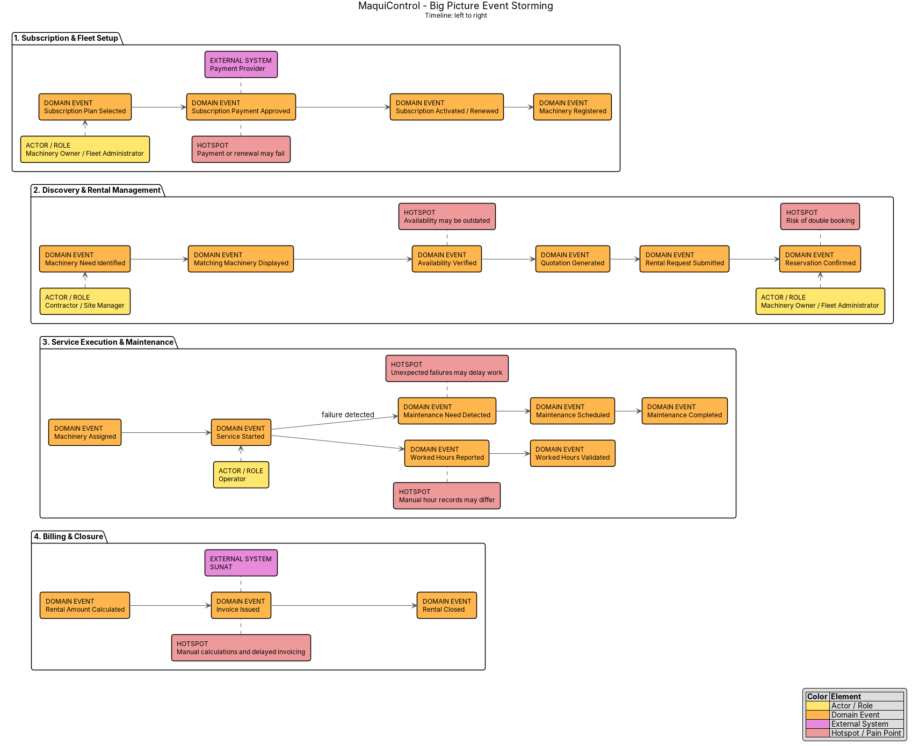

A partir del mapa se reconocen áreas de dominio candidatas como Discovery and Availability, Rental and Reservation Management, Fleet and Maintenance Management, Service Execution and Hour Control, Subscription Management, Billing and SUNAT Compliance, Operational Notifications y Dashboard and Analytics. Estas áreas todavía no representan Bounded Contexts definitivos, ya que su refinamiento se realiza posteriormente mediante Design-Level Event Storming.

## 2.4. Ubiquitous Language

En esta sección se presenta el Ubiquitous Language de TechnoLoad, compuesto por términos propios del dominio de gestión de flotas, mantenimiento de maquinaria pesada y transporte de carga. El objetivo es mantener un lenguaje común y sin ambigüedades entre los integrantes del equipo y los stakeholders involucrados en el proyecto.

Los términos se presentan en inglés debido a que serán utilizados de manera consistente durante el modelado del dominio y el desarrollo posterior de la solución.

| Term | Definition |
|---|---|
| **Fleet** | Conjunto de vehículos o maquinaria pertenecientes a una empresa y administrados como parte de sus operaciones. |
| **Heavy Machinery** | Maquinaria pesada utilizada principalmente en actividades de construcción, minería u operaciones industriales. |
| **Vehicle** | Unidad de transporte utilizada para trasladar carga entre diferentes ubicaciones. |
| **Asset** | Recurso perteneciente a una empresa que puede corresponder a una maquinaria pesada o un vehículo de transporte. |
| **Fleet Manager** | Persona responsable de supervisar el estado, disponibilidad, uso y mantenimiento de los activos de una flota. |
| **Logistics Coordinator** | Persona responsable de organizar la asignación de vehículos, rutas y despachos dentro de una operación logística. |
| **Horometer** | Dispositivo o registro utilizado para medir las horas acumuladas de funcionamiento de una maquinaria. |
| **Mileage** | Cantidad de kilómetros acumulados recorridos por un vehículo. |
| **Preventive Maintenance** | Mantenimiento planificado que se realiza antes de que ocurra una falla con el objetivo de conservar el activo en condiciones adecuadas de operación. |
| **Corrective Maintenance** | Mantenimiento realizado después de detectar una falla o avería en un activo. |
| **Maintenance Alert** | Aviso generado cuando una maquinaria o vehículo se aproxima al límite establecido para realizar un mantenimiento. |
| **Maintenance Schedule** | Planificación de las fechas o condiciones bajo las cuales deben realizarse los mantenimientos de un activo. |
| **Maintenance Record** | Registro histórico que almacena información sobre los mantenimientos realizados a una maquinaria o vehículo. |
| **Fleet Availability** | Condición que permite identificar qué activos se encuentran disponibles para realizar una operación. |
| **Available** | Estado de un activo que se encuentra operativo y disponible para ser asignado. |
| **In Operation** | Estado de un activo que actualmente se encuentra ejecutando una operación o servicio. |
| **In Maintenance** | Estado de un activo que temporalmente no se encuentra disponible debido a actividades de mantenimiento. |
| **Transport Request** | Solicitud que requiere la asignación de una unidad para realizar un servicio de transporte de carga. |
| **Dispatch** | Proceso mediante el cual una unidad es seleccionada, asignada y enviada para realizar un servicio. |
| **Route** | Recorrido definido que debe seguir un vehículo para realizar un servicio de transporte. |
| **Downtime** | Periodo durante el cual una maquinaria o vehículo no se encuentra disponible para operar. |
| **Operational Cost** | Costo asociado a la utilización, mantenimiento y operación de una maquinaria o vehículo. |
| **Fleet Status** | Información que representa la condición operativa actual de un activo perteneciente a la flota. |
| **Usage Reading** | Registro de las horas de funcionamiento o kilometraje acumulado de un activo. |

# Capítulo III: Requirements Specification

Este capítulo formaliza los hallazgos del análisis en historias de usuario, criterios de aceptación, relaciones de impacto y backlog priorizado. Los requisitos funcionales cubren activos, lecturas, mantenimiento, alertas, disponibilidad y asignación; los no funcionales establecen seguridad, rendimiento, accesibilidad, internacionalización, trazabilidad y mantenibilidad.

## 3.1. User Stories

A partir del análisis de las entrevistas y de los artefactos de Needfinding, se identificaron las principales necesidades de los usuarios de TechnoLoad. Estas necesidades fueron transformadas en historias de usuario y organizadas según las épicas funcionales del producto.

Las historias de usuario siguen la estructura: **Como [tipo de usuario], deseo [funcionalidad] para [beneficio esperado]**.

| Epic / Story ID | Tipo | Título | User Story | Criterios de aceptación | Relacionado con |
|---|---|---|---|---|---|
| EP-01 | Epic | Gestión de maquinaria y disponibilidad | Permitir la administración del inventario, estado y disponibilidad de las maquinarias de alquiler. | El sistema debe permitir registrar, consultar y actualizar la información de las maquinarias. | — |
| US-001 | User Story | Registrar maquinaria | Como propietario de una empresa de alquiler, quiero registrar una maquinaria con sus características, para mantener actualizado el inventario. | **Given:** el propietario tiene permisos de registro.<br>**When:** registra los datos obligatorios de la maquinaria.<br>**Then:** el sistema guarda la maquinaria y la muestra en el inventario. | EP-01 |
| US-002 | User Story | Consultar disponibilidad | Como administrador, quiero consultar la disponibilidad de una maquinaria por fecha, para evitar reservas duplicadas. | **Given:** existe una maquinaria registrada.<br>**When:** el administrador consulta un periodo determinado.<br>**Then:** el sistema muestra si la maquinaria está disponible, reservada o en mantenimiento. | EP-01 |
| US-003 | User Story | Gestionar mantenimiento | Como propietario, quiero actualizar el estado de mantenimiento de una maquinaria, para evitar que sea reservada cuando no está operativa. | **Given:** existe una maquinaria registrada.<br>**When:** el propietario cambia su estado a mantenimiento.<br>**Then:** el sistema impide nuevas reservas durante dicho estado. | EP-01 |
| US-016 | User Story | Editar datos de maquinaria | Como propietario, quiero modificar los datos técnicos de un equipo, para mantener la información actualizada. | **Given:** la maquinaria está registrada.<br>**When:** el propietario actualiza sus especificaciones.<br>**Then:** el sistema guarda los cambios en el catálogo. | EP-01 |
| US-017 | User Story | Dar de baja maquinaria | Como propietario, quiero desactivar una maquinaria fuera de servicio, para retirarla del inventario activo. | **Given:** el equipo no tiene reservas activas.<br>**When:** el propietario cambia su estado a inactivo.<br>**Then:** el sistema oculta el equipo de las búsquedas. | EP-01 |
| EP-02 | Epic | Gestión de reservas | Permitir la creación, consulta, modificación y cancelación de reservas de maquinaria. | El sistema debe controlar los periodos reservados y evitar conflictos de disponibilidad. | — |
| US-004 | User Story | Crear una reserva | Como contratista, quiero reservar una maquinaria disponible, para utilizarla en mi obra durante el periodo requerido. | **Given:** la maquinaria está disponible.<br>**When:** el contratista registra una reserva válida.<br>**Then:** el sistema confirma la reserva y bloquea el periodo seleccionado. | EP-02 |
| US-005 | User Story | Evitar reservas duplicadas | Como administrador, quiero evitar reservas que se superpongan, para garantizar la disponibilidad correcta de la maquinaria. | **Given:** existe una reserva para un periodo determinado.<br>**When:** se intenta crear otra reserva para el mismo periodo.<br>**Then:** el sistema rechaza la nueva reserva e informa que existe un conflicto. | EP-02 |
| US-006 | User Story | Cancelar una reserva | Como administrador, quiero cancelar una reserva, para liberar la maquinaria cuando ya no sea necesaria. | **Given:** existe una reserva activa.<br>**When:** el administrador cancela la reserva.<br>**Then:** el sistema cambia su estado a cancelada y libera el periodo reservado. | EP-02 |
| US-018 | User Story | Modificar fechas de reserva | Como contratista, quiero solicitar la extensión de una reserva activa, para continuar mis trabajos en obra. | **Given:** existe una reserva en curso y disponibilidad en fechas futuras.<br>**When:** el contratista modifica la fecha fin.<br>**Then:** el sistema actualiza el periodo bloqueado. | EP-02 |
| US-019 | User Story | Aprobar o rechazar reservas | Como administrador, quiero revisar las solicitudes pendientes de alquiler, para confirmar o rechazar contratos. | **Given:** existe una reserva pendiente.<br>**When:** el administrador evalúa y selecciona aprobar/rechazar.<br>**Then:** el sistema actualiza el estado y notifica al contratista. | EP-02 |
| EP-03 | Epic | Consulta y contratación de maquinaria | Facilitar que los contratistas consulten las maquinarias disponibles y sus condiciones de alquiler. | El sistema debe mostrar características, tarifas y disponibilidad de los equipos. | — |
| US-007 | User Story | Consultar catálogo de maquinaria | Como contratista, quiero consultar el catálogo de maquinarias, para elegir el equipo adecuado para mi obra. | **Given:** existen maquinarias registradas.<br>**When:** el contratista consulta el catálogo.<br>**Then:** el sistema muestra las características principales de cada maquinaria. | EP-03 |
| US-008 | User Story | Consultar tarifas | Como contratista, quiero consultar las tarifas de alquiler, para calcular el presupuesto de mi obra. | **Given:** una maquinaria tiene una tarifa registrada.<br>**When:** el contratista consulta sus datos.<br>**Then:** el sistema muestra la tarifa correspondiente y la unidad de cobro. | EP-03 |
| US-009 | User Story | Consultar reservas por obra | Como contratista, quiero consultar las reservas asociadas a mi obra, para organizar el uso de las maquinarias contratadas. | **Given:** el contratista tiene reservas registradas.<br>**When:** consulta las reservas de una obra.<br>**Then:** el sistema muestra la maquinaria, el periodo y el estado de cada reserva. | EP-03 |
| US-020 | User Story | Filtrar maquinaria por categoría | Como contratista, quiero filtrar equipos por tipo de máquina, para agilizar la búsqueda de equipos específicos. | **Given:** el usuario está en el catálogo.<br>**When:** selecciona una categoría.<br>**Then:** el sistema lista únicamente los equipos pertenecientes a dicho tipo. | EP-03 |
| US-021 | User Story | Buscar maquinaria por ubicación | Como contratista, quiero buscar equipos según su ubicación, para reducir costos de flete. | **Given:** existen equipos registrados en distintas sedes.<br>**When:** el usuario ingresa su ciudad/obra.<br>**Then:** el sistema muestra los equipos más cercanos. | EP-03 |
| EP-04 | Epic | Control de horas y facturación | Permitir el registro de horas trabajadas y la generación de información para el control de cobros. | El sistema debe relacionar las horas trabajadas con las reservas y los importes correspondientes. | — |
| US-010 | User Story | Registrar horas trabajadas | Como administrador, quiero registrar las horas trabajadas por cada maquinaria, para calcular correctamente el costo del servicio. | **Given:** existe una reserva activa o finalizada.<br>**When:** el administrador registra las horas trabajadas.<br>**Then:** el sistema guarda las horas y calcula el importe correspondiente. | EP-04 |
| US-011 | User Story | Validar horas trabajadas | Como propietario, quiero validar las horas registradas, para asegurar que los cobros se basen en información correcta. | **Given:** existen horas registradas para una reserva.<br>**When:** el propietario revisa los datos.<br>**Then:** el sistema permite aprobarlas o indicar que requieren corrección. | EP-04 |
| US-012 | User Story | Generar resumen de facturación | Como propietario, quiero obtener un resumen de facturación, para controlar los ingresos generados por los alquileres. | **Given:** existen reservas finalizadas y horas validadas.<br>**When:** el propietario solicita el resumen.<br>**Then:** el sistema muestra el cliente, la maquinaria, las horas y el importe total. | EP-04 |
| US-022 | User Story | Emitir comprobante de pago | Como propietario, quiero generar comprobantes electrónicos, para cumplir con los requisitos fiscales. | **Given:** las horas trabajadas están validadas.<br>**When:** el propietario presiona emitir comprobante.<br>**Then:** el sistema genera la factura con los datos del contrato. | EP-04 |
| US-023 | User Story | Aplicar penalizaciones por mora | Como propietario, quiero aplicar cargos por entrega tardía, para compensar retrasos no acordados. | **Given:** el equipo es devuelto fuera del tiempo pactado.<br>**When:** se liquida la reserva.<br>**Then:** el sistema añade el recargo por mora al importe final. | EP-04 |
| EP-05 | Epic | Landing Page de TechnoLoad | Presentar la propuesta de valor y los servicios de TechnoLoad a visitantes interesados. | El sitio debe mostrar información clara para empresas de alquiler y contratistas. | — |
| US-013 | User Story | Mostrar propuesta de valor | Como visitante, quiero conocer la propuesta de valor de TechnoLoad, para identificar cómo puede ayudar a mi empresa. | **Given:** el visitante accede a la Landing Page.<br>**When:** consulta el contenido principal.<br>**Then:** el sitio presenta los beneficios y servicios de TechnoLoad. | EP-05 |
| US-014 | User Story | Mostrar información por segmento | Como visitante, quiero consultar información relacionada con mi tipo de negocio, para determinar si TechnoLoad se adapta a mis necesidades. | **Given:** el visitante accede al contenido del sitio.<br>**When:** consulta la información de los segmentos.<br>**Then:** el sitio presenta información para empresas de alquiler y contratistas. | EP-05 |
| US-015 | User Story | Solicitar contacto o demostración | Como visitante, quiero enviar una solicitud de contacto, para obtener más información sobre TechnoLoad. | **Given:** el visitante desea recibir información adicional.<br>**When:** envía sus datos de contacto válidos.<br>**Then:** el sistema registra la solicitud y confirma su recepción. | EP-05 |
| US-024 | User Story | Calculadora de ahorro / ROI | Como visitante, quiero simular mi ahorro operativo según el tamaño de mi flota, para evaluar la compra del SaaS. | **Given:** el visitante ingresa a la sección comercial.<br>**When:** ingresa el número de maquinarias que gestiona.<br>**Then:** el sistema despliega el cálculo de horas y costos ahorrados. | EP-05 |
| US-025 | User Story | Chat de soporte comercial | Como visitante, quiero enviar preguntas directas en la landing, para resolver dudas antes de registrarme. | **Given:** el visitante explora la web.<br>**When:** interactúa con el widget de chat.<br>**Then:** el sistema conecta la conversación con un asesor comercial. | EP-05 |
| EP-06 | Epic | Gestión de usuarios y acceso | Gestionar el ciclo de vida de las cuentas de usuario y la seguridad de acceso a la plataforma. | Controlar la autenticación y los permisos por rol dentro del sistema. | — |
| US-026 | User Story | Registrar cuenta de usuario | Como usuario nuevo, quiero crear una cuenta en el sistema, para acceder a las funciones del software. | **Given:** el usuario no posee cuenta previa.<br>**When:** completa el formulario con datos válidos.<br>**Then:** el sistema guarda la cuenta y envía correo de confirmación. | EP-06 |
| US-027 | User Story | Iniciar sesión | Como usuario registrado, quiero autenticarme en el sistema, para acceder a mi panel personalizado. | **Given:** la cuenta está activa.<br>**When:** se ingresan credenciales correctas.<br>**Then:** el sistema concede acceso a la plataforma. | EP-06 |
| US-028 | User Story | Recuperar contraseña | Como usuario, quiero solicitar el restablecimiento de clave, para recuperar el acceso en caso de olvido. | **Given:** el usuario no recuerda su contraseña.<br>**When:** ingresa su correo registrado.<br>**Then:** el sistema envía un enlace seguro para restablecerla. | EP-06 |
| US-029 | User Story | Gestionar roles de usuario | Como administrador, quiero asignar roles (propietario, contratista, operador), para restringir accesos. | **Given:** existe un usuario registrado.<br>**When:** el administrador modifica sus permisos.<br>**Then:** el sistema actualiza el acceso a los módulos. | EP-06 |
| US-030 | User Story | Actualizar perfil | Como usuario, quiero modificar mis datos personales, para mantener actualizada mi información. | **Given:** el usuario inició sesión.<br>**When:** actualiza sus datos de perfil.<br>**Then:** el sistema guarda los cambios efectuados. | EP-06 |
| EP-07 | Epic | Mantenimiento preventivo y correctivo | Controlar los programas de mantenimiento, reparaciones y la hoja de vida técnica de los equipos. | Registrar intervenciones mecánicas para asegurar la continuidad operativa de los equipos. | — |
| US-031 | User Story | Programar mantenimientos preventivos | Como propietario, quiero agendar alertas periódicas por horas uso, para prevenir fallas mayores. | **Given:** el equipo acumula horas de trabajo.<br>**When:** alcanza el umbral configurado.<br>**Then:** el sistema emite una alerta de mantenimiento obligatorio. | EP-07 |
| US-032 | User Story | Registrar orden de reparación | Como técnico, quiero ingresar los detalles de reparaciones efectuadas, para mantener la ficha técnica del equipo. | **Given:** un equipo estuvo en revisión.<br>**When:** el técnico llena la orden de trabajo.<br>**Then:** el sistema anexa la reparación al historial de la máquina. | EP-07 |
| US-033 | User Story | Consultar historial mecánico | Como contratista, quiero ver el registro de mantenimientos de un equipo, para validar su estado antes de rentarlo. | **Given:** una máquina está publicada en catálogo.<br>**When:** el contratista solicita su historial.<br>**Then:** el sistema despliega las fichas técnicas y revisiones. | EP-07 |
| US-034 | User Story | Reportar avería en obra | Como contratista, quiero reportar una falla mecánica durante el uso, para solicitar soporte urgente. | **Given:** la reserva está activa.<br>**When:** el contratista envía un reporte de avería.<br>**Then:** el sistema notifica al administrador para asistencia inmediata. | EP-07 |
| EP-08 | Epic | Operaciones de campo y seguimiento | Monitorear el estado físico de la maquinaria mediante los registros de entrega, devolución y lecturas. | Garantizar la trazabilidad de la máquina desde la salida del depósito hasta su retorno. | — |
| US-035 | User Story | Registrar check-in de entrega | Como operador, quiero registrar el estado inicial del equipo al entregarlo en obra, para evitar disputas por daños. | **Given:** se entrega la maquinaria al cliente.<br>**When:** el operador registra horómetro inicial y fotos.<br>**Then:** el sistema crea el acta de entrega digital. | EP-08 |
| US-036 | User Story | Registrar check-out de devolución | Como operador, quiero registrar el estado del equipo al ser devuelto, para verificar su condición final. | **Given:** finaliza el periodo de reserva.<br>**When:** el operador toma las fotos y lectura final.<br>**Then:** el sistema cierra la recepción y habilita la facturación. | EP-08 |
| US-037 | User Story | Reasignar equipo por falla | Como administrador, quiero asignar una máquina de reemplazo, para evitar detener los trabajos del cliente. | **Given:** un equipo sufre avería en obra.<br>**When:** se selecciona un sustituto disponible.<br>**Then:** el sistema traslada los días restantes al nuevo equipo. | EP-08 |
| EP-09 | Epic | Reportes y analítica de negocio | Proporcionar paneles e informes financieros y operativos sobre la flota de alquiler. | Generar visualizaciones sobre el uso, rentabilidad e indicadores claves de rendimiento. | — |
| US-038 | User Story | Consultar reporte de utilización | Como propietario, quiero visualizar el porcentaje de uso de mi flota, para identificar los equipos más rentables. | **Given:** existen reservas acumuladas.<br>**When:** se accede al módulo de analítica.<br>**Then:** el sistema calcula el ratio de ocupación por maquinaria. | EP-09 |
| US-039 | User Story | Exportar reportes en Excel/PDF | Como administrador, quiero descargar la lista de reservas y facturas, para realizar auditorías externas. | **Given:** se genera una consulta en pantalla.<br>**When:** se selecciona exportar a Excel/PDF.<br>**Then:** el sistema entrega el archivo en el formato deseado. | EP-09 |
| US-040 | User Story | Calificar servicio y maquinaria | Como contratista, quiero puntuar el desempeño del equipo rentado, para retroalimentar la calidad del servicio. | **Given:** la reserva está finalizada.<br>**When:** el usuario califica del 1 al 5 y comenta.<br>**Then:** el sistema registra la valoración en el perfil de la máquina. | EP-09 |
| EP-10 | Epic | API RESTful de TechnoLoad | Proporcionar servicios REST para que otros sistemas puedan consultar y gestionar información de TechnoLoad. | La API debe validar solicitudes, devolver respuestas estructuradas y utilizar códigos HTTP adecuados. | — |
| TS-001 | Technical Story | Consultar maquinarias mediante API | Como desarrollador, quiero consultar las maquinarias mediante `GET /api/machinery`, para integrar el inventario con otros sistemas. | **Given:** existen maquinarias registradas.<br>**When:** se realiza una solicitud válida a `GET /api/machinery`.<br>**Then:** la API responde con código `200` y una lista de maquinarias. | EP-10 |
| TS-002 | Technical Story | Registrar reservas mediante API | Como desarrollador, quiero registrar reservas mediante `POST /api/reservations`, para permitir que otros sistemas creen reservas. | **Given:** se envían datos válidos y no existe conflicto de fechas.<br>**When:** se realiza una solicitud `POST /api/reservations`.<br>**Then:** la API crea la reserva y responde con código `201`. | EP-10 |
| TS-003 | Technical Story | Validar conflictos de reservas en la API | Como desarrollador, quiero validar los conflictos de fechas en la API, para mantener la consistencia de la disponibilidad. | **Given:** ya existe una reserva para el periodo solicitado.<br>**When:** se envía una solicitud para reservar el mismo periodo.<br>**Then:** la API rechaza la solicitud y responde con código `409`. | EP-10 |
| TS-004 | Technical Story | Validar datos incorrectos en la API | Como desarrollador, quiero validar los datos recibidos por la API, para evitar registros incompletos o incorrectos. | **Given:** la solicitud contiene datos obligatorios inválidos o incompletos.<br>**When:** la API procesa la solicitud.<br>**Then:** responde con código `400` y detalla los errores encontrados. | EP-10 |
| TS-005 | Technical Story | Autenticación basada en JWT | Como desarrollador, quiero asegurar los endpoints con JWT, para proteger las rutas privadas de la API. | **Given:** el cliente envía peticiones a la API.<br>**When:** no incluye o envía un token inválido en el header.<br>**Then:** la API rechaza la petición con código `401 Unauthorized`. | EP-10 |
| TS-006 | Technical Story | Registro masivo de horómetros | Como desarrollador, quiero procesar lotes de lecturas mediante `POST /api/horometers/batch`, para sincronización móvil offline. | **Given:** una lista de datos de horómetro capturada sin conexión.<br>**When:** el cliente envía la petición en lote.<br>**Then:** la API actualiza los datos y responde `200 OK`. | EP-10 |
| TS-007 | Technical Story | Endpoint para facturación fiscal | Como desarrollador, quiero integrar la API con el WebService del PSE/SUNAT, para tramitar la emisión de facturas. | **Given:** la solicitud de facturación incluye RUC y datos válidos.<br>**When:** se ejecuta `POST /api/invoices/issue`.<br>**Then:** la API responde con código `200` y el CDR firmado. | EP-10 |
| TS-008 | Technical Story | Webhooks de eventos de reserva | Como desarrollador, quiero notificar eventos vía Webhook, para mantener sincronizados sistemas externos. | **Given:** una reserva cambia de estado.<br>**When:** el evento ocurre en el sistema.<br>**Then:** la API realiza un callback HTTP POST a los endpoints suscritos. | EP-10 |
| EP-11 | Epic | Gestión de suscripciones y pagos | Permitir que los propietarios contraten, paguen y administren su plan de suscripción a TechnoLoad. | El sistema debe gestionar los planes disponibles, el estado de la suscripción y el procesamiento de pagos mediante el proveedor externo. | — |
| US-041 | User Story | Consultar planes de suscripción | Como propietario, quiero ver los planes de suscripción disponibles (Essential, Pro), para elegir el que se ajuste al tamaño de mi flota. | **Given:** el propietario no tiene una suscripción activa.<br>**When:** consulta los planes disponibles.<br>**Then:** el sistema muestra el límite de maquinarias y el precio de cada plan. | EP-11 |
| US-042 | User Story | Contratar un plan de suscripción | Como propietario, quiero seleccionar y pagar un plan de suscripción mediante el proveedor de pagos, para habilitar la gestión de mi flota en TechnoLoad. | **Given:** el propietario seleccionó un plan.<br>**When:** completa el pago a través del proveedor de pagos (sandbox).<br>**Then:** el sistema activa la suscripción y la vincula a la organización del propietario. | EP-11 |
| US-043 | User Story | Renovar suscripción | Como propietario, quiero que mi suscripción se renueve automáticamente al vencer el periodo contratado, para mantener el acceso sin interrupciones. | **Given:** la suscripción está próxima a vencer.<br>**When:** el proveedor de pagos aprueba el cobro de renovación.<br>**Then:** el sistema extiende la fecha de vencimiento de la suscripción. | EP-11 |
| US-044 | User Story | Consultar estado de la suscripción | Como propietario, quiero consultar el estado y el historial de pagos de mi suscripción, para verificar mi situación con la plataforma. | **Given:** el propietario tiene una suscripción registrada.<br>**When:** consulta su panel de cuenta.<br>**Then:** el sistema muestra el plan activo, la fecha de vencimiento y los pagos realizados. | EP-11 |
| US-045 | User Story | Bloquear registro de maquinaria al superar el límite del plan | Como sistema, quiero impedir que un propietario registre más maquinarias que las permitidas por su plan, para hacer cumplir los límites comerciales de la suscripción. | **Given:** el propietario alcanzó el límite de maquinarias de su plan.<br>**When:** intenta registrar una maquinaria adicional.<br>**Then:** el sistema rechaza el registro e indica que debe actualizar su plan. | EP-11 |

## 3.2. Impact Mapping


## 3.3. Product Backlog

| Orden | User Story ID | Título | Descripción | Story Points |
| :---: | :---: | :--- | :--- | :---: |
| 1 | **US-001** | Registrar maquinaria | Como propietario de una empresa de alquiler, quiero registrar una maquinaria con sus características, para mantener actualizado el inventario. | 2 |
| 2 | **US-002** | Consultar disponibilidad | Como administrador, quiero consultar la disponibilidad de una maquinaria por fecha, para evitar reservas duplicadas. | 2 |
| 3 | **US-003** | Gestionar mantenimiento | Como propietario, quiero actualizar el estado de mantenimiento de una maquinaria, para evitar que sea reservada cuando no está operativa. | 3 |
| 4 | **US-004** | Crear una reserva | Como contratista, quiero reservar una maquinaria disponible, para utilizarla en mi obra durante el periodo requerido. | 3 |
| 5 | **US-005** | Evitar reservas duplicadas | Como administrador, quiero evitar reservas que se superpongan, para garantizar la disponibilidad correcta de la maquinaria. | 3 |
| 6 | **US-006** | Cancelar una reserva | Como administrador, quiero cancelar una reserva, para liberar la maquinaria cuando ya no sea necesaria. | 2 |
| 7 | **US-007** | Consultar catálogo de maquinaria | Como contratista, quiero consultar el catálogo de maquinarias, para elegir el equipo adecuado para mi obra. | 1 |
| 8 | **US-008** | Consultar tarifas | Como contratista, quiero consultar las tarifas de alquiler, para calcular el presupuesto de mi obra. | 1 |
| 9 | **US-009** | Consultar reservas por obra | Como contratista, quiero consultar las reservas asociadas a mi obra, para organizar el uso de las maquinarias contratadas. | 2 |
| 10 | **US-010** | Registrar horas trabajadas | Como administrador, quiero registrar las horas trabajadas por cada maquinaria, para calcular correctamente el costo del servicio. | 3 |
| 11 | **US-011** | Validar horas trabajadas | Como propietario, quiero validar las horas registradas, para asegurar que los cobros se basen en información correcta. | 3 |
| 12 | **US-012** | Generar resumen de facturación | Como propietario, quiero obtener un resumen de facturación, para controlar los ingresos generados por los alquileres. | 3 |
| 13 | **US-013** | Mostrar propuesta de valor | Como visitante, quiero conocer la propuesta de valor de TechnoLoad, para identificar cómo puede ayudar a mi empresa. | 1 |
| 14 | **US-014** | Mostrar información por segmento | Como visitante, quiero consultar información relacionada con mi tipo de negocio, para determinar si TechnoLoad se adapta a mis necesidades. | 1 |
| 15 | **US-015** | Solicitar contacto o demostración | Como visitante, quiero enviar una solicitud de contacto, para obtener más información sobre TechnoLoad. | 1 |
| 16 | **US-016** | Editar datos de maquinaria | Como propietario, quiero modificar los datos técnicos de un equipo, para mantener la información actualizada. | 2 |
| 17 | **US-017** | Dar de baja maquinaria | Como propietario, quiero desactivar una maquinaria fuera de servicio, para retirarla del inventario activo. | 1 |
| 18 | **US-018** | Modificar fechas de reserva | Como contratista, quiero solicitar la extensión de una reserva activa, para continuar mis trabajos en obra. | 3 |
| 19 | **US-019** | Aprobar o rechazar reservas | Como administrador, quiero revisar las solicitudes pendientes de alquiler, para confirmar o rechazar contratos. | 2 |
| 20 | **US-020** | Filtrar maquinaria por categoría | Como contratista, quiero filtrar equipos por tipo de máquina, para agilizar la búsqueda de equipos específicos. | 1 |
| 21 | **US-021** | Buscar maquinaria por ubicación | Como contratista, quiero buscar equipos según su ubicación, para reducir costos de flete. | 2 |
| 22 | **US-022** | Emitir comprobante de pago | Como propietario, quiero generar comprobantes electrónicos, para cumplir con los requisitos fiscales. | 3 |
| 23 | **US-023** | Aplicar penalizaciones por mora | Como propietario, quiero aplicar cargos por entrega tardía, para compensar retrasos no acordados. | 2 |
| 24 | **US-024** | Calculadora de ahorro / ROI | Como visitante, quiero simular mi ahorro operativo según el tamaño de mi flota, para evaluar la compra del SaaS. | 2 |
| 25 | **US-025** | Chat de soporte comercial | Como visitante, quiero enviar preguntas directas en la Landing Page, para resolver dudas antes de registrarme. | 2 |
| 26 | **US-026** | Registrar cuenta de usuario | Como usuario nuevo, quiero crear una cuenta en el sistema, para acceder a las funciones del software. | 2 |
| 27 | **US-027** | Iniciar sesión | Como usuario registrado, quiero autenticarme en el sistema, para acceder a mi panel personalizado. | 2 |
| 28 | **US-028** | Recuperar contraseña | Como usuario, quiero solicitar el restablecimiento de clave, para recuperar el acceso en caso de olvido. | 2 |
| 29 | **US-029** | Gestionar roles de usuario | Como administrador, quiero asignar roles de propietario, contratista u operador, para restringir los accesos correspondientes. | 2 |
| 30 | **US-030** | Actualizar perfil | Como usuario, quiero modificar mis datos personales, para mantener actualizada mi información. | 1 |
| 31 | **US-031** | Programar mantenimientos preventivos | Como propietario, quiero agendar alertas periódicas por horas de uso, para prevenir fallas mayores. | 3 |
| 32 | **US-032** | Registrar orden de reparación | Como técnico, quiero ingresar los detalles de las reparaciones efectuadas, para mantener la ficha técnica del equipo. | 2 |
| 33 | **US-033** | Consultar historial mecánico | Como contratista, quiero consultar el registro de mantenimientos de un equipo, para validar su estado antes de alquilarlo. | 2 |
| 34 | **US-034** | Reportar avería en obra | Como contratista, quiero reportar una falla mecánica durante el uso, para solicitar soporte urgente. | 2 |
| 35 | **US-035** | Registrar check-in de entrega | Como operador, quiero registrar el estado inicial del equipo al entregarlo en obra, para evitar disputas por daños. | 2 |
| 36 | **US-036** | Registrar check-out de devolución | Como operador, quiero registrar el estado del equipo al ser devuelto, para verificar su condición final. | 2 |
| 37 | **US-037** | Reasignar equipo por falla | Como administrador, quiero asignar una máquina de reemplazo, para evitar detener los trabajos del cliente. | 3 |
| 38 | **US-038** | Consultar reporte de utilización | Como propietario, quiero visualizar el porcentaje de uso de mi flota, para identificar los equipos más rentables. | 2 |
| 39 | **US-039** | Exportar reportes en Excel/PDF | Como administrador, quiero descargar la lista de reservas y facturas, para realizar auditorías externas. | 2 |
| 40 | **US-040** | Calificar servicio y maquinaria | Como contratista, quiero puntuar el desempeño del equipo alquilado, para retroalimentar la calidad del servicio. | 1 |
| 41 | **TS-001** | Consultar maquinarias mediante API | Como desarrollador, quiero consultar las maquinarias mediante `GET /api/machinery`, para integrar el inventario con otros sistemas. | 2 |
| 42 | **TS-002** | Registrar reservas mediante API | Como desarrollador, quiero registrar reservas mediante `POST /api/reservations`, para permitir que otros sistemas creen reservas. | 3 |
| 43 | **TS-003** | Validar conflictos de reservas en la API | Como desarrollador, quiero validar los conflictos de fechas en la API, para mantener la consistencia de la disponibilidad. | 3 |
| 44 | **TS-004** | Validar datos incorrectos en la API | Como desarrollador, quiero validar los datos recibidos por la API, para evitar registros incompletos o incorrectos. | 2 |
| 45 | **TS-005** | Autenticación basada en JWT | Como desarrollador, quiero asegurar los endpoints con JWT, para proteger las rutas privadas de la API. | 3 |
| 46 | **TS-006** | Registro masivo de horómetros | Como desarrollador, quiero procesar lotes de lecturas mediante `POST /api/horometers/batch`, para permitir la sincronización móvil. | 3 |
| 47 | **TS-007** | Endpoint para facturación fiscal | Como desarrollador, quiero integrar la API con el servicio del PSE/SUNAT, para tramitar la emisión de facturas. | 3 |
| 48 | **TS-008** | Webhooks de eventos de reserva | Como desarrollador, quiero notificar eventos mediante webhooks, para mantener sincronizados los sistemas externos. | 3 |
| 49 | **US-041** | Consultar planes de suscripción | Como propietario, quiero ver los planes de suscripción disponibles (Essential, Pro), para elegir el que se ajuste al tamaño de mi flota. | 1 |
| 50 | **US-042** | Contratar un plan de suscripción | Como propietario, quiero seleccionar y pagar un plan de suscripción mediante el proveedor de pagos, para habilitar la gestión de mi flota en TechnoLoad. | 3 |
| 51 | **US-043** | Renovar suscripción | Como propietario, quiero que mi suscripción se renueve automáticamente al vencer el periodo contratado, para mantener el acceso sin interrupciones. | 3 |
| 52 | **US-044** | Consultar estado de la suscripción | Como propietario, quiero consultar el estado y el historial de pagos de mi suscripción, para verificar mi situación con la plataforma. | 2 |
| 53 | **US-045** | Bloquear registro de maquinaria al superar el límite del plan | Como sistema, quiero impedir que un propietario registre más maquinarias que las permitidas por su plan, para hacer cumplir los límites comerciales de la suscripción. | 2 |

## Capítulo IV: Product Design

## 4.1. Style Guidelines

Esta sección define las decisiones visuales y de interacción que mantienen una experiencia coherente en TechnoLoad. El sistema de diseño se orienta a operaciones de flota: debe permitir identificar el estado de un activo, detectar una excepción y ejecutar una acción sin ambigüedad, tanto desde escritorio como desde un dispositivo móvil.

### 4.1.1. General Style Guidelines

La identidad visual de TechnoLoad busca transmitir una imagen profesional, tecnológica y orientada a la gestión operativa de flotas de maquinaria pesada y transporte de carga por carretera.

La interfaz utiliza principalmente una paleta clara y contrastada acompañada de elementos en color azul y naranja para resaltar acciones importantes, estados de activos y componentes interactivos.

Los principales colores utilizados son:

#### Color Palette

TechnoLoad utiliza una paleta de colores de alto contraste que combina superficies limpias con colores de acento bien definidos para destacar acciones importantes y estados de la flota.

| Token | Código HEX | Uso en TechnoLoad |
| :--- | :---: | :--- |
| **Primary** | `#0F3D5E` | Navegación, encabezados y confianza operativa |
| **Action** | `#1976D2` | Botones primarios, enlaces y focos activos |
| **Accent** | `#FF8F00` | CTA, alertas de atención y priorización de mantenimientos |
| **Success** | `#2E7D32` | Activo disponible, rutas activas y confirmaciones |
| **Error** | `#C62828` | Validación, fallos críticos de máquina y acciones bloqueadas |
| **Neutral 50–900** | `#F6F8FB`–`#17324D` | Superficies, bordes y jerarquía de texto |

---

#### Typography

La tipografía principal utilizada es `Inter`, con fuentes alternativas Arial, Helvetica y sans-serif por su alta legibilidad en dashboards, tablas de horómetros e indicadores logísticos.

La jerarquía visual se establece mediante diferentes tamaños y pesos tipográficos, utilizando títulos grandes para comunicar métricas clave y textos secundarios con menor contraste para información complementaria.

| Elemento | Tipografía | Peso aproximado | Aplicación |
| :--- | :---: | :---: | :--- |
| **Main Headings** | Inter | Bold / 700 | Hero y títulos principales |
| **Section Headings** | Inter | Bold / 700 | Títulos de secciones y módulos |
| **Card Titles** | Inter | Semi Bold / 600 | Métrica de activos, tarjetas de flota y pasos |
| **Body Text** | Inter | Regular / 400 | Descripciones, lecturas de horómetros y contenido |
| **Buttons** | Inter | Semi Bold / 600 | Call to Action y botones de comando |
| **Navigation** | Inter | Regular / 400–500 | Enlaces de navegación y pestañas |

La jerarquía tipográfica se mantiene mediante variaciones de tamaño (escala de 12, 14, 16, 20, 24, 32 y 40 px) y peso, permitiendo distinguir claramente títulos, subtítulos, textos descriptivos y acciones.

---

#### Component Mapping & Spacing Rules

La escala de espaciado se compone de 4, 8, 12, 16, 24, 32 y 48 px. Las tarjetas usan un radio de borde de 12 px, una sombra tenue y separación interna mínima de 16 px. El color de estado siempre se acompaña con una etiqueta, icono o texto descriptivo.

| Elemento Figma | Equivalente PrimeVue | Estados documentados |
| :--- | :---: | :--- |
| **Primary / secondary button** | `pv-button` | default, hover, focus, disabled, loading |
| **Campo de formulario** | `pv-input-text` | default, focus, error, disabled |
| **Tarjeta de activo** | `pv-card` | default, hover, loading |
| **Tabla operativa** | `pv-data-table` | loading, empty, selected, error |
| **Estado de activo** | `pv-tag` | disponible, mantenimiento, crítico |
| **Confirmación y error** | `pv-toast` | success, warn, error, info |
| **Carga de contenido** | `pv-skeleton` | tarjeta, fila y detalle |

### 4.1.2. Web Style Guidelines

Las Web Style Guidelines de TechnoLoad establecen los criterios visuales y de interacción que serán aplicados tanto en la Landing Page como en la Web Application, buscando mantener una experiencia consistente, responsive y accesible en diferentes tamaños de pantalla.

La interfaz utiliza un enfoque responsive basado en una grilla flexible que permite adaptar el contenido a computadoras, tablets y dispositivos móviles. En pantallas de escritorio se utiliza una distribución de hasta 12 columnas, mientras que en dispositivos móviles los elementos se reorganizan verticalmente para facilitar su lectura e interacción.

Los principales breakpoints considerados son:

| Dispositivo | Resolución de referencia | Comportamiento |
|---|---|---|
| Mobile | 375 px – 767 px | Una columna, navegación mediante menú desplegable y componentes apilados. |
| Tablet | 768 px – 1023 px | Distribución intermedia con reducción de columnas y espacios. |
| Desktop | 1024 px o superior | Navegación completa, múltiples columnas y visualización ampliada de tablas y dashboards. |

Los componentes interactivos mantienen estados visuales claramente diferenciados.

| Componente | Estados considerados |
|---|---|
| Buttons | Default, Hover, Focus, Disabled y Loading |
| Input Fields | Default, Focus, Error y Disabled |
| Cards | Default, Hover y Selected |
| Tables | Loading, Empty, Selected y Error |
| Alerts | Info, Success, Warning y Error |
| Navigation Items | Default, Hover, Active y Focus |

Los botones principales utilizan el color de acción definido en el Design System, mientras que las acciones secundarias emplean estilos con menor jerarquía visual. Los estados de error, advertencia y éxito utilizan colores acompañados de iconos o textos, evitando depender únicamente del color para transmitir información.

En dispositivos móviles, el menú lateral de la Web Application se transforma en un Drawer que puede abrirse mediante un botón de navegación. Las tablas que contienen gran cantidad de información permiten desplazamiento horizontal o presentan una versión simplificada para conservar la legibilidad.

Las interfaces mantienen áreas de interacción suficientemente amplias y controles accesibles mediante teclado. Los formularios proporcionan mensajes de validación cercanos al campo correspondiente y muestran claramente los errores detectados.

TechnoLoad utiliza componentes de PrimeVue para mantener consistencia visual y de comportamiento entre las diferentes vistas de la aplicación. Entre los componentes principales se consideran `Button`, `InputText`, `DataTable`, `Card`, `Tag`, `Dialog`, `Toast`, `Drawer` y `Skeleton`.

## 4.2. Information Architecture

La arquitectura de información de TechnoLoad organiza de forma progresiva los contenidos relativos a activos, mantenimiento y operaciones de carga. La experiencia parte de la propuesta de valor y conduce al visitante por beneficios, perfiles objetivo, funcionamiento y mecanismos de navegación, con el propósito de reducir la carga cognitiva y orientar cada interacción hacia una decisión operativa verificable.

### 4.2.1. Organization Systems

La arquitectura de información de TechnoLoad utiliza diferentes sistemas de organización dependiendo del tipo de contenido y del objetivo que debe cumplir el usuario.

#### Organización jerárquica

La organización jerárquica se utiliza principalmente en la Web Application, donde la información se estructura desde módulos generales hasta información específica.

La jerarquía principal es:

**Dashboard → Módulos → Listados → Detalle → Acciones**

Los módulos principales considerados son:

- Dashboard
- Assets
- Maintenance
- Operations
- Reservations
- Profile

Por ejemplo, un administrador puede ingresar al módulo de activos, seleccionar una maquinaria específica y posteriormente consultar su información detallada, historial de uso o mantenimiento.

#### Organización secuencial

La organización secuencial se utiliza cuando el usuario debe completar un conjunto ordenado de pasos para alcanzar un objetivo.

Ejemplos:

**Seleccionar activo → Registrar lectura → Validar información → Confirmar registro**

**Seleccionar activo → Programar mantenimiento → Definir fecha y prioridad → Confirmar mantenimiento**

**Consultar disponibilidad → Seleccionar unidad → Asignar operación → Confirmar asignación**

Este sistema permite que los procesos transaccionales sean fáciles de comprender y reduzcan errores durante su ejecución.

#### Organización por tópicos

El contenido se agrupa según las principales áreas funcionales del dominio de TechnoLoad:

- Gestión de activos.
- Control de horómetros y kilometraje.
- Gestión de mantenimiento.
- Disponibilidad de unidades.
- Operaciones.
- Reservas.
- Reportes y análisis.

#### Organización según audiencia

La información también se organiza de acuerdo con los principales tipos de usuario.

**Fleet Manager:** accede principalmente a información relacionada con activos, lecturas, disponibilidad y mantenimiento.

**Operations Manager:** accede a indicadores de utilización, costos y rendimiento de la flota.

**Logistics Coordinator:** accede a disponibilidad de unidades, asignaciones y operaciones.

**Visitor:** accede al Landing Page para conocer la propuesta de valor, características y mecanismos de contacto de TechnoLoad.

De esta manera, la organización del contenido permite reducir la cantidad de información innecesaria presentada a cada usuario.

### 4.2.2. Labeling Systems

El sistema de etiquetado de TechnoLoad utiliza términos breves, comprensibles y consistentes con el Ubiquitous Language definido para el dominio.

Se busca evitar etiquetas ambiguas o excesivamente técnicas y utilizar nombres que permitan al usuario comprender rápidamente la función de cada elemento.

#### Navigation Labels

| Label | Propósito |
|---|---|
| Home | Página principal de la Landing Page. |
| Features | Presenta las principales características de TechnoLoad. |
| Solutions | Presenta los beneficios de la plataforma para cada segmento. |
| Contact | Permite acceder a los medios de contacto. |
| Dashboard | Presenta una visión general de la operación. |
| Assets | Permite administrar maquinaria y vehículos. |
| Maintenance | Permite consultar y gestionar mantenimientos. |
| Operations | Permite gestionar las operaciones de las unidades. |
| Reservations | Permite consultar y administrar reservas. |
| Profile | Permite gestionar la información del usuario. |

#### Action Labels

Las acciones utilizan verbos que describen directamente lo que realizará el usuario.

- Register Asset
- Edit Asset
- Register Reading
- Schedule Maintenance
- Assign Unit
- Create Reservation
- Cancel Reservation
- View Details
- Save
- Confirm
- Cancel

#### Status Labels

Los estados utilizados para representar la situación actual de los activos son:

- Available
- Assigned
- In Operation
- In Maintenance
- Inactive

Los mantenimientos podrán utilizar estados como:

- Scheduled
- In Progress
- Completed
- Cancelled

Las etiquetas mantendrán la misma terminología en toda la plataforma para evitar que un mismo concepto sea representado con diferentes palabras.

Además, los textos visibles serán administrados mediante internacionalización, permitiendo presentar la interfaz en `en_US` y `es_419`.

### 4.2.3. SEO Tags and Meta Tags

La Landing Page de TechnoLoad incorpora etiquetas HTML orientadas a mejorar la identificación del sitio por los motores de búsqueda y proporcionar información básica sobre el contenido de la página.

En el elemento `<head>` se han implementado las siguientes etiquetas:

* **Title:** `TechnoLoad | Intelligent Fleet Management`
* **Description:** describe a TechnoLoad como una plataforma para la gestión de flotas, control de mantenimientos preventivos, horómetros y optimización de rutas para maquinaria pesada y transporte.
* **Keywords:** incluye términos relacionados con gestión de flotas, mantenimiento preventivo, maquinaria pesada, logística, transporte de carga y TechnoLoad.
* **Author:** identifica a `TechnoLoad Team` como autor del sitio.

Además, se incluyen etiquetas técnicas necesarias para una correcta visualización y optimización en redes sociales:

* `charset="UTF-8"` para la codificación de caracteres.
* `viewport` para adaptar correctamente la página a dispositivos móviles.
* Etiquetas `OpenGraph` para estandarizar el título, descripción, imagen y URL al compartir la página.

La configuración implementada en la Landing Page es la siguiente:

```html
`<meta charset="UTF-8">`

`<meta name="viewport" content="width=device-width, initial-scale=1.0">`

`<meta name="description" content="TechnoLoad centraliza activos, mantenimiento y operaciones de transporte de carga y maquinaria pesada en una sola plataforma.">`

`<meta name="keywords" content="fleet management, maintenance, machinery, logistics, TechnoLoad">`

`<meta name="author" content="TechnoLoad Team">`

`<title>TechnoLoad | Intelligent Fleet Management</title>`
```

### 4.2.4. Searching Systems

La Landing Page no requiere un buscador interno: su objetivo es comunicar y convertir mediante llamadas a la acción directas hacia la Web App. En la aplicación autenticada, la búsqueda usa debounce de 300 ms, filtros combinables por estado, tipo y prioridad, parámetros conservados en la URL y paginación de servidor. Los estados vacíos explican la causa, ofrecen restablecer filtros y presentan un CTA contextual cuando el rol lo permite.

### 4.2.5. Navigation Systems

La navegación pública es lineal por anclas: el Header contiene enlaces a secciones y un botón de acceso a plataforma; en móvil se contrae a un menú compacto. La aplicación autenticada usa Sidebar o Drawer, Topbar, Breadcrumbs dinámicos y CTAs contextuales. Esta combinación conserva orientación espacial al pasar de listados a detalle y a formularios.

## 4.3. Landing Page UI Design

La Landing Page aplica Primary `#0F3D5E`, Secondary `#FF8F00` e Inter para comunicar confiabilidad, actividad y claridad. La composición dirige la mirada del titular a la propuesta de valor, luego a los módulos y finalmente a la conversión.

### 4.3.1. Landing Page Wireframes

El wireframe de baja fidelidad define Navbar, Hero de dos columnas, beneficios, módulos, proceso, CTA y Footer. Las estructuras se validan antes de aplicar estilo visual y responden a desktop y móvil.

La arquitectura de información prioriza una secuencia de conversión clara: propuesta de valor, evidencia de beneficio, módulos, segmentos, planes y llamada a la acción. Esta jerarquía reduce la carga cognitiva y permite que el visitante identifique rápidamente el propósito de la plataforma y el siguiente paso.

| Breakpoint | Composición | Decisión de Responsive Web Design |
| :--- | :--- | :--- |
| **Desktop (≥ 1024 px)** | Hero en dos columnas, navegación horizontal y grillas de tres tarjetas. | Aprovecha el ancho disponible para comparar módulos y mantener CTAs visibles. |
| **Tablet (768–1023 px)** | Hero con columnas reducidas y grillas de dos tarjetas. | Conserva la jerarquía visual sin requerir desplazamiento horizontal. |
| **Mobile (< 768 px)** | Una columna, menú compacto, CTAs apilados y tarjetas secuenciales. | Prioriza legibilidad, objetivos táctiles de al menos 44 px y contenido esencial. |


### 4.3.2. Landing Page Mock-ups

En esta sección se presentan los mockups de alta fidelidad de la Landing Page de TechnoLoad.

Los mockups aplican la identidad visual definida previamente, incluyendo colores, tipografía, componentes, botones, tarjetas, iconografía y distribución responsive.

La interfaz final está compuesta por las siguientes secciones:

* **Header.**
* **Hero Section.**
* **Benefits Section.**
* **Target Segments Section.**
* **How It Works Section.**
* **Value Proposition.**
* **Pricing Section.**
* **Final Call to Action.**
* **Footer.**

El mock-up de alta fidelidad aplica la jerarquía Inter, superficies claras, cards con bordes suaves y CTAs contrastantes. El copy principal, “Controla tu flota antes de que una parada detenga tu operación”, se acompaña de “Solicitar una demostración” y “Conocer los módulos”.

---

#### **Vista Desktop**


<!-- SVG embebido anterior conservado solo como referencia de diseño; la imagen local anterior es la representación visible.
<svg xmlns="http://www.w3.org/2000/svg" viewBox="0 0 1200 800" width="100%" style="background:#0F1115; border-radius:8px; font-family:'Inter', sans-serif;">
  <!-- Header -->
  <rect x="0" y="0" width="1200" height="70" fill="#171A20"/>
  <text x="40" y="42" fill="#F5F5F5" font-size="20" font-weight="bold">TechnoLoad</text>
  <text x="750" y="42" fill="#A8ADB8" font-size="14">Inicio</text>
  <text x="820" y="42" fill="#A8ADB8" font-size="14">Servicios</text>
  <text x="910" y="42" fill="#A8ADB8" font-size="14">Planes</text>
  <rect x="1000" y="20" width="160" height="36" rx="6" fill="#FF8F00"/>
  <text x="1035" y="43" fill="#FFFFFF" font-size="13" font-weight="bold">Ir a la Plataforma</text>

  <!-- Hero Section -->
  <text x="80" y="160" fill="#FFFFFF" font-size="38" font-weight="bold">Controla tu flota antes de que</text>
  <text x="80" y="210" fill="#FF8F00" font-size="38" font-weight="bold">una parada detenga tu operación.</text>
  <text x="80" y="260" fill="#A8ADB8" font-size="16">Monitoreo de horómetros, mantenimiento preventivo y gestión logística en tiempo real.</text>

  <rect x="80" y="300" width="200" height="48" rx="6" fill="#1976D2"/>
  <text x="110" y="330" fill="#FFFFFF" font-size="15" font-weight="bold">Solicitar Demostración</text>

  <rect x="300" y="300" width="180" height="48" rx="6" fill="none" stroke="#2A2F38" stroke-width="2"/>
  <text x="335" y="330" fill="#F5F5F5" font-size="15">Conocer Módulos</text>

  <!-- Hero Card Graphic -->
  <rect x="680" y="130" width="440" height="260" rx="12" fill="#171A20" stroke="#2A2F38" stroke-width="2"/>
  <rect x="710" y="160" width="380" height="130" rx="8" fill="#0F3D5E"/>
  <circle cx="800" cy="225" r="30" fill="#FF8F00"/>
  <rect x="850" y="210" width="180" height="12" rx="4" fill="#FFFFFF"/>
  <rect x="850" y="232" width="120" height="10" rx="4" fill="#A8ADB8"/>
  <rect x="710" y="310" width="140" height="32" rx="16" fill="#2E7D32"/>
  <text x="735" y="331" fill="#FFFFFF" font-size="12" font-weight="bold">● Flota Operativa 98%</text>

  <!-- Cards Grid -->
  <rect x="80" y="440" width="320" height="280" rx="10" fill="#171A20" stroke="#2A2F38"/>
  <rect x="110" y="470" width="40" height="40" rx="8" fill="#FF8F00"/>
  <text x="123" y="496" fill="#FFFFFF" font-size="18" font-weight="bold">01</text>
  <text x="110" y="545" fill="#FFFFFF" font-size="20" font-weight="bold">Maquinaria Pesada</text>
  <text x="110" y="580" fill="#A8ADB8" font-size="14">Control automático de horómetros,</text>
  <text x="110" y="605" fill="#A8ADB8" font-size="14">alertas de servicios preventivos y</text>
  <text x="110" y="630" fill="#A8ADB8" font-size="14">reportes de costos operativos en obra.</text>

  <rect x="440" y="440" width="320" height="280" rx="10" fill="#171A20" stroke="#2A2F38"/>
  <rect x="470" y="470" width="40" height="40" rx="8" fill="#1976D2"/>
  <text x="483" y="496" fill="#FFFFFF" font-size="18" font-weight="bold">02</text>
  <text x="470" y="545" fill="#FFFFFF" font-size="20" font-weight="bold">Transporte y Carga</text>
  <text x="470" y="580" fill="#A8ADB8" font-size="14">Asignación eficiente de rutas,</text>
  <text x="470" y="605" fill="#A8ADB8" font-size="14">seguimiento de kilometraje y</text>
  <text x="470" y="630" fill="#A8ADB8" font-size="14">reducción de tiempos muertos.</text>

  <rect x="800" y="440" width="320" height="280" rx="10" fill="#171A20" stroke="#2A2F38"/>
  <rect x="830" y="470" width="40" height="40" rx="8" fill="#2E7D32"/>
  <text x="843" y="496" fill="#FFFFFF" font-size="18" font-weight="bold">03</text>
  <text x="830" y="545" fill="#FFFFFF" font-size="20" font-weight="bold">Mantenimiento</text>
  <text x="830" y="580" fill="#A8ADB8" font-size="14">Planificación centralizada para</text>
  <text x="830" y="605" fill="#A8ADB8" font-size="14">evitar averías críticas y reducir</text>
  <text x="830" y="630" fill="#A8ADB8" font-size="14">penalizaciones contractuales.</text>
</svg>
-->

---

#### **Vista Mobile**


## 4.4. Web Applications UX/UI Design

El Dashboard y la Web App se diseñan a partir de los User Personas y User Stories. El administrador requiere visibilidad de activos y mantenimiento; el coordinador necesita conocer disponibilidad y asignar unidades sin perder trazabilidad.

### 4.4.1. Web Applications Wireframes

Los wireframes de TechnoLoad representan la estructura inicial de las principales vistas de la Web Application antes de aplicar los estilos visuales definitivos.

Estos diseños de baja fidelidad permiten establecer la distribución de los componentes, la jerarquía de la información y la ubicación de los principales elementos de interacción.

Los wireframes fueron elaborados considerando los principales procesos de la plataforma, permitiendo validar la organización de las vistas antes de desarrollar los mock-ups de alta fidelidad.

La estructura responde a una arquitectura de información por tareas: el Dashboard resume alertas y métricas; los módulos Assets, Maintenance, Rentals, Operations y Billing agrupan acciones relacionadas; y el detalle de cada entidad concentra historial, estado y acciones contextuales. En desktop se usa sidebar persistente y tablas con filtros; en tablet el sidebar se contrae; y en móvil se convierte en drawer, las tablas se muestran como tarjetas y los formularios se presentan en una columna.

A continuación, se presentan los wireframes correspondientes a las principales interfaces de la Web Application de TechnoLoad.

---

#### **14 Vistas Prioritarias del MVP**


### 4.4.2. Web Applications Wireflow Diagrams

Los Wireflow Diagrams permiten representar la relación entre los wireframes y las acciones que conectan las diferentes vistas de la Web Application de TechnoLoad.

Estos diagramas muestran cómo el usuario puede desplazarse entre las interfaces para completar determinadas tareas, combinando la representación visual de las pantallas con las conexiones que describen el flujo de navegación.

Los wireflows permiten validar la continuidad de la experiencia y detectar posibles problemas de navegación antes de la implementación de la aplicación.

A continuación, se presentan los principales Wireflow Diagrams de TechnoLoad.

---

#### **Seis Wireflows Priorizados**


### 4.4.3. Web Applications Mock-ups

Los mock-ups presentan la propuesta visual de alta fidelidad de la Web Application de TechnoLoad.

A diferencia de los wireframes, estas interfaces incorporan la identidad visual definida en las Style Guidelines, incluyendo colores, tipografía, iconografía, componentes, botones, tarjetas, estados visuales y jerarquías de información.

Los mock-ups permiten representar de manera más cercana la apariencia final de la aplicación y sirven como referencia visual para la etapa de implementación.

La propuesta visual aplica contraste suficiente entre texto y superficies, color semántico para estados operativos, jerarquía tipográfica para distinguir indicadores y acciones, y retroalimentación visible para carga, éxito, error y ausencia de datos. Los componentes mantienen tamaños táctiles adecuados en móvil y no dependen exclusivamente del color para comunicar un estado.

A continuación, se presentan los mock-ups correspondientes a las principales vistas de la Web Application de TechnoLoad.

---

#### **Mock-ups de Alta Fidelidad**


### 4.4.4. Web Applications User Flow Diagrams

Los User Flow Diagrams representan los recorridos que realizan los usuarios para completar las principales tareas dentro de la Web Application de TechnoLoad. Fueron definidos tomando como referencia las User Stories y las necesidades identificadas para los User Personas de TechnoLoad.

Cada flujo documenta el camino exitoso y también las decisiones, validaciones, estados vacíos, conflictos, cancelaciones y mecanismos de recuperación relevantes. De esta manera, la navegación no se limita al *happy path* y permite anticipar la respuesta de la interfaz ante datos inválidos, indisponibilidad o errores de persistencia.

| Flujo | Objetivo principal | Alternativas y errores cubiertos |
| :--- | :--- | :--- |
| UF-01 | Acceder a la plataforma | Campos inválidos, credenciales incorrectas, cuenta inactiva, recuperación y reintento. |
| UF-02 | Registrar maquinaria | Datos incompletos, equipo duplicado, cancelación y error de guardado. |
| UF-03 | Programar mantenimiento | Datos inválidos, conflicto con reserva, cambio de fecha y fallo de persistencia. |
| UF-04 | Revisar solicitud de alquiler | Rechazo, indisponibilidad, alternativa y conflicto concurrente. |
| UF-05 | Buscar y reservar maquinaria | Sin resultados, modificación de filtros, conflicto de fechas, autenticación y fallo de registro. |
| UF-06 | Liquidar servicio | Lecturas inválidas, borrador, rechazo de horas y discrepancia del importe. |

#### UF-01: Acceder a la plataforma

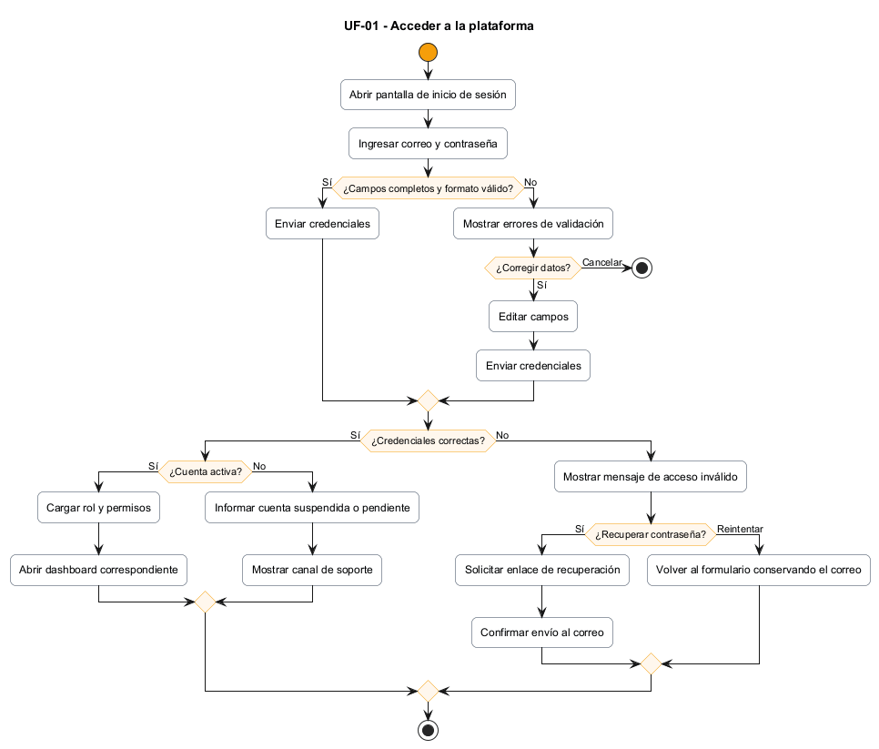

#### UF-02: Registrar maquinaria

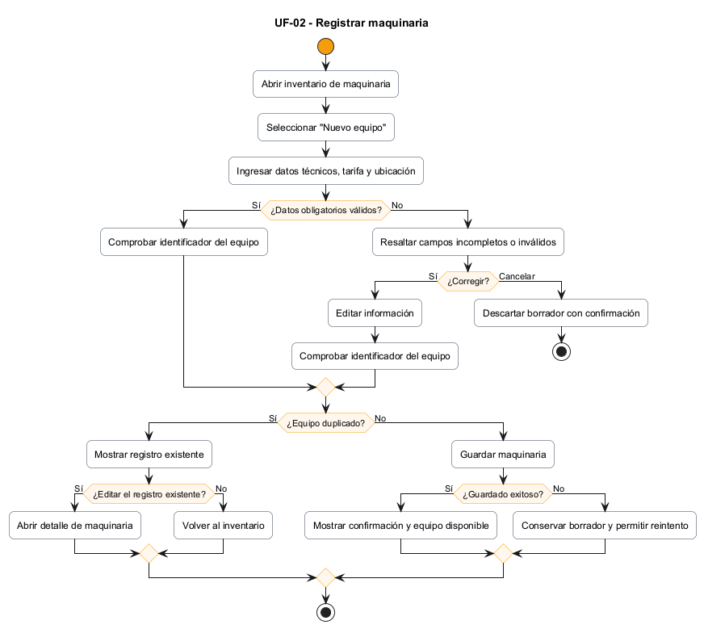

#### UF-03: Programar mantenimiento

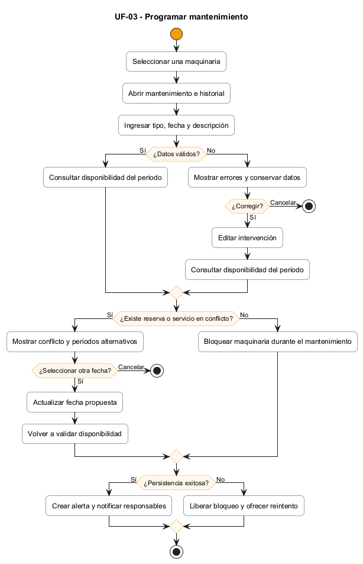

#### UF-04: Revisar solicitud de alquiler

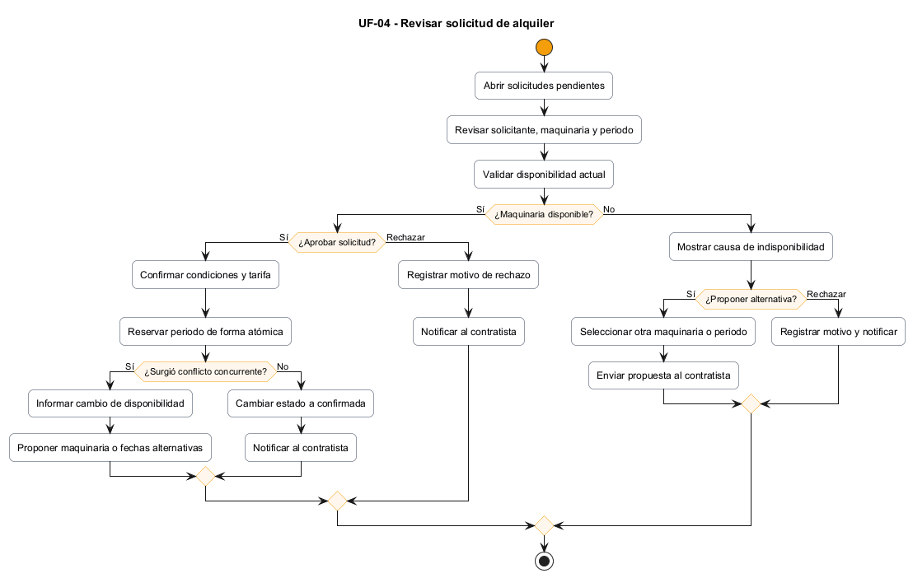

#### UF-05: Buscar y reservar maquinaria

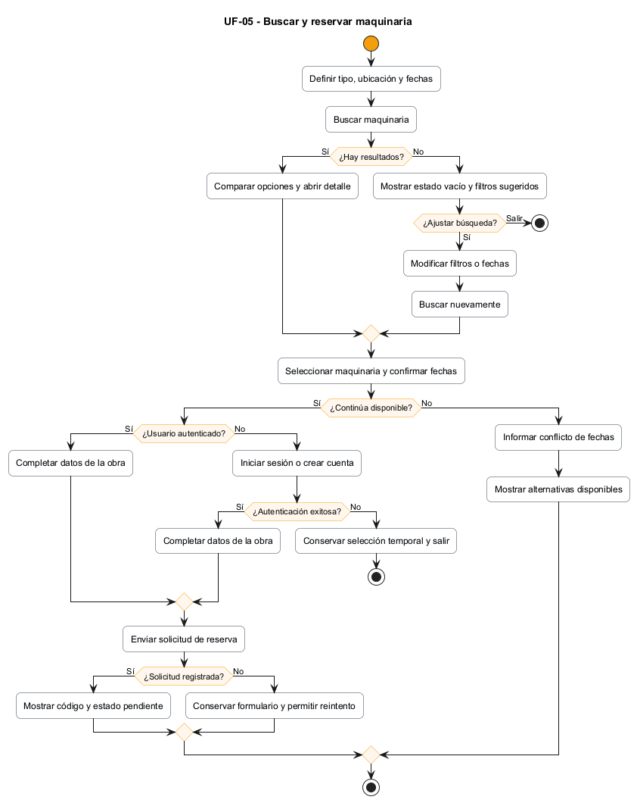

#### UF-06: Liquidar servicio

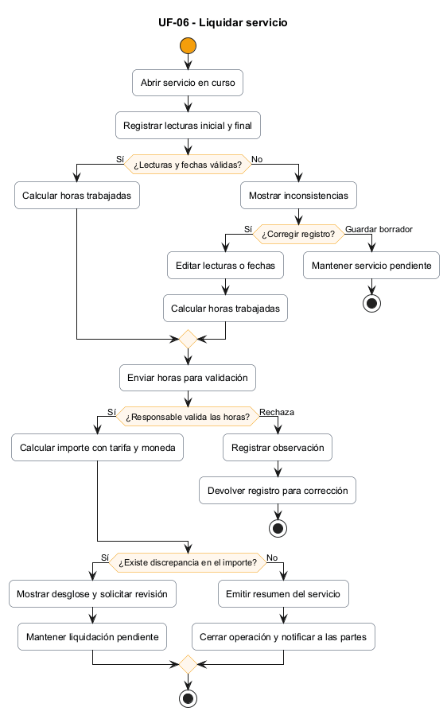

## 4.5. Web Applications Prototyping

En esta sección se presenta el prototipo interactivo de la Web Application de TechnoLoad, desarrollado a partir de los mock-ups y User Flow Diagrams definidos previamente.

El prototipo permite simular la navegación entre las principales vistas de la aplicación y validar la secuencia de interacción que siguen los usuarios para completar sus tareas principales. Las conexiones entre pantallas fueron definidas considerando los recorridos planteados en los User Flows y el sistema de navegación establecido para la aplicación.

Las imágenes del prototipo y de los mock-ups utilizan rutas relativas verificadas dentro de `assets/`, por lo que se renderizan tanto en GitHub como en WebStorm. El repositorio no incluye una URL pública de Figma; por ello, se conserva la evidencia visual versionada y no se declara un enlace externo no verificable.

Se consideraron las principales funcionalidades de TechnoLoad, como el acceso a la plataforma, visualización del dashboard, consulta y gestión de maquinaria, reservas, mantenimiento, disponibilidad y seguimiento de servicios.

A continuación, se presenta una captura del prototipo en funcionamiento y el enlace al video de demostración, donde se muestran los principales flujos de navegación e interacción de la aplicación.

---

#### **Prototipo Interactivo en Figma**


## 4.6. Domain-Driven Software Architecture

En esta sección se presenta la arquitectura de software de TechnoLoad desde una perspectiva orientada al dominio.

La propuesta arquitectónica toma como referencia los procesos de negocio identificados previamente, el Ubiquitous Language, el Big Picture Event Storming y los principales requisitos funcionales de la plataforma.

A partir de estos elementos se identifican los principales límites del dominio, las responsabilidades del sistema y las relaciones entre los diferentes componentes que conforman la solución.

La arquitectura se documenta mediante Design-Level Event Storming y diagramas C4 a nivel de Context, Container y Component.

### 4.6.1. Design-Level Event Storming

En esta sección se presenta el Design-Level Event Storming de TechnoLoad, desarrollado a partir del Big Picture Event Storming realizado previamente.

El objetivo de esta etapa es profundizar en el dominio del problema e identificar los principales Bounded Contexts, Aggregates, Commands, Domain Events, Policies, Queries y Read Models de la solución. Las políticas expresan reglas reactivas con la estructura evento ocurrido, política aplicada y comando desencadenado.

La sesión se realizó en equipo tomando como punto de partida los eventos del Big Picture. Para cada Bounded Context se ubicaron los Domain Events en orden temporal, se identificó el actor y el Command que origina cada evento, se agruparon los Commands en el Aggregate que valida sus reglas de negocio y se definieron las Policies que reaccionan a eventos propios o de otros Bounded Contexts. Finalmente se definieron los Read Models que cada actor necesita consultar y se marcaron como hotspots los riesgos pendientes. Los modelos se contrastaron con la implementación de la aplicación web y los servicios backend para que los Aggregates, estados y reglas coincidan con el código.

Cada diagrama se lee de izquierda a derecha como una línea de tiempo y cada fila representa un flujo. El actor se ubica debajo del Command que ejecuta, el Command actúa sobre el Aggregate y el Aggregate publica un Domain Event. Cuando el sistema debe reaccionar, una Policy escucha ese evento y ejecuta automáticamente el siguiente Command, y así sucesivamente hasta que el flujo termina. El último paso de cada flujo es un Command que modifica un Aggregate sin publicar un nuevo evento, porque ya no hay ninguna reacción pendiente. Las cadenas pueden continuar en otro Bounded Context (por ejemplo, `Maintenance Started` dispara `Change Machinery Status` en Fleet Management); en ese caso el nombre del contexto aparece entre paréntesis. Los eventos en color claro provienen de otro Bounded Context, los Read Models indican la query que los consulta y el Aggregate del que se obtienen, y los recuadros de reglas de negocio resumen las invariantes de cada Aggregate.

A partir del análisis realizado se identificaron los siguientes Bounded Contexts principales: **Fleet Management**, **Rental Management**, **Maintenance Management** y **Operations Management** como *core*; **Profiles Management**, **Subscription Management** y **Billing Management** como *soporte*; e **Identity & Access Management** como *genérico*.

#### Fleet Management Bounded Context

Este Bounded Context concentra la gestión de la maquinaria y de sus categorías. El propietario o administrador de flota ejecuta los comandos `Register Machinery`, `Update Machinery`, `Change Machinery Status` y `Delete Machinery` sobre el agregado `Machinery`, y `Create Category`, `Rename Category` y `Delete Category` sobre el agregado `Category`. Las reglas exigen datos técnicos obligatorios, tarifa por hora no negativa, categorías con nombre único que no se pueden eliminar si tienen maquinaria, y no permiten eliminar maquinaria con alquileres activos. Sus políticas ejecutan `Change Machinery Status` a partir de eventos propios y de otros contextos: dejan la maquinaria disponible al registrarse, la marcan como reservada cuando Rental Management confirma una reserva, la liberan cuando se cancela y la pasan a mantenimiento mientras Maintenance Management la atiende. Los read models `Machinery Catalog`, `Machinery Availability` y `Category Catalog` informan al contratista y al propietario.

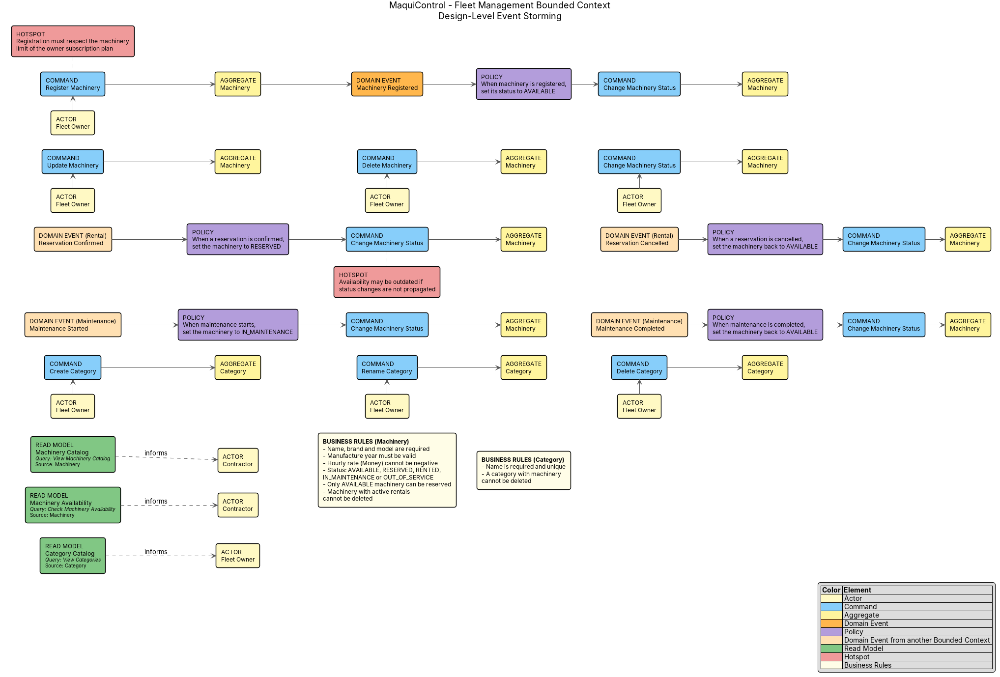

#### Rental Management Bounded Context

Este Bounded Context gestiona las solicitudes y reservas de maquinaria. El contratista ejecuta `Request Rental` y `Cancel Reservation`, y el propietario o administrador de flota ejecuta `Confirm Reservation` o `Reject Reservation` sobre una solicitud pendiente. Su agregado `Rental` controla el periodo de alquiler, evita reservas superpuestas sobre la misma maquinaria, solo permite las transiciones `REQUESTED`, `CONFIRMED`, `IN_PROGRESS` y `COMPLETED`, y registra el motivo cuando una reserva termina como `REJECTED` o `CANCELLED`. Los comandos `Start Rental` y `Complete Rental` no tienen actor humano: los ejecutan las políticas que reaccionan a Operations Management cuando la operación inicia (`Operation Started`) y cuando termina (`Operation Completed`). Los read models `Pending Rental Requests` y `My Reservations` informan al propietario y al contratista, y el hotspot identificado es la posibilidad de solicitudes superpuestas antes de la confirmación.

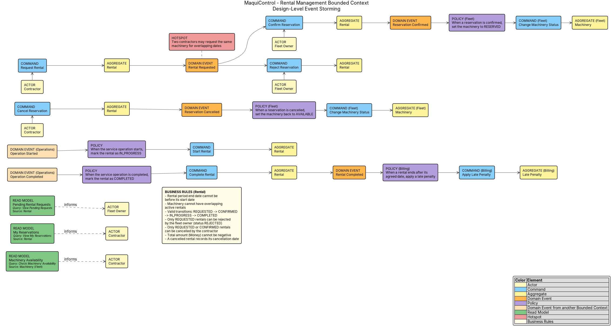

#### Maintenance Management Bounded Context

Este Bounded Context agrupa la programación, ejecución y cierre de los mantenimientos, junto con el reporte de averías. El propietario o administrador de flota ejecuta `Schedule Maintenance`, `Start Maintenance`, `Cancel Maintenance` y `Complete Maintenance`, y el contratista ejecuta `Report Breakdown` desde la obra. Su agregado `Maintenance` exige descripción, tipo preventivo, correctivo o de inspección, costo no negativo, solo permite cancelar un mantenimiento que aún no empezó y registra la fecha de cierre al completarse. Sus políticas ejecutan `Schedule Maintenance` de forma automática: un mantenimiento correctivo cuando se reporta una avería y uno preventivo cuando las horas validadas en Operations Management alcanzan el umbral definido. Los read models `Maintenance Schedule`, `Breakdown Reports` y `Maintenance History` informan al propietario y al contratista.

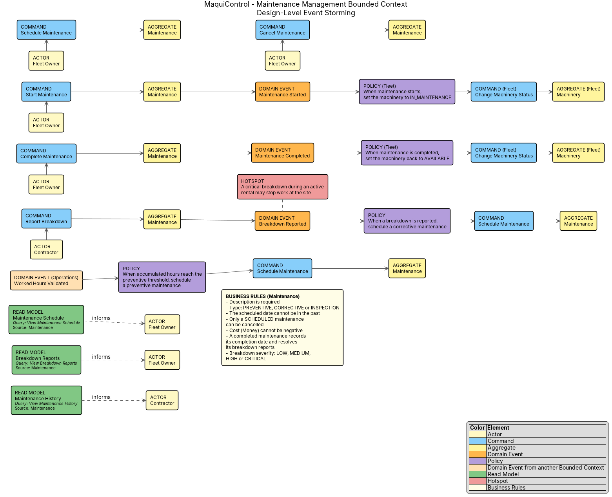

#### Operations Management Bounded Context

Este Bounded Context representa la ejecución del servicio de una reserva confirmada. El operador ejecuta `Start Operation` y `Record Worked Hours`, y el propietario de flota ejecuta `Validate Worked Hours` o `Reject Worked Hours` sobre cada registro y, al final, `Complete Operation`. Su agregado `Service Operation` exige una reserva confirmada para iniciar, horas no negativas y que ningún registro quede pendiente antes de completar. Sus políticas habilitan la operación cuando Rental Management confirma una reserva, solicitan la validación o el rechazo de cada registro de horas y permiten completar la operación cuando no quedan registros pendientes. Los read models `Service Operation Status` y `Worked Hours Summary` informan al propietario y al operador, y el hotspot es la diferencia entre las horas registradas manualmente y el horómetro.

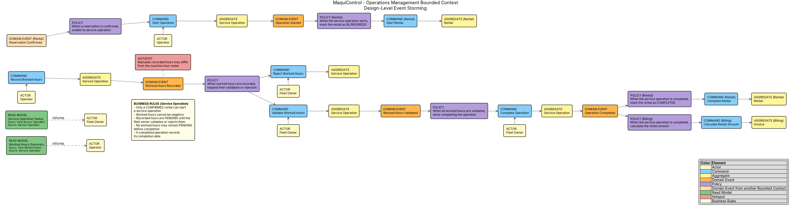

#### Profiles Management Bounded Context

Este Bounded Context gestiona el perfil de cada usuario y la organización a la que pertenece. Sus comandos son `Create Profile`, `Update Profile`, `Create Organization` y `Update Organization`. El agregado `Profile` exige nombres, documento e información de contacto válida, y la entidad `Organization` exige razón social, RUC y dirección. Cuando Identity & Access Management registra una nueva cuenta, su política solicita al usuario los datos del perfil, que este registra con `Create Profile`, y luego solicita los datos de la organización. Los read models `Profile Details` y `Organization Details` informan al usuario, y el hotspot es que el RUC todavía no se verifica contra SUNAT.

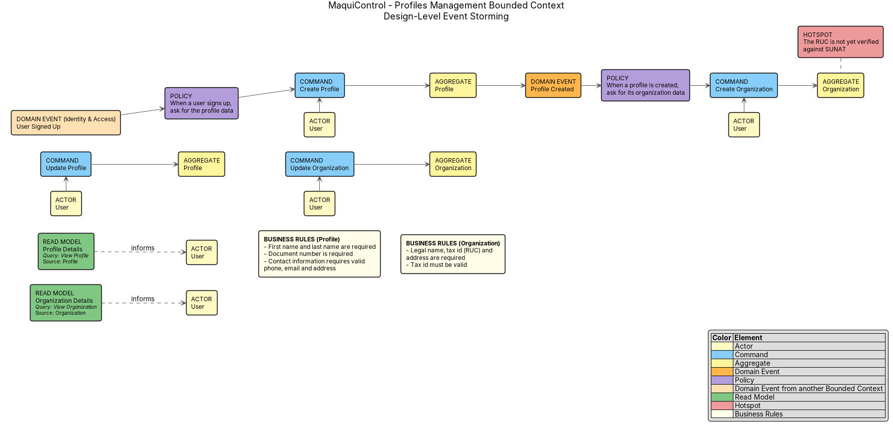

#### Subscription Management Bounded Context

Este Bounded Context gestiona la contratación, activación y cancelación de la suscripción de un propietario de flota. El propietario ejecuta `Subscribe to Plan` (Essential o Pro) y es redirigido a la pasarela de pago (Checkout Pro / Sandbox); al volver, la aplicación ejecuta `Confirm Checkout`, que registra el pago. Si el pago es aprobado, una política ejecuta `Activate Subscription`. El propietario puede ejecutar `Cancel Subscription` sobre una suscripción activa. Los estados de la suscripción son `PENDING_PAYMENT`, `ACTIVE` y `CANCELLED`, y los del pago siguen los del proveedor (`PENDING`, `IN_PROCESS`, `APPROVED`, `REJECTED` y `CANCELLED`). El límite de maquinarias del plan se aplica en Fleet Management al registrar maquinaria. Los read models `Plan Catalog`, `Subscription Status` y `Payment History` informan al propietario.

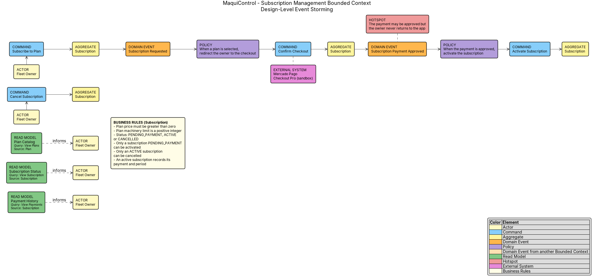

#### Billing Management Bounded Context

Este Bounded Context concentra el cálculo del monto de alquiler, la emisión de comprobantes electrónicos ante SUNAT y la aplicación de penalidades por mora. Sus agregados son `Invoice` y `Late Penalty`, ambos referenciando el alquiler mediante su identificador. `Calculate Rental Amount` y `Apply Late Penalty` se ejecutan por políticas: el monto se calcula cuando Operations Management completa la operación (`Operation Completed`) y la penalidad se aplica cuando Rental Management completa un alquiler después de la fecha pactada. `Issue Invoice` lo ejecuta el propietario de flota desde la aplicación una vez calculado el monto. Los read models `Invoice Details`, `Invoice History` y `Late Penalties` informan al propietario y al contratista, y el hotspot es el rechazo o la demora de SUNAT.

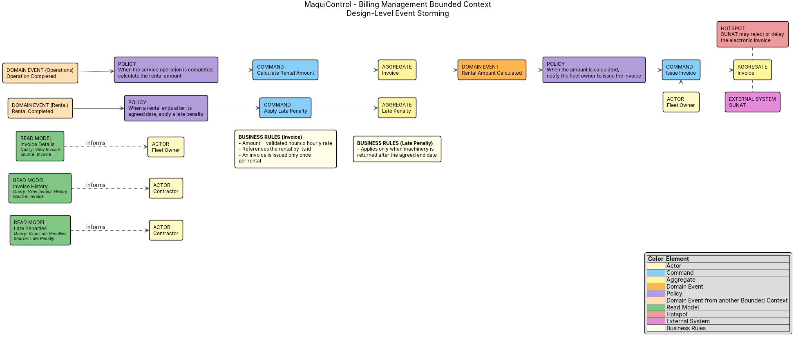

#### Identity & Access Management Bounded Context

Este Bounded Context se encarga del registro, la autenticación y los roles de los usuarios de TechnoLoad. El visitante ejecuta `Sign Up` indicando su correo, contraseña y su rol (propietario de flota, administrador de flota, contratista u operador; el rol de administrador del sistema no se puede elegir), y el usuario ejecuta `Sign In` y `Sign Out`. Como el rol se elige dentro de `Sign Up`, no existe un comando separado de asignación de roles. Su agregado `User Account` exige un correo válido y único, una credencial y un rol al registrarse, y solo permite iniciar sesión a cuentas activas. El evento `User Signed Up` es consumido por Profiles Management, que pide al usuario completar su perfil. El read model `Current Session` alimenta los guards de rutas, y el hotspot es que el token JWT debe expirar y descartarse en el cliente al cerrar sesión.

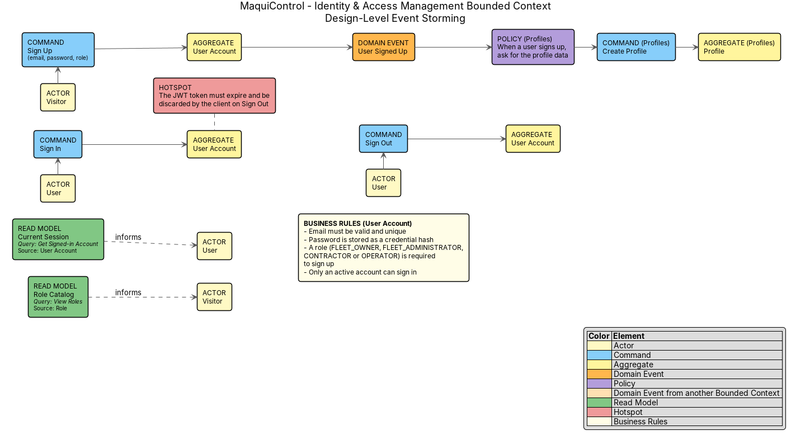

#### Catálogo de comandos y trazabilidad

La siguiente tabla es la referencia única de los comandos de TechnoLoad. Cada comando conserva el mismo nombre en el Design-Level Event Storming, en el diagrama de clases (clase `<Comando>Command` atendida por el `CommandService` del contexto), en el endpoint de los Web Services y en la Frontend Web Application (método del store y botón de la vista). Los comandos marcados como *Política* no tienen botón: los ejecuta el sistema al reaccionar a un evento. Cuando la columna Domain Event muestra *— (fin del flujo)*, el comando cierra su flujo en el Aggregate y no publica un evento, porque ningún otro paso reacciona a él.

| Bounded Context | Command | Actor | Domain Event | Endpoint (Web Services) | Frontend Web Application |
| --- | --- | --- | --- | --- | --- |
| Fleet Management | Register Machinery | Fleet Owner | Machinery Registered | `POST /api/v1/machinery` | `registerMachinery()` · botón *Register machinery* |
| Fleet Management | Update Machinery | Fleet Owner | — (fin del flujo) | `PUT /api/v1/machinery/{machineryId}` | `updateMachinery()` · botón *Save* |
| Fleet Management | Change Machinery Status | Fleet Owner / Política | — (fin del flujo) | `PATCH /api/v1/machinery/{machineryId}/status` | `changeMachineryStatus()` · selector de estado |
| Fleet Management | Delete Machinery | Fleet Owner | — (fin del flujo) | `DELETE /api/v1/machinery/{machineryId}` | `deleteMachinery()` · botón *Delete* |
| Fleet Management | Create Category | Fleet Owner | — (fin del flujo) | `POST /api/v1/categories` | `createCategory()` · botón *Create category* |
| Fleet Management | Rename Category | Fleet Owner | — (fin del flujo) | `PUT /api/v1/categories/{categoryId}` | `renameCategory()` · botón *Rename* |
| Fleet Management | Delete Category | Fleet Owner | — (fin del flujo) | `DELETE /api/v1/categories/{categoryId}` | `deleteCategory()` · botón *Delete* |
| Identity & Access Management | Sign Up | Visitor | User Signed Up | `POST /api/v1/authentication/sign-up` | `signUp()` · botón *Create account* |
| Identity & Access Management | Sign In | User | — (fin del flujo) | `POST /api/v1/authentication/sign-in` | `signIn()` · botón *Sign in* |
| Identity & Access Management | Sign Out | User | — (fin del flujo) | No aplica (el cliente descarta el token JWT) | `signOut()` · botón *Sign out* |
| Rental Management | Request Rental | Contractor | Rental Requested | `POST /api/v1/rentals` | `requestRental()` · botón *Request rental* |
| Rental Management | Confirm Reservation | Fleet Owner | Reservation Confirmed | `PATCH /api/v1/rentals/{rentalId}/status` (`CONFIRMED`) | `confirmReservation()` · botón *Confirm* |
| Rental Management | Reject Reservation | Fleet Owner | — (fin del flujo) | `PATCH /api/v1/rentals/{rentalId}/status` (`REJECTED`, motivo) | `rejectReservation()` · botón *Reject* |
| Rental Management | Cancel Reservation | Contractor | Reservation Cancelled | `PATCH /api/v1/rentals/{rentalId}/status` (`CANCELLED`, motivo) | `cancelReservation()` · botón *Cancel request* |
| Rental Management | Start Rental | Política | — (fin del flujo) | No aplica (reacciona a Operation Started) | Estado *In progress* en *My reservations* |
| Rental Management | Complete Rental | Política | Rental Completed | No aplica (reacciona a Operation Completed) | Estado *Completed* en *My reservations* |
| Maintenance Management | Schedule Maintenance | Fleet Owner / Política | — (fin del flujo) | `POST /api/v1/maintenances` | `scheduleMaintenance()` · botón *Schedule* |
| Maintenance Management | Start Maintenance | Fleet Owner | Maintenance Started | `PATCH /api/v1/maintenances/{maintenanceId}/status` (`IN_PROGRESS`) | `startMaintenance()` · botón *Start* |
| Maintenance Management | Cancel Maintenance | Fleet Owner | — (fin del flujo) | `PATCH /api/v1/maintenances/{maintenanceId}/status` (`CANCELLED`) | `cancelMaintenance()` · botón *Cancel* |
| Maintenance Management | Complete Maintenance | Fleet Owner | Maintenance Completed | `PATCH /api/v1/maintenances/{maintenanceId}/status` (`COMPLETED`, costo) | `completeMaintenance()` · botón *Complete* |
| Maintenance Management | Report Breakdown | Contractor | Breakdown Reported | `POST /api/v1/breakdown-reports` | `reportBreakdown()` · botón *Report breakdown* |
| Operations Management | Start Operation | Operator | Operation Started | `POST /api/v1/service-operations` | `startOperation()` · botón *Start operation* |
| Operations Management | Record Worked Hours | Operator | Worked Hours Recorded | `POST /api/v1/service-operations/{operationId}/worked-hours` | `recordWorkedHours()` · botón *Record* |
| Operations Management | Validate Worked Hours | Fleet Owner | Worked Hours Validated | `PATCH /api/v1/service-operations/{operationId}/worked-hours/{workedHoursId}/status` (`VALIDATED`) | `validateWorkedHours()` · botón *Validate* |
| Operations Management | Reject Worked Hours | Fleet Owner | — (fin del flujo) | `PATCH /api/v1/service-operations/{operationId}/worked-hours/{workedHoursId}/status` (`REJECTED`) | `rejectWorkedHours()` · botón *Reject* |
| Operations Management | Complete Operation | Fleet Owner | Operation Completed | `PATCH /api/v1/service-operations/{operationId}/status` (`COMPLETED`) | `completeOperation()` · botón *Complete operation* |
| Profiles Management | Create Profile | User (tras User Signed Up) | Profile Created | `POST /api/v1/profiles` | `createProfile()` · botón *Save profile* |
| Profiles Management | Update Profile | User | — (fin del flujo) | `PUT /api/v1/profiles/{profileId}` | `updateProfile()` · botón *Save profile* |
| Profiles Management | Create Organization | User | — (fin del flujo) | `POST /api/v1/organizations` | `createOrganization()` · botón *Save organization* |
| Profiles Management | Update Organization | User | — (fin del flujo) | `PUT /api/v1/organizations/{organizationId}` | `updateOrganization()` · botón *Save organization* |
| Subscription Management | Subscribe to Plan | Fleet Owner | Subscription Requested | `POST /api/v1/subscriptions` | `subscribeToPlan()` · botón *Subscribe* |
| Subscription Management | Confirm Checkout | Fleet Owner (retorno de pago) | Subscription Payment Approved | `POST /api/v1/subscriptions/{subscriptionId}/payments` | `confirmCheckout()` · vista *Checkout result* |
| Subscription Management | Activate Subscription | Política | — (fin del flujo) | No aplica (reacciona a Subscription Payment Approved) | Estado *Active* en *My subscription* |
| Subscription Management | Cancel Subscription | Fleet Owner | — (fin del flujo) | `PATCH /api/v1/subscriptions/{subscriptionId}/status` (`CANCELLED`) | `cancelSubscription()` · botón *Cancel subscription* |
| Billing Management | Calculate Rental Amount | Política | Rental Amount Calculated | No aplica (reacciona a Operation Completed) | Monto visible en *Invoices* |
| Billing Management | Issue Invoice | Fleet Owner | — (fin del flujo) | `PATCH /api/v1/invoices/{invoiceId}/status` (`ISSUED`) | `issueInvoice()` · botón *Issue invoice* |
| Billing Management | Apply Late Penalty | Política | — (fin del flujo) | No aplica (reacciona a Rental Completed) | Penalidad visible en *Invoices* |

Las queries siguen la misma regla: cada read model del Event Storming corresponde a una clase `<Query>Query` atendida por el `QueryService` del contexto y a un endpoint `GET` del recurso correspondiente. Por ejemplo, las queries de Rental Management son:

| Query | Actor | Endpoint (Web Services) | Frontend Web Application |
| --- | --- | --- | --- |
| View My Reservations | Contractor | `GET /api/v1/rentals/my-reservations` | `loadRentals()` · vista *Reservations* |
| View Pending Requests | Fleet Owner | `GET /api/v1/rentals/pending-requests` | `loadRentals()` · contador *pending* |
| View Fleet Rentals | Fleet Owner | `GET /api/v1/rentals/fleet-rentals` | `loadRentals()` · vista *Reservations* |
| Check Machinery Availability | Contractor | `GET /api/v1/rentals/availability` | Validación en *Request rental* |
| Get Rental By Id | Participante | `GET /api/v1/rentals/{rentalId}` | Vista *Service operation* |

### 4.6.2. Software Architecture Context Diagram

El Software Architecture Context Diagram presenta el sistema central de la solución y define su frontera respecto a los actores humanos y a los sistemas externos que interactúan con la plataforma TechnoLoad.

- **Fleet Administrator**: Utiliza la plataforma para administrar el inventario de maquinaria pesada, programar y registrar tareas de mantenimiento preventivo y correctivo, evaluar solicitudes de alquiler y supervisar las operaciones en campo.
- **Contractor / Site Manager**: Utiliza la plataforma para consultar el catálogo de maquinaria disponible por categoría y ubicación, enviar solicitudes de alquiler, realizar seguimiento a sus reservas activas y verificar la ejecución de los servicios contratados.
- **SUNAT**: Sistema gubernamental tributario con el cual la plataforma se comunica mediante HTTPS para la emisión, validación y control de comprobantes de pago electrónicos generados en la facturación de servicios.
- **Payment Provider (Mercado Pago)**: Plataforma externa (Checkout Pro, en modo sandbox durante el desarrollo) encargada del procesamiento seguro de cobros recurrentes y transacciones electrónicas asociadas a los planes de suscripción de las empresas cliente.

Este diagrama de nivel 1 del modelo C4 permite dimensionar el alcance funcional del ecosistema, estableciendo con claridad las fronteras del sistema sin profundizar en decisiones internas de tecnología o implementación.

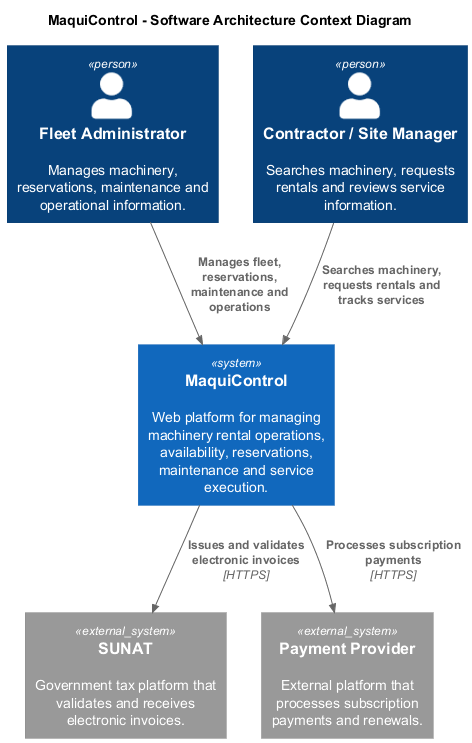

### 4.6.3. Software Architecture Container Diagram

El Software Architecture Container Diagram detalla la arquitectura de alto nivel del ecosistema, ilustrando las unidades de despliegue independientes (*containers*), las responsabilidades asignadas a cada una y los protocolos de comunicación utilizados.

La solución se compone de los siguientes containers principales:
- **Web Application (Azure Static Web Apps / App Service)**: Servicio de hospedaje web con HTTPS responsable de alojar y servir los artefactos compilados (HTML, JavaScript, CSS y assets) de la aplicación cliente hacia los navegadores mediante HTTPS.
- **Single Page Application (Angular)**: Ejecuta la lógica de presentación e interactividad directamente en el navegador del usuario cliente. Proporciona una interfaz reactiva desarrollada con TypeScript, componentes modulares y manejo reactivo de estado.
- **REST API (Backend Services)**: Container de backend que concentra la lógica de negocio, reglas de dominio y casos de uso organizados bajo principios de Domain-Driven Design (DDD). Expone servicios web RESTful seguros mediante HTTPS y serialización JSON, con persistencia en base de datos relacional.
- **Database (Relational Database)**: Almacena de forma estructurada y persistente las entidades de la plataforma (cuentas de usuario, perfiles, maquinaria, alquileres, órdenes de mantenimiento, partes operativos de servicio, facturas y suscripciones).

**Flujo de interacción y comunicaciones:**
1. Tanto el **Fleet Administrator** como el **Contractor / Site Manager** acceden inicialmente al **Web Application Server** a través de HTTPS para descargar los artefactos estáticos de la aplicación.
2. Una vez cargada en el navegador web, ambos usuarios interactúan de forma directa y continua con la **Single Page Application**, ejecutando allí sus operaciones cotidianas (búsqueda de flota, gestión de reservas, asignación de mantenimiento y registro de operaciones).
3. La **Single Page Application** se comunica con la **REST API** mediante peticiones asíncronas HTTPS/JSON para autenticar usuarios y coordinar las transacciones de negocio.
4. La **REST API** persiste y consulta los datos en la base de datos relacional mediante el ORM de acceso a datos configurado.
5. Finalmente, la **REST API** gestiona la integración externa con **SUNAT** para la emisión de comprobantes electrónicos y con **Mercado Pago** para la recaudación de suscripciones.

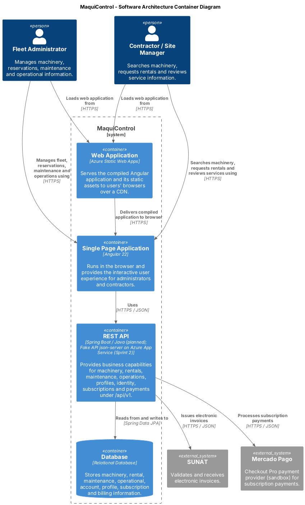

### 4.6.4. Software Architecture Components Diagrams

En esta sección se presentan los diagramas de componentes (Nivel 3 de C4 Model) de TechnoLoad, desagregando internamente tanto la **Single Page Application (Frontend)** como la **REST API (Backend)** en sus capas y artefactos de código (componentes UI, almacenes de estado reactivo, modelos de dominio, servicios HTTP, controladores REST, servicios de aplicación y repositorios).

En los diagramas de componentes del frontend, la capa Presentation se divide en **Views**, que son las páginas con ruta propia, y **Components**, que son las piezas de interfaz que se muestran dentro de esas páginas. Los Bounded Contexts se presentan en este orden: primero los core (Fleet, Rental, Maintenance y Operations), luego los de soporte (Profiles, Subscription y Billing) y al final el genérico (Identity & Access Management).

#### 4.6.4.1. Single Page Application (Frontend) Component Diagrams

##### Single Page Application Component Diagram

Presenta la descomposición de alto nivel de la Single Page Application en carpetas por Bounded Context, tal como está organizado el código fuente en `src/app`. Cada Bounded Context se divide en las capas `presentation`, `application`, `domain` e `infrastructure`:

- **fleet-management**: catálogo de maquinaria, formulario de maquinaria y gestión de categorías.
- **rental-management**: solicitud de alquiler y listado de reservas propias.
- **maintenance-management**: programación de mantenimientos y reporte de averías.
- **operations-management**: operación de servicio y registro y validación de horas trabajadas.
- **profiles-management**: perfil del usuario y organización.
- **subscription-management**: planes de suscripción y pago con Checkout Pro (sandbox).
- **identity-access-management**: inicio de sesión, registro con rol de propietario de flota o contratista, guards de rutas por sesión y rol, e interceptor HTTP.
- **shared**: layout, selector de idioma, páginas compartidas y clases base de infraestructura (`BaseApi`, `BaseApiEndpoint`, `BaseAssembler`).

Todos los Bounded Contexts consumen la **REST API** mediante HTTPS y JSON bajo el prefijo `/api/v1`.

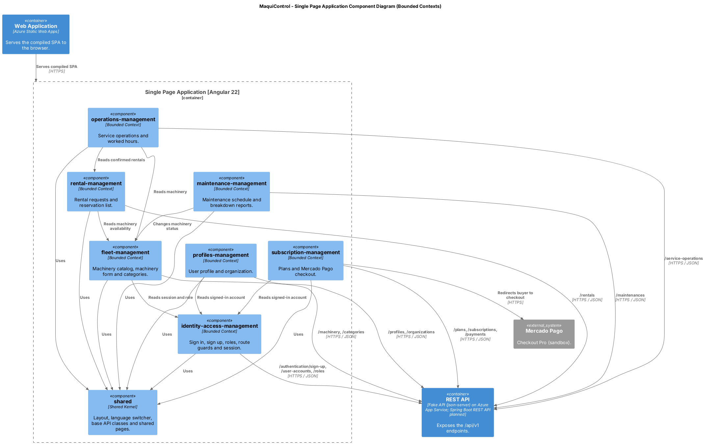

##### Fleet Frontend Component Diagram

- **Presentation Layer**:
  - `MachineryList`: catálogo de maquinaria para propietarios y contratistas; permite eliminar maquinaria propia o solicitar su alquiler.
  - `MachineryForm`: registro y edición de maquinaria mediante `createMachinery()` y `updateMachinery()`.
  - `CategoryManagement`: creación, renombrado y eliminación de categorías, validando nombres únicos y categorías en uso.
- **Application Layer**:
  - `FleetManagementStore`: mantiene las señales `machinery()` y `categories()` y expone `loadMachinery()`, `createMachinery()`, `updateMachinery()`, `deleteMachinery()`, `changeMachineryStatus()` y las operaciones de categorías.
- **Domain Layer**:
  - `Machinery` (`isAvailable()`, `isInMaintenance()`, `withStatus()`), `Category`, los Value Objects `MachineryLocation` y `Money`, y el enum `MachineryStatus`.
- **Infrastructure Layer**:
  - `FleetManagementApi`, `MachineryApiEndpoint` y `CategoryApiEndpoint`: llamadas HTTP a `/api/v1/machinery` y `/api/v1/categories`, con sus assemblers.

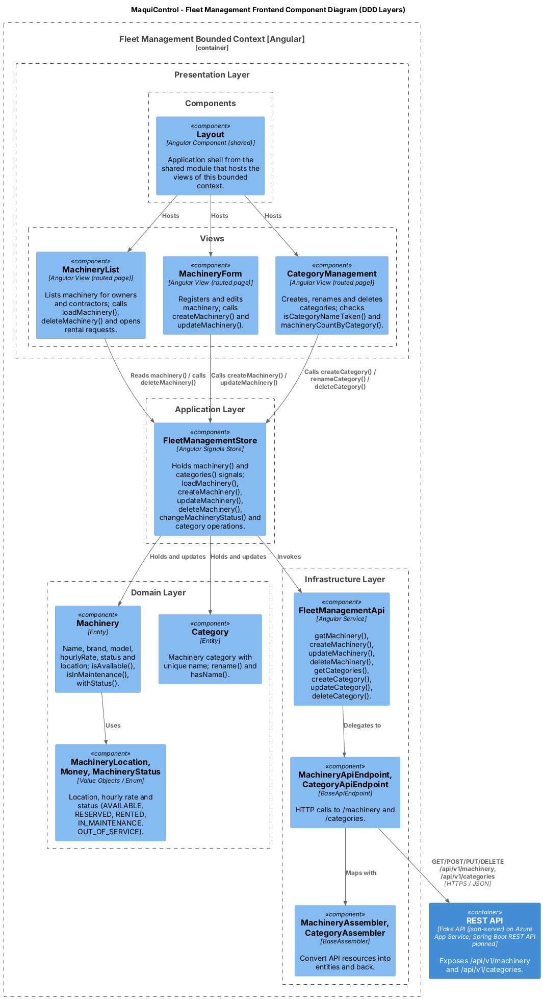

##### Rental Frontend Component Diagram

- **Presentation Layer**:
  - `RentalRequestPage`: selección de fechas para alquilar una maquinaria disponible mediante `requestRental()`.
  - `ReservationList`: listado de las reservas del usuario, con confirmación y cancelación mediante `confirmReservation()` y `cancelReservation()`.
- **Application Layer**:
  - `RentalManagementStore`: expone `loadRentals()`, `requestRental()`, `confirmReservation()`, `cancelReservation()` y `hasOverlappingActiveRental()`.
- **Domain Layer**:
  - `Rental` (`calculateTotal()`, `isActive()`, `isPending()`), los Value Objects `RentalPeriod` y `Money`, y el enum `RentalStatus`.
- **Infrastructure Layer**:
  - `RentalManagementApi` y `RentalApiEndpoint`: llamadas HTTP a `/api/v1/rentals`, con `RentalAssembler`.

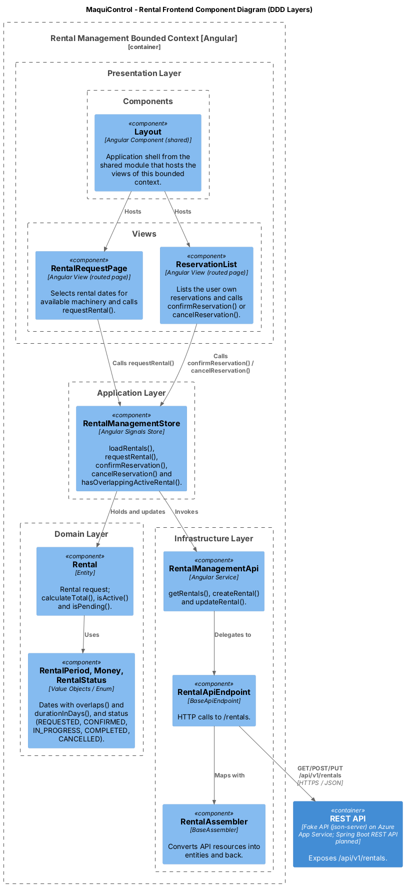

##### Maintenance Frontend Component Diagram

- **Presentation Layer**:
  - `MaintenanceSchedulePage`: programa, inicia y completa mantenimientos, y actualiza el estado de la maquinaria en Fleet Management.
  - `BreakdownReportForm`: reporte de averías mediante `reportBreakdown()`.
- **Application Layer**:
  - `MaintenanceManagementStore`: expone `loadMaintenances()`, `scheduleMaintenance()`, `startMaintenance()`, `completeMaintenance()` y `reportBreakdown()`.
- **Domain Layer**:
  - `Maintenance`, `BreakdownReport`, el Value Object `Money` y los enums `MaintenanceType`, `MaintenanceStatus` y `BreakdownSeverity`.
- **Infrastructure Layer**:
  - `MaintenanceManagementApi` y `MaintenanceApiEndpoint`: llamadas HTTP a `/api/v1/maintenances`, con `MaintenanceAssembler`.

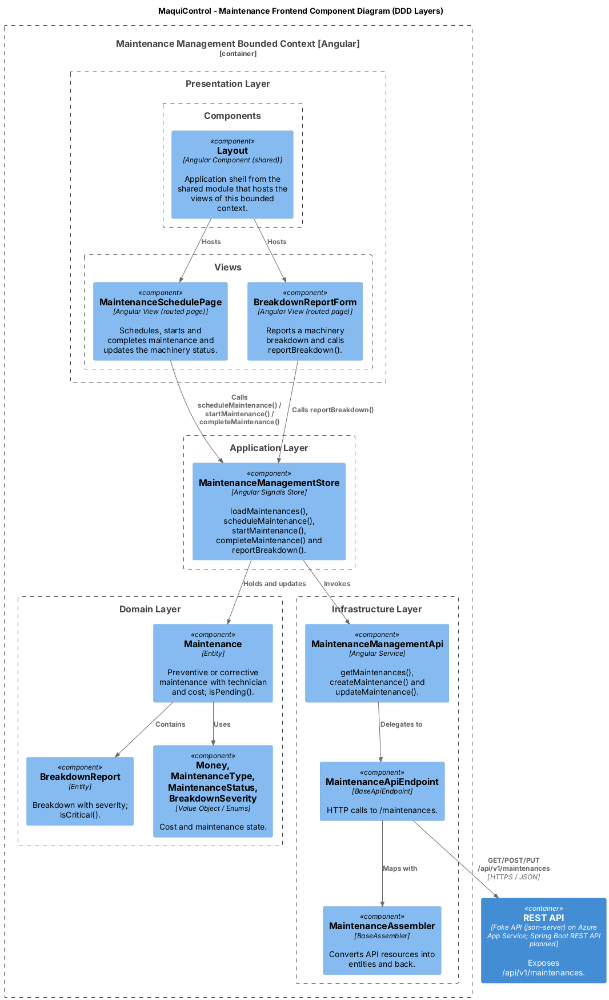

##### Operations Frontend Component Diagram

- **Presentation Layer**:
  - `ServiceOperationPage`: inicia y completa la operación de servicio de un alquiler confirmado y valida las horas trabajadas.
  - `WorkedHoursForm`: captura las horas trabajadas de un día y las envía a la página.
- **Application Layer**:
  - `OperationsManagementStore`: expone `loadOperations()`, `startOperation()`, `recordWorkedHours()`, `validateWorkedHours()` y `completeOperation()`.
- **Domain Layer**:
  - `ServiceOperation` (`calculateTotalHours()`), `WorkedHours` (`isValidated()`) y los enums `OperationStatus` y `WorkedHoursStatus`.
- **Infrastructure Layer**:
  - `OperationsManagementApi` y `ServiceOperationApiEndpoint`: llamadas HTTP a `/api/v1/service-operations`, con `ServiceOperationAssembler`.

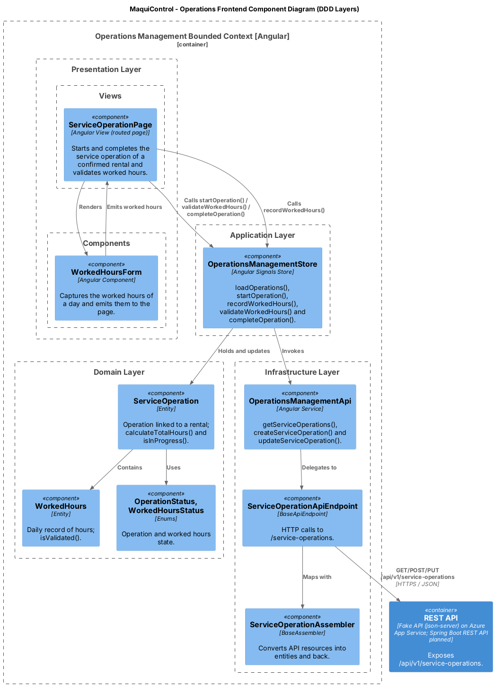

##### Profiles Frontend Component Diagram

- **Presentation Layer**:
  - `ProfilePage`: muestra y edita el perfil del usuario mediante `saveProfile()`.
  - `OrganizationForm`: registra la empresa del usuario mediante `saveOrganization()`.
- **Application Layer**:
  - `ProfilesManagementStore`: expone `loadProfiles()`, `loadOrganizations()`, `saveProfile()` y `saveOrganization()`.
- **Domain Layer**:
  - `Profile`, `Organization`, el Value Object `ContactInformation` y el enum `OrganizationType`.
- **Infrastructure Layer**:
  - `ProfilesManagementApi`, `ProfileApiEndpoint` y `OrganizationApiEndpoint`: llamadas HTTP a `/api/v1/profiles` y `/api/v1/organizations`, con sus assemblers.

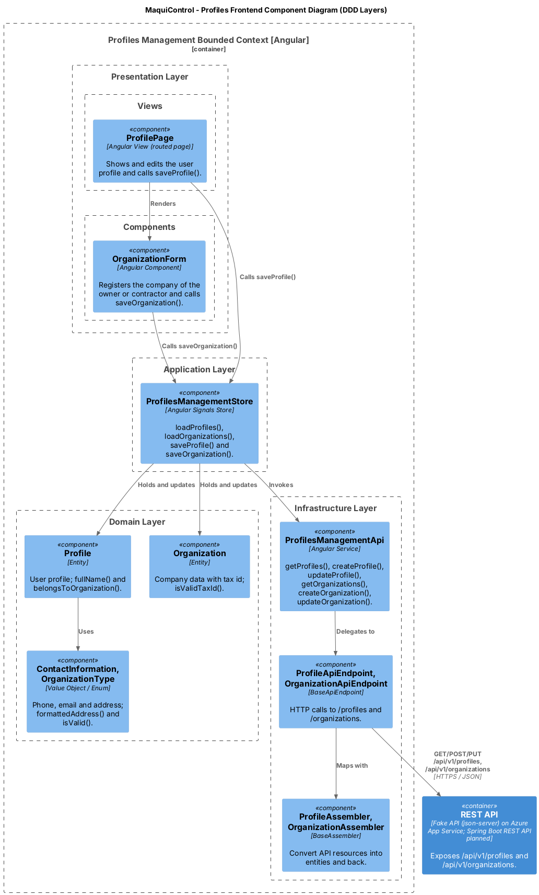

##### Subscription Frontend Component Diagram

- **Presentation Layer**:
  - `Plans`: muestra los planes Essential y Pro a los propietarios de flota e inicia la suscripción mediante `subscribe()`.
  - `CheckoutResult`: recibe el retorno de la pasarela de pago y confirma el pago mediante `confirmCheckout()`.
- **Application Layer**:
  - `SubscriptionManagementStore`: expone `loadPlans()`, `loadSubscriptions()`, `subscribe()` y `confirmCheckout()`.
- **Domain Layer**:
  - `Plan`, `Subscription` (`activate()`, `cancel()`, `isActive()`, `isPendingPayment()`), `Payment`, el Value Object `Money` y los enums `PlanCode`, `SubscriptionStatus` y `PaymentStatus`.
- **Infrastructure Layer**:
  - `SubscriptionManagementApi`, `PlanApiEndpoint`, `SubscriptionApiEndpoint` y `PaymentApiEndpoint`: llamadas HTTP a `/api/v1/plans`, `/api/v1/subscriptions` y `/api/v1/payments`.

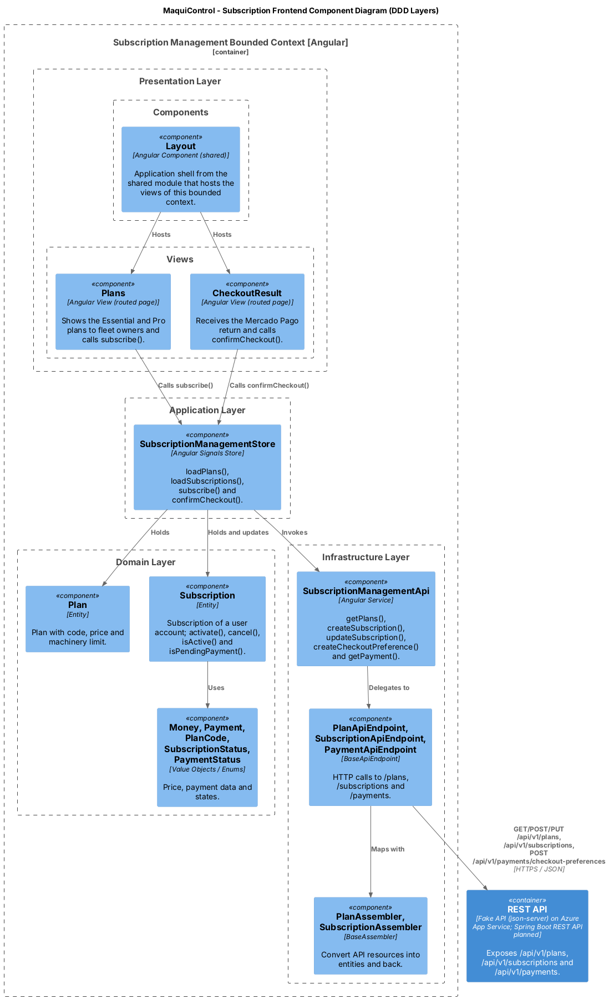

##### Identity & Access Frontend Component Diagram

- **Presentation Layer**:
  - `SignInForm`: formulario de inicio de sesión que invoca `signIn()` del store.
  - `SignUpForm`: formulario de registro que permite elegir el rol de contratista o propietario de flota e invoca `signUp()`.
  - `AuthenticationSection`: muestra al usuario autenticado en la barra superior e invoca `signOut()`.
- **Application Layer**:
  - `IdentityAccessStore`: store basado en signals reactivos que mantiene la sesión y expone `signIn()`, `signUp()`, `signOut()`, `loadRoles()`, `hasRole()` y `hasAnyRole()`.
- **Domain Layer**:
  - `UserAccount`, `Role` y `Credential`, junto con los comandos `SignInCommand` y `SignUpCommand`.
- **Infrastructure Layer**:
  - `IdentityAccessApi`: expone `signIn()`, `signUp()`, `getRoles()` y `userAccountExists()`.
  - `SignInPort`: token de inyección que selecciona el adaptador de autenticación según el entorno.
  - `SignUpApiEndpoint` y `RoleApiEndpoint`: llamadas HTTP a `/api/v1/authentication/sign-up` y `/api/v1/roles`.
  - `identityAccessGuard`, `roleGuard` e `identityAccessInterceptor`: protegen las rutas por sesión y rol, y adjuntan el token en las solicitudes.

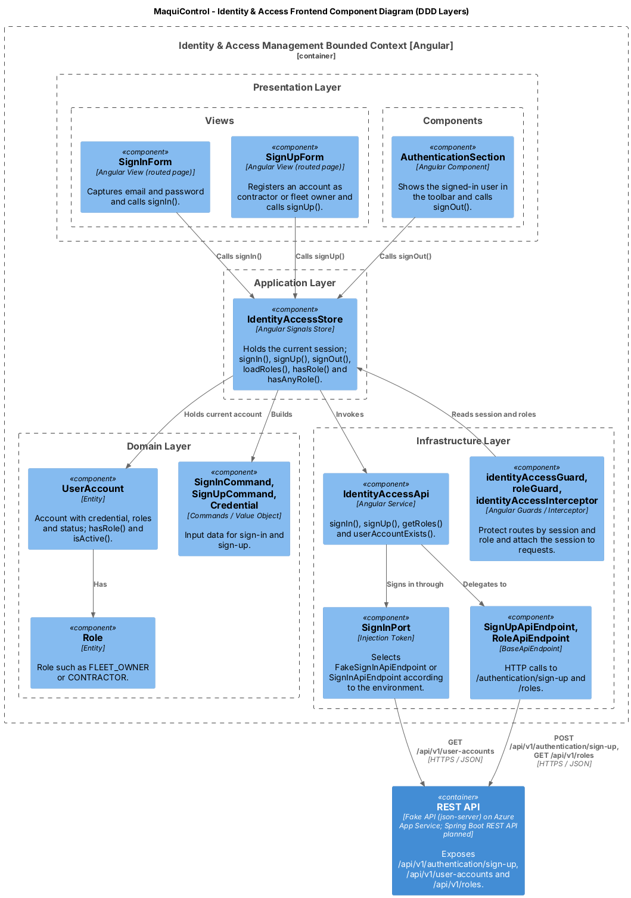

##### Shared Frontend Component Diagram

- **Presentation Layer**:
  - `Layout`: estructura de la aplicación con barra superior, navegación según el rol, `router-outlet` y pie de página.
  - `LanguageSwitcher`: cambia el idioma entre inglés y español mediante `useLanguage()`.
  - `FooterContent`, `Home`, `PageNotFound` y `TermsOfService`: componentes y páginas compartidas.
- **Application Layer**:
  - `TranslatedTitleStrategy`: traduce el título del navegador en cada ruta.
- **Domain Layer**:
  - `BaseEntity`: contrato común de identificador para todas las entidades.
- **Infrastructure Layer**:
  - `BaseApi`, `BaseApiEndpoint` (`getAll()`, `getById()`, `create()`, `update()`, `delete()`) y `BaseAssembler`: clases base que reutilizan todos los Bounded Contexts.

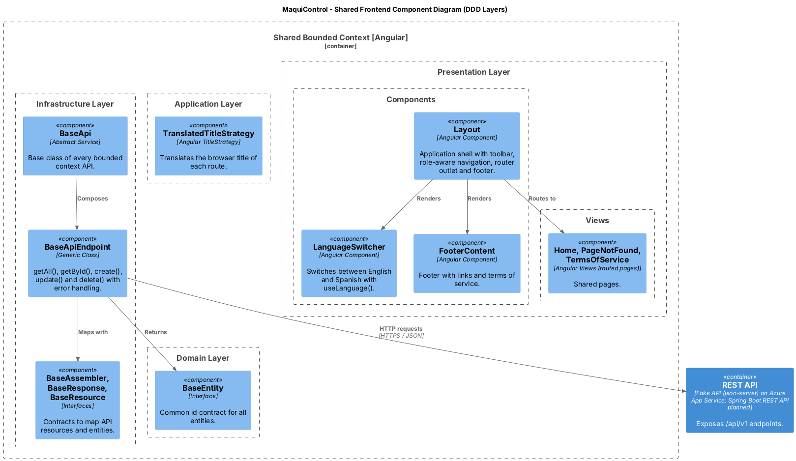

#### 4.6.4.2. Backend API Component Diagrams

Los siguientes diagramas detallan la estructura interna de la REST API organizada bajo Domain-Driven Design. El primero es la vista general y muestra los Bounded Contexts y su interconexión sin sus capas internas. Después, cada Bounded Context tiene su propio diagrama que muestra sus cuatro capas (`interfaces`, `application`, `domain` e `infrastructure`) y los módulos o packages en que se divide cada capa. Como el nivel de componentes es una vista estructural de módulos, las clases detalladas se presentan en los diagramas de clases de la sección 4.7. En todos los contextos, los controladores de `interfaces.rest` envían comandos y queries a `application`, la implementación de los servicios ejecuta el comportamiento de los agregados de `domain` y los adaptadores de `infrastructure.persistence` implementan los repositorios del dominio.

##### API Application Component Diagram

Presenta la visión global de la REST API y la interconexión de sus ocho Bounded Contexts principales con la Single Page Application, la base de datos relacional y los sistemas externos:
- **Identity & Access Management**: Registro con rol, inicio de sesión con JWT, cuentas y roles mediante `/api/v1/authentication/*`, `/api/v1/user-accounts` y `/api/v1/roles`.
- **Profiles Management**: Gestión de datos de perfiles personales y empresas mediante `/api/v1/profiles/*` y `/api/v1/organizations/*`.
- **Fleet Management**: Administración de maquinaria, categorías, disponibilidad y tarifas horarias mediante `/api/v1/machinery/*` y `/api/v1/categories/*`.
- **Rental Management**: Gestión de solicitudes y reservas de alquiler mediante `/api/v1/rentals/*`.
- **Maintenance Management**: Programación de mantenimientos y reporte de averías mediante `/api/v1/maintenances/*` y `/api/v1/breakdown-reports/*`.
- **Operations Management**: Registro y validación de horas trabajadas y cierre de operaciones mediante `/api/v1/service-operations/*`.
- **Subscription Management**: Planes, suscripciones y pagos mediante `/api/v1/plans/*` y `/api/v1/subscriptions/*`.
- **Billing Management**: Cálculo del monto de alquiler, emisión de comprobantes electrónicos ante SUNAT y penalidades por mora mediante `/api/v1/invoices/*` y `/api/v1/late-penalties/*`.
- **Shared Kernel Bounded Context**: Clases transversales, Value Objects base y utilitarios compartidos.

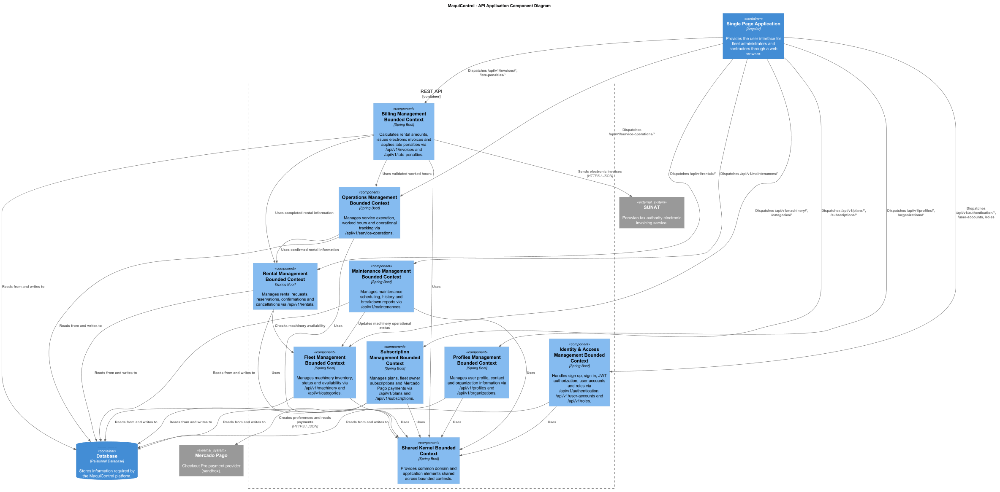

##### Fleet Management Bounded Context Component Diagram

Muestra las capas y packages del Bounded Context de Fleet Management:
- `interfaces`: `rest` (controladores de `/api/v1/machinery` y `/api/v1/categories`, con los subpackages `resources` y `transform`), `acl` (facade que usan Rental y Maintenance para consultar dueño, estado y tarifa de la maquinaria).
- `application`: `commandservices` y `queryservices` (contratos de los servicios), `internal.commandservices` e `internal.queryservices` (sus implementaciones), `internal.eventhandlers` (reaccionan a los eventos de integración de Rental y Maintenance y envían `Change Machinery Status`) y `acl` (implementación del facade).
- `domain`: `model.aggregates` (`Machinery` y `Category`), `model.valueobjects`, `model.commands`, `model.queries`, `model.events` y `repositories`.
- `infrastructure`: `persistence.jpa` con `adapters`, `assemblers`, `entities` y `repositories`.

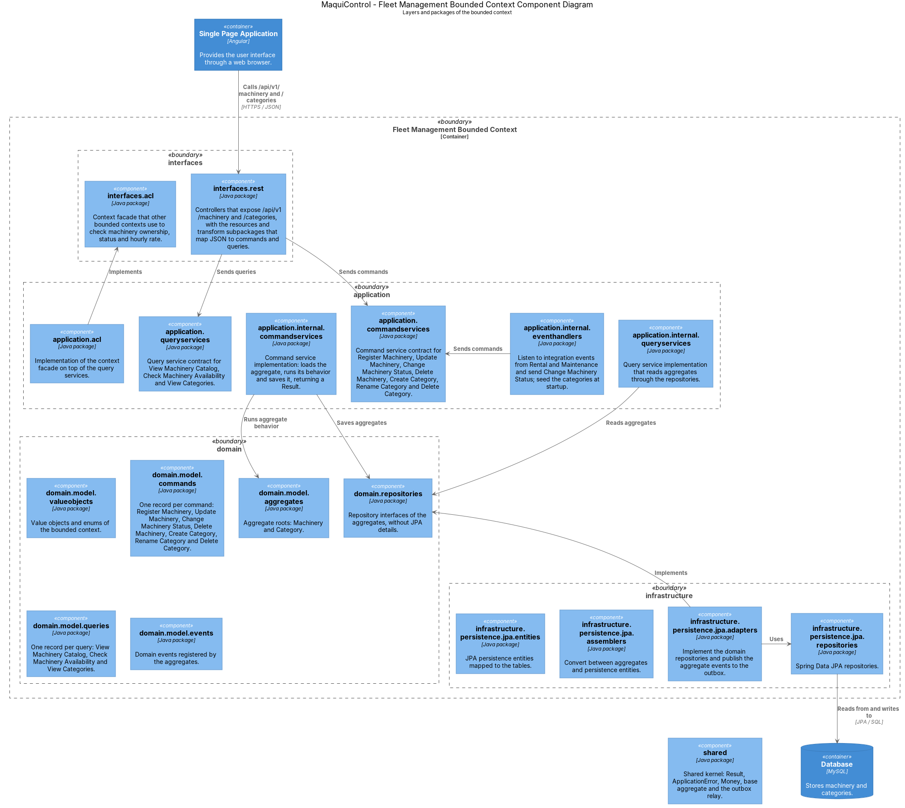

##### Rental Management Bounded Context Component Diagram

Muestra las capas y packages del Bounded Context de Rental Management:
- `interfaces`: `rest` (controladores de `/api/v1/rentals`, con los subpackages `resources` y `transform`), `acl` (facade para leer los alquileres y saber quién participa en ellos) y `events` (eventos de integración `Reservation Confirmed`, `Reservation Cancelled`, `Rental Started` y `Rental Completed`).
- `application`: `commandservices` y `queryservices` (contratos de los servicios), `internal.commandservices` e `internal.queryservices` (sus implementaciones), `internal.eventhandlers` (traducen los eventos de dominio a eventos de integración y escuchan `Operation Started` y `Operation Completed`), `internal.policies` (`Start Rental` y `Complete Rental`), `internal.outboundservices.acl` (consulta la maquinaria en Fleet Management) y `acl`.
- `domain`: `model.aggregates` (`Rental`), `model.valueobjects`, `model.commands`, `model.queries`, `model.events` y `repositories`.
- `infrastructure`: `persistence.jpa` con `adapters`, `assemblers`, `entities` y `repositories`.

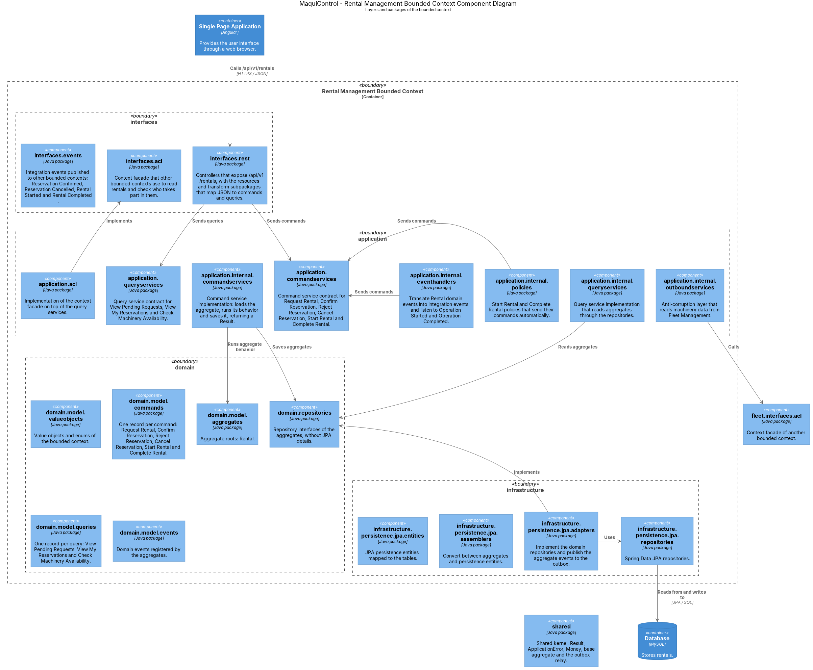

##### Maintenance Management Bounded Context Component Diagram

Muestra las capas y packages del Bounded Context de Maintenance Management:
- `interfaces`: `rest` (controladores de `/api/v1/maintenances` y `/api/v1/breakdown-reports`, con los subpackages `resources` y `transform`) y `events` (eventos de integración `Maintenance Started` y `Maintenance Completed`).
- `application`: `commandservices` y `queryservices` (contratos de los servicios), `internal.commandservices` e `internal.queryservices` (sus implementaciones), `internal.eventhandlers` (traducen los eventos de dominio a eventos de integración y, ante `Worked Hours Validated`, programan el mantenimiento preventivo) e `internal.outboundservices.acl` (consulta Fleet Management, Rental Management y Operations Management).
- `domain`: `model.aggregates` (`Maintenance`), `model.entities` (`BreakdownReport`), `model.valueobjects`, `model.commands`, `model.queries`, `model.events` y `repositories`.
- `infrastructure`: `persistence.jpa` con `adapters`, `assemblers`, `entities` y `repositories`.

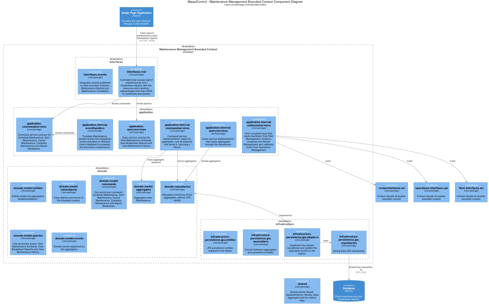

##### Operations Management Bounded Context Component Diagram

Muestra las capas y packages del Bounded Context de Operations Management:
- `interfaces`: `rest` (controladores de `/api/v1/service-operations`, con los subpackages `resources` y `transform`), `acl` (facade para leer operaciones completadas y horas validadas) y `events` (eventos de integración `Operation Started`, `Worked Hours Validated` y `Operation Completed`).
- `application`: `commandservices` y `queryservices` (contratos de los servicios), `internal.commandservices` e `internal.queryservices` (sus implementaciones), `internal.eventhandlers` (publican los eventos de integración), `internal.outboundservices.acl` (consulta Rental Management y Fleet Management) y `acl`.
- `domain`: `model.aggregates` (`ServiceOperation`), `model.entities` (`WorkedHours`), `model.valueobjects`, `model.commands`, `model.queries`, `model.events` y `repositories`.
- `infrastructure`: `persistence.jpa` con `adapters`, `assemblers`, `entities` y `repositories`.

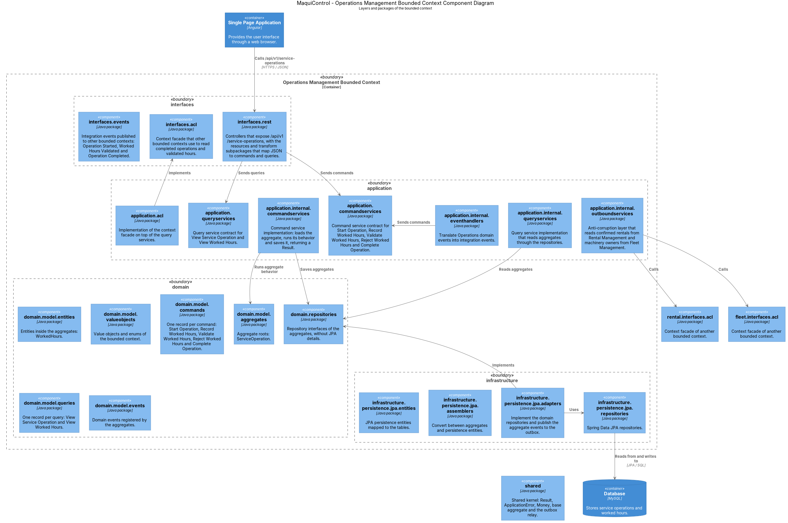

##### Profiles Management Bounded Context Component Diagram

Muestra las capas y packages del Bounded Context de Profiles Management:
- `interfaces`: `rest` (controladores de `/api/v1/profiles` y `/api/v1/organizations`, con los subpackages `resources` y `transform`) y `acl` (facade para obtener el perfil de un usuario).
- `application`: `commandservices` y `queryservices` (contratos de los servicios), `internal.commandservices` e `internal.queryservices` (sus implementaciones), `internal.outboundservices.acl` (consulta la cuenta en Identity & Access Management) y `acl`.
- `domain`: `model.aggregates` (`Profile` y `Organization`), `model.valueobjects`, `model.commands`, `model.queries`, `model.events` y `repositories`.
- `infrastructure`: `persistence.jpa` con `adapters`, `assemblers`, `entities` y `repositories`.

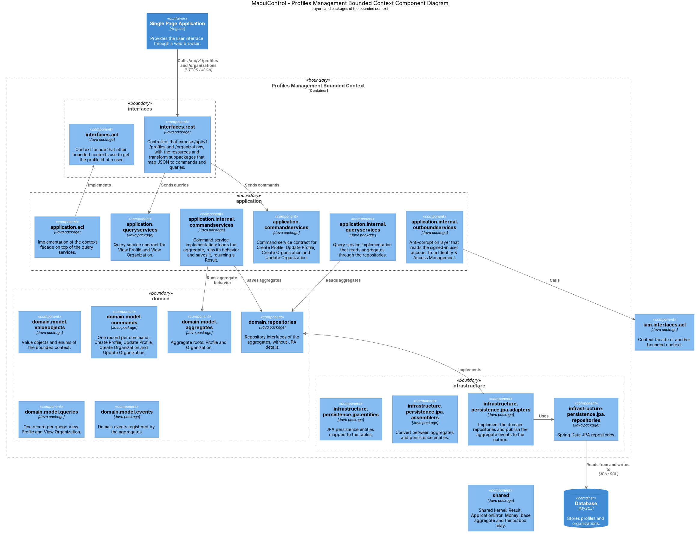

##### Identity & Access Management Bounded Context Component Diagram

Muestra las capas y packages del Bounded Context de Identity & Access Management:
- `interfaces`: `rest` (controladores de `/api/v1/authentication`, `/api/v1/user-accounts` y `/api/v1/roles`, con los subpackages `resources` y `transform`) y `acl` (facade para buscar cuentas y roles por correo).
- `application`: `commandservices` y `queryservices` (contratos de los servicios), `internal.commandservices` e `internal.queryservices` (sus implementaciones), `internal.eventhandlers` (crea los roles al iniciar), `internal.outboundservices` (contratos de `hashing` y `tokens`) y `acl`.
- `domain`: `model.aggregates` (`UserAccount`), `model.entities` (`Role`), `model.valueobjects`, `model.commands`, `model.queries`, `model.events` y `repositories`.
- `infrastructure`: `persistence.jpa` con `adapters`, `assemblers`, `entities` y `repositories`, `hashing.bcrypt` (BCrypt), `tokens.jwt` (JWT) y `authorization.sfs` (configuración de seguridad y filtro del token).

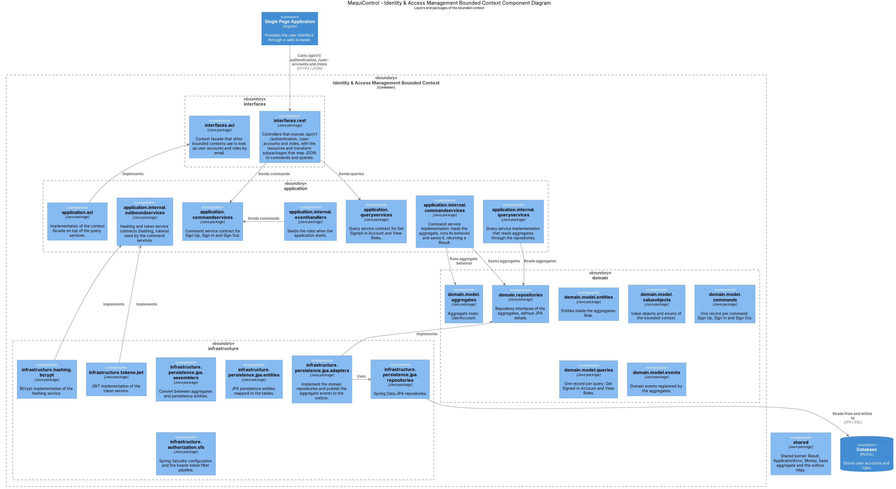

##### Subscription Management Bounded Context Component Diagram

Muestra las capas y packages del Bounded Context de Subscription Management:
- `interfaces`: `rest` (controladores de `/api/v1/plans` y `/api/v1/subscriptions`, con los subpackages `resources` y `transform`), `acl` (facade para saber si hay una suscripción activa y leer el límite de maquinarias de su plan) y `events` (eventos de integración `Subscription Activated` y `Subscription Cancelled`).
- `application`: `commandservices` y `queryservices` (contratos de los servicios), `internal.commandservices` e `internal.queryservices` (sus implementaciones), `internal.eventhandlers` (traducen los eventos de dominio a eventos de integración), `internal.outboundservices.acl` (Anti-Corruption Layer frente a Checkout Pro) y `acl`.
- `domain`: `model.aggregates` (`Subscription` y `SubscriptionPlan`), `model.entities` (`Payment`), `model.valueobjects`, `model.commands`, `model.queries`, `model.events` y `repositories`.
- `infrastructure`: `persistence.jpa` con `adapters`, `assemblers`, `entities` y `repositories` y `seeding` (crea los planes Essential y Pro al iniciar).

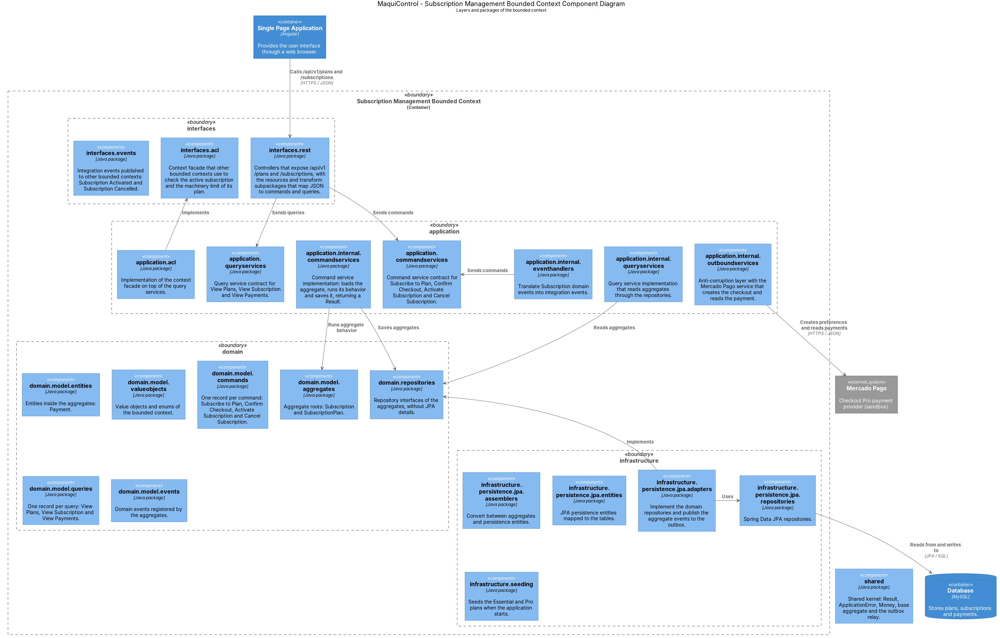

##### Billing Management Bounded Context Component Diagram

Muestra las capas y packages del Bounded Context de Billing Management:
- `interfaces`: `rest` (controladores de `/api/v1/invoices` y `/api/v1/late-penalties`, con los subpackages `resources` y `transform`).
- `application`: `commandservices` y `queryservices` (contratos de los servicios), `internal.commandservices` e `internal.queryservices` (sus implementaciones), `internal.eventhandlers` (reaccionan a `Operation Completed` y `Rental Completed`) e `internal.outboundservices.acl` (consulta Rental Management y Fleet Management, y Anti-Corruption Layer para enviar comprobantes a SUNAT).
- `domain`: `model.aggregates` (`Invoice` y `LatePenalty`), `model.valueobjects`, `model.commands`, `model.queries`, `model.events` y `repositories`.
- `infrastructure`: `persistence.jpa` con `adapters`, `assemblers`, `entities` y `repositories`.

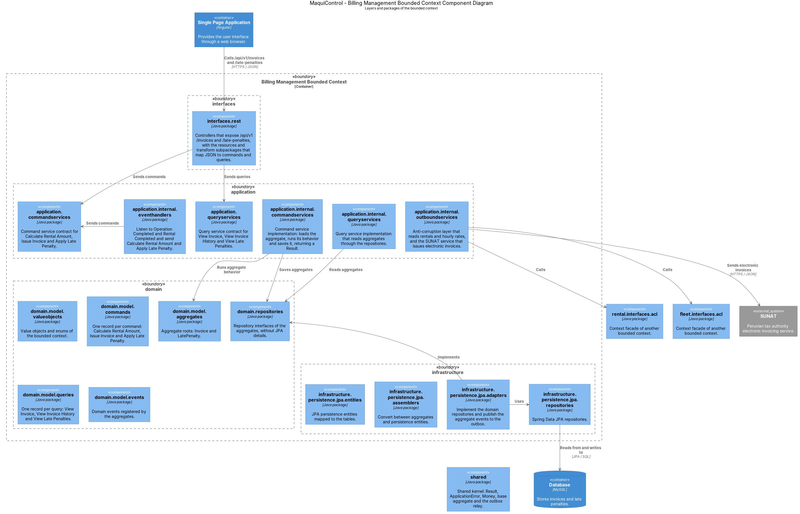

## 4.7. Software Object-Oriented Design

El diseño orientado a objetos de TechnoLoad representa las principales clases, interfaces, enumeraciones, atributos, operaciones y relaciones que conforman cada Bounded Context. Los modelos mantienen los límites definidos mediante Domain-Driven Design y evitan los tipos de datos primitivos en los atributos y parámetros del dominio. Cada identificador se modela como un Value Object propio (`MachineryId`, `RentalId`, `ProfileId`, entre otros), de modo que un agregado de otro contexto se referencia por su identificador tipado y no por un número sin significado, evitando el acoplamiento directo entre contextos. Los conceptos del dominio que antes se representaban como texto o números también se modelan como Value Objects que validan su propio formato, por ejemplo `EmailAddress`, `PhoneNumber`, `PersonName`, `DocumentNumber`, `TaxId`, `MachinerySpecification`, `HoursWorked`, `WorkShift`, `InvoiceNumber` y `MachineryLimit`. Los valores monetarios se modelan mediante el Value Object `Money`, que encapsula el importe y su moneda. Los tipos primitivos solo aparecen dentro de los Value Objects, que son los responsables de validarlos. Los identificadores de cada contexto se agrupan en el paquete `Identifiers` de su diagrama.

La capa de aplicación de cada contexto se divide en un `CommandService` y un `QueryService`. El `CommandService` tiene un método `handle` por cada comando del Design-Level Event Storming, y cada comando se modela como una clase propia agrupada en el paquete `Commands` (por ejemplo `RegisterMachineryCommand` o `RejectReservationCommand`). Del mismo modo, el `QueryService` atiende una clase por cada query de los read models, agrupadas en el paquete `Queries`. Así, los nombres del diagrama de clases coinciden uno a uno con el Catálogo de comandos de la sección 4.6.1 y con la implementación de los servicios backend.

Para reducir la complejidad, cada Bounded Context tiene primero un diagrama general con todas sus clases y, cuando tiene más de un agregado, un diagrama por cada agregado. El agregado es el límite de consistencia transaccional y también la unidad en que se programa, por lo que cada diagrama de agregado agrupa solo su raíz, sus entidades, sus Value Objects, los comandos y queries que lo usan y su repositorio. Los Bounded Contexts con un solo agregado (Rental, Maintenance, Operations, Profiles e Identity & Access Management) se presentan con su diagrama general, que corresponde a ese único agregado.

### 4.7.1. Class Diagrams

#### Fleet Management Bounded Context Class Diagram

El diagrama general de Fleet Management representa los agregados `Machinery` y `Category`. El agregado `Machinery` es responsable del registro, actualización, clasificación, ubicación, estado y disponibilidad de la maquinaria. También incluye los objetos de valor `MachineryLocation` y `Money`; este último representa la tarifa por hora mediante un importe y una moneda.

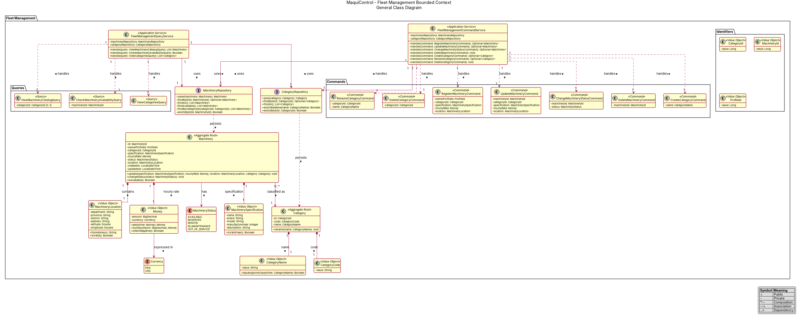

##### Machinery Aggregate Class Diagram

Agrupa la raíz `Machinery`, sus Value Objects (`MachinerySpecification`, `MachineryLocation`, `Money`), el estado `MachineryStatus`, los comandos `Register Machinery`, `Update Machinery`, `Change Machinery Status` y `Delete Machinery`, sus queries y `MachineryRepository`. La categoría se referencia solo por `CategoryId`.

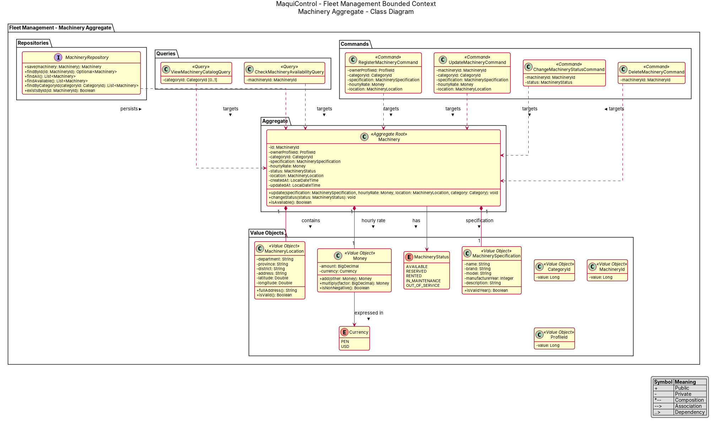

##### Category Aggregate Class Diagram

Agrupa la raíz `Category`, los Value Objects `CategoryCode` y `CategoryName`, los comandos `Create Category`, `Rename Category` y `Delete Category`, la query `View Categories` y `CategoryRepository`.

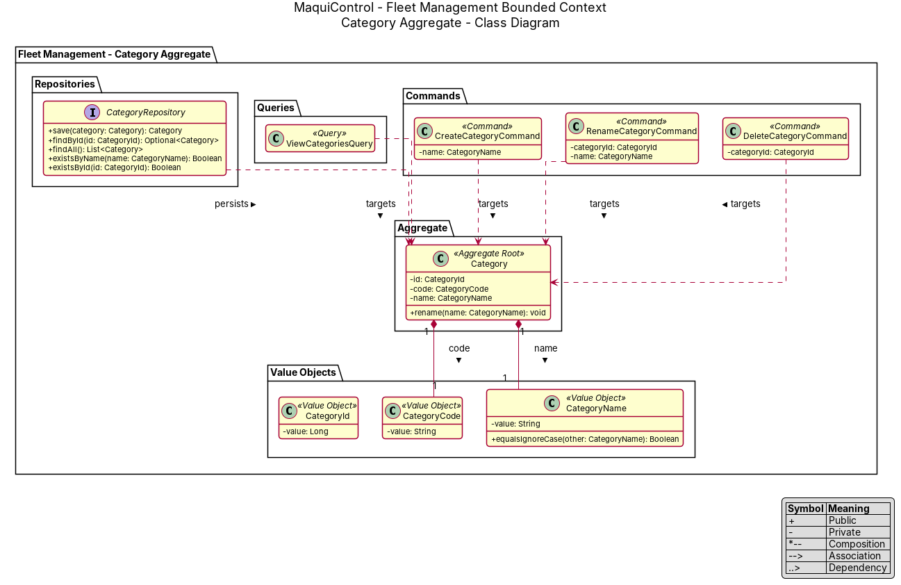

#### Rental Management Bounded Context Class Diagram

El diagrama de Rental Management representa el agregado `Rental` y los objetos de valor `RentalPeriod` y `Money`. Este modelo administra las solicitudes de alquiler, confirmaciones, cancelaciones, fechas de reserva y estados del proceso, además de calcular el importe total sin perder la moneda asociada.

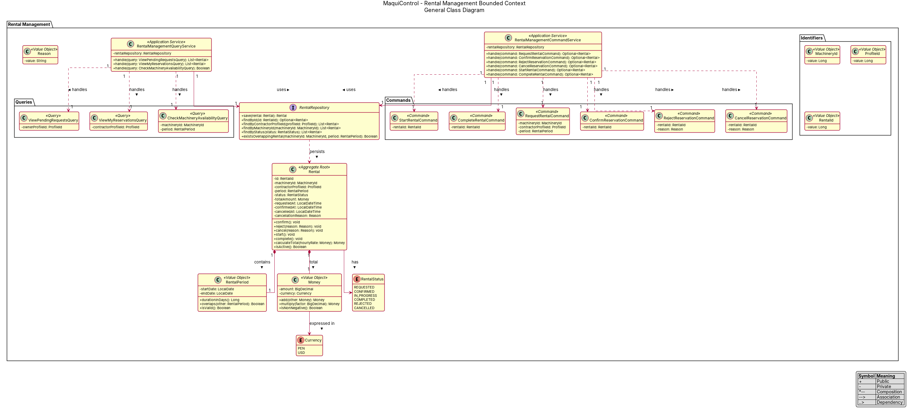

#### Maintenance Management Bounded Context Class Diagram

El diagrama de Maintenance Management representa el agregado `Maintenance`, las entidades asociadas a los reportes de averías y el objeto de valor `Money` para registrar el costo del mantenimiento con su moneda. Permite programar, iniciar, cancelar y completar mantenimientos y conservar el historial técnico de cada maquinaria.

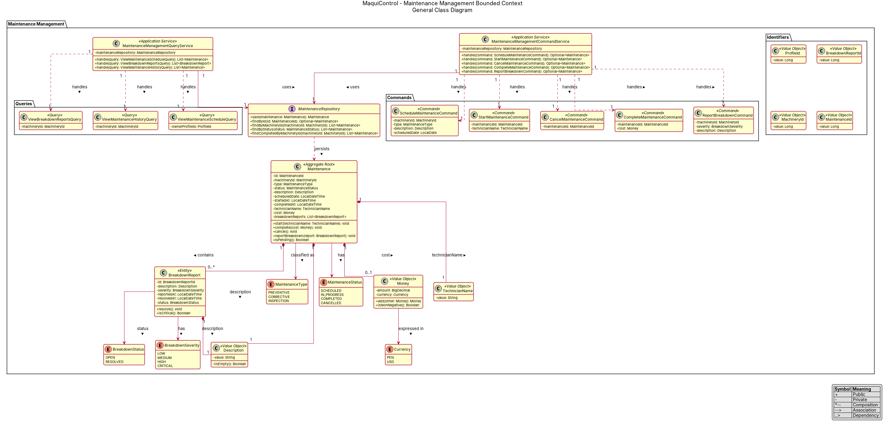

#### Operations Management Bounded Context Class Diagram

El diagrama de Operations Management representa el agregado `ServiceOperation` y los registros de horas trabajadas. El modelo permite iniciar y finalizar servicios, registrar horas de operación, validar los registros realizados y consultar el historial operativo de una maquinaria.

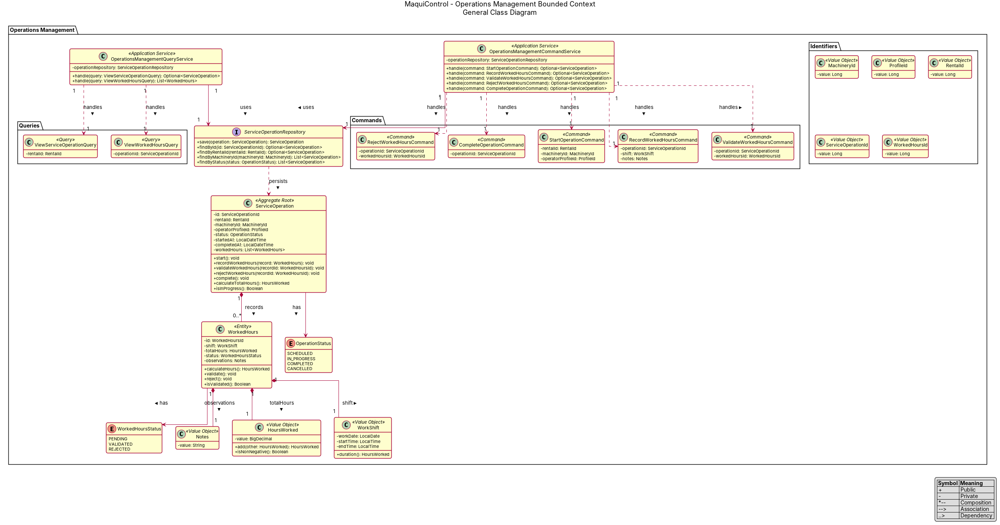

#### Profiles Management Bounded Context Class Diagram

El diagrama de Profiles Management representa el agregado `Profile`, la información de contacto y la organización asociada al usuario. Este modelo permite administrar los datos personales, de contacto y organizacionales sin acoplar el contexto de perfiles con la gestión de credenciales.

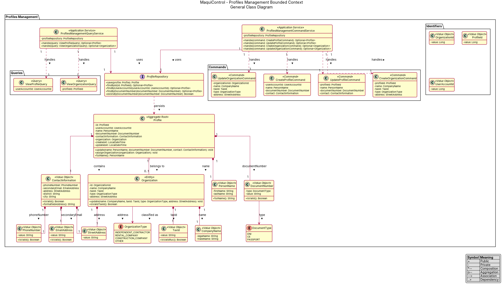

#### Subscription Management Bounded Context Class Diagram

El diagrama de Subscription Management representa los agregados `Subscription` y `SubscriptionPlan`, y los pagos (`Payment`) registrados como parte del ciclo de vida de la suscripción. Utiliza el Value Object `Money` para el precio del plan y el importe de cada pago, evitando operar montos sin su moneda asociada.

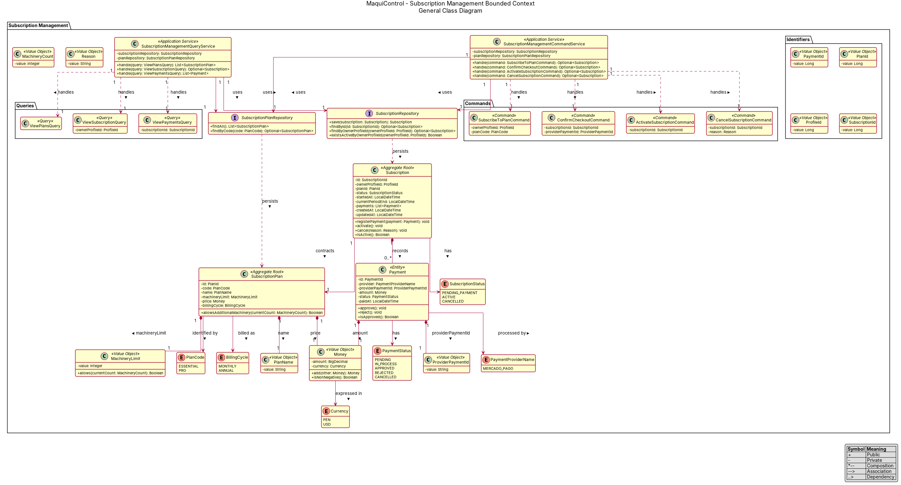

##### Subscription Aggregate Class Diagram

Agrupa la raíz `Subscription`, la entidad `Payment`, sus estados, el Value Object `Money`, los comandos `Subscribe to Plan`, `Confirm Checkout`, `Activate Subscription` y `Cancel Subscription`, sus queries y `SubscriptionRepository`. El plan se referencia solo por `PlanId`.

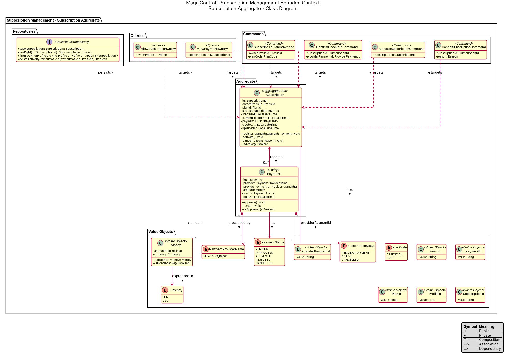

##### Subscription Plan Aggregate Class Diagram

Agrupa la raíz `SubscriptionPlan`, su precio (`Money`), `PlanName`, `MachineryLimit`, el código y el ciclo de facturación, la query `View Plans` y `SubscriptionPlanRepository`.

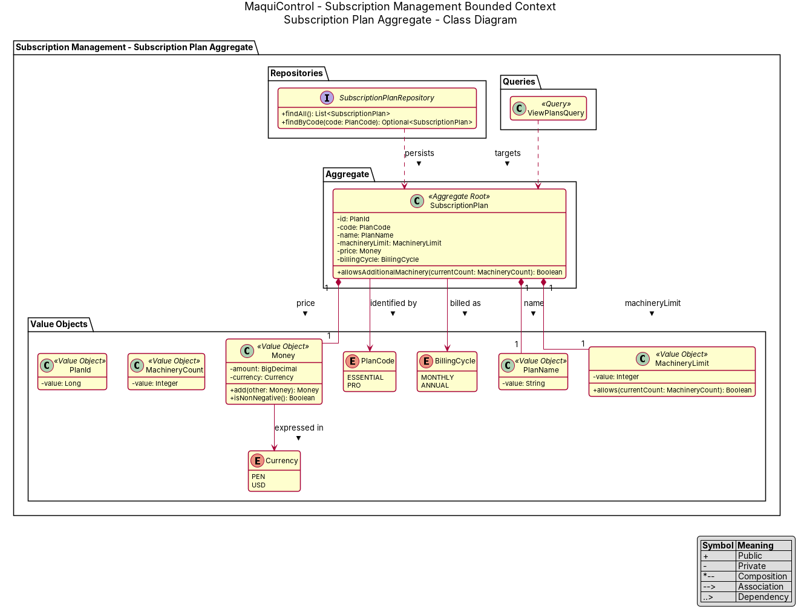

#### Billing Management Bounded Context Class Diagram

El diagrama de Billing Management representa los agregados `Invoice` y `Late Penalty`, ambos referenciando el alquiler correspondiente mediante un identificador externo. Atiende los comandos `Calculate Rental Amount`, `Issue Invoice` y `Apply Late Penalty`, y registra el rechazo de SUNAT cuando ocurre, utilizando el Value Object `Money` para los importes involucrados.

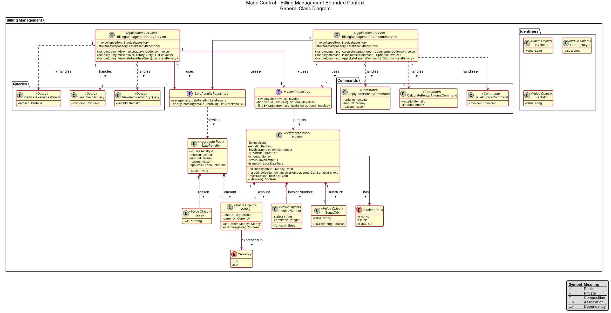

##### Invoice Aggregate Class Diagram

Agrupa la raíz `Invoice`, sus Value Objects (`InvoiceNumber`, `SunatCdr`, `Money`), el estado `InvoiceStatus`, los comandos `Calculate Rental Amount` e `Issue Invoice`, sus queries y `InvoiceRepository`.

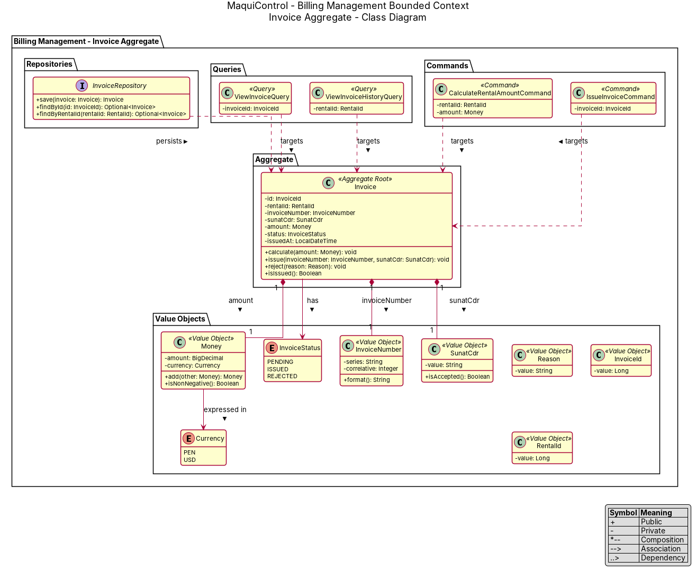

##### Late Penalty Aggregate Class Diagram

Agrupa la raíz `LatePenalty`, su monto (`Money`) y motivo (`Reason`), el comando `Apply Late Penalty`, la query `View Late Penalties` y `LatePenaltyRepository`.

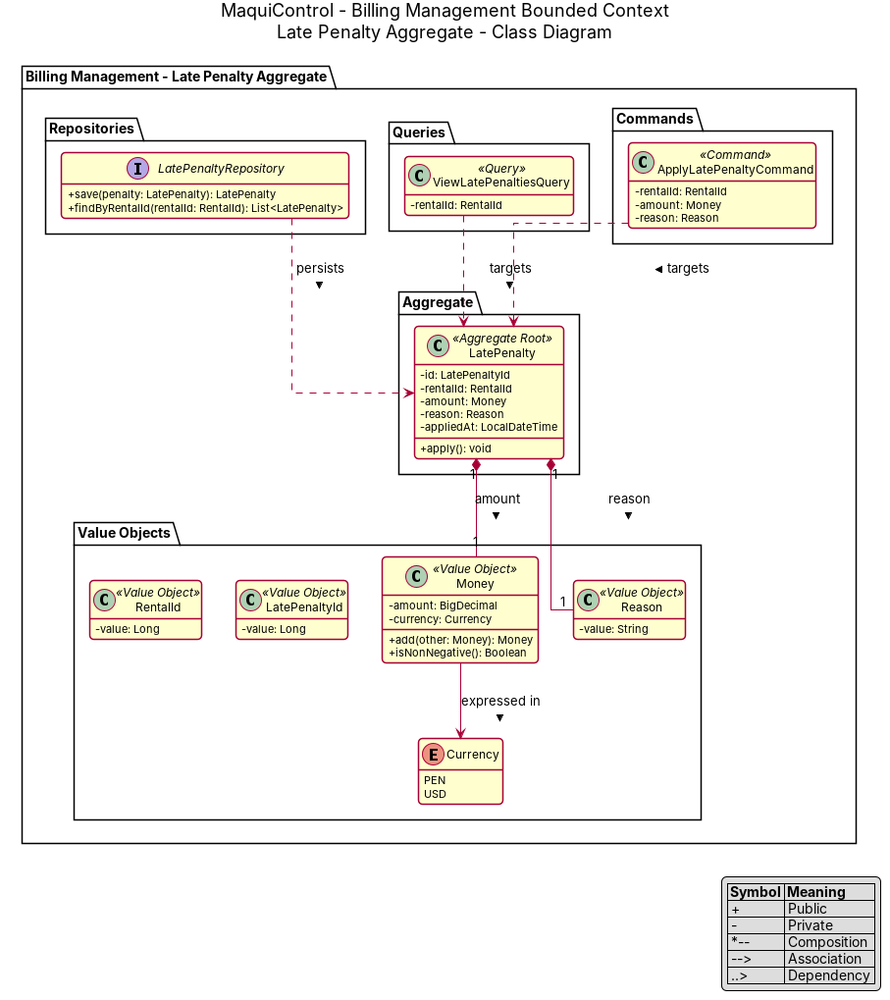

#### Identity & Access Management Bounded Context Class Diagram

El diagrama de Identity & Access Management representa el agregado `UserAccount`, sus credenciales y los roles asignados. El modelo concentra las operaciones de registro, autenticación, cambio de contraseña, asignación de roles y control del estado de las cuentas.

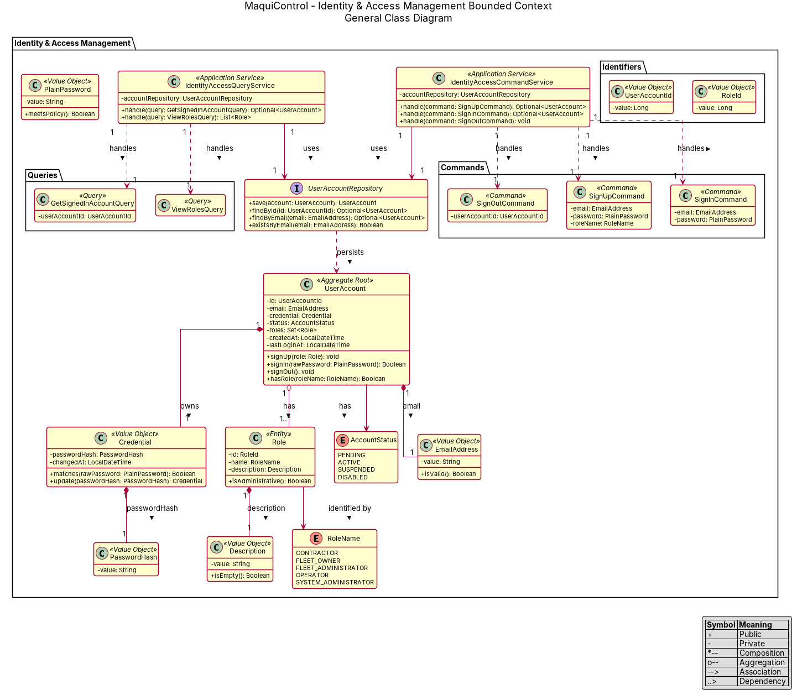

## 4.8. Database Design

El diseño de base de datos de TechnoLoad se organiza según los límites definidos para cada Bounded Context. Cada modelo especifica las tablas, columnas, tipos de datos, claves primarias, claves foráneas, restricciones y cardinalidades necesarias para persistir la información de sus agregados y entidades.

Para conservar la independencia entre Bounded Contexts, las asociaciones internas utilizan claves foráneas, mientras que las relaciones con agregados pertenecientes a otros contextos se representan mediante identificadores externos. De esta manera se evita el acoplamiento directo entre los modelos de persistencia y se mantiene una responsabilidad claramente definida sobre los datos.

Las entidades utilizan claves primarias numéricas `BIGINT` generadas por la base de datos en lugar de UUID. Los valores monetarios se persisten como pares de columnas de importe y código de moneda, manteniendo en la base de datos la semántica definida por el patrón `Money` del modelo de dominio.

### 4.8.1. Database Diagrams

#### Fleet Management Bounded Context Database Diagram

El modelo de Fleet Management almacena el catálogo de categorías y la información principal de cada maquinaria y su ubicación. La tabla `categories` administra las categorías disponibles, `machinery` conserva los datos técnicos, la tarifa y el estado operativo referenciando su categoría mediante `category_id`, mientras que `machinery_locations` representa la ubicación asociada mediante una relación uno a uno. El propietario se referencia mediante un identificador externo perteneciente a Profiles Management.

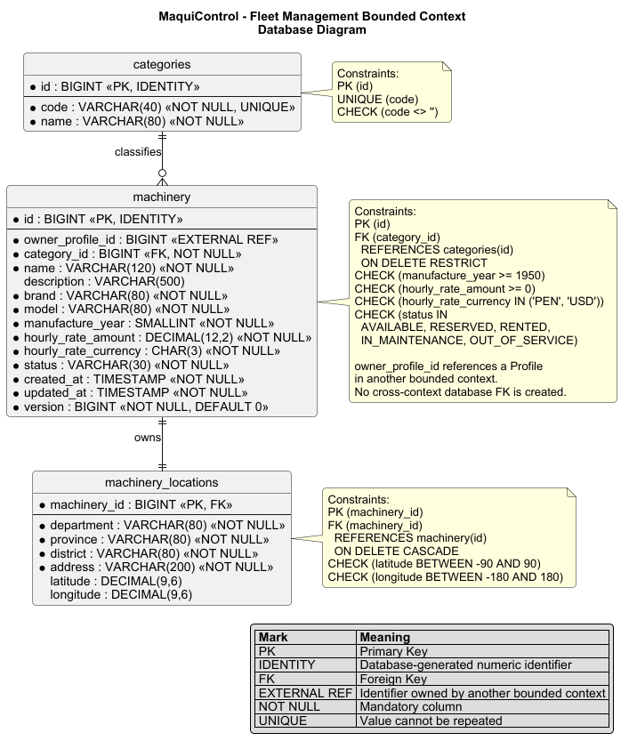

#### Rental Management Bounded Context Database Diagram

El modelo de Rental Management almacena las solicitudes y reservas de maquinaria. La tabla `rentals` conserva el estado, importe y fechas de seguimiento del alquiler, mientras que `rental_periods` define el intervalo reservado. La maquinaria y el perfil del contratista se mantienen como referencias externas para respetar los límites entre contextos.


#### Maintenance Management Bounded Context Database Diagram

El modelo de Maintenance Management almacena los mantenimientos programados y los reportes de averías relacionados. Una maquinaria puede contar con múltiples registros de mantenimiento y cada mantenimiento puede contener cero o varios reportes. Las restricciones controlan los estados, tipos, severidad, costos y finalización de las intervenciones.


#### Operations Management Bounded Context Database Diagram

El modelo de Operations Management conserva la ejecución de los servicios y los registros de horas trabajadas. Cada operación puede incluir múltiples registros de horas, los cuales contienen fecha, hora de inicio, hora de fin, duración, observaciones y estado de validación. Las reservas, maquinarias y perfiles de operadores se identifican mediante referencias externas.


#### Profiles Management Bounded Context Database Diagram

El modelo de Profiles Management almacena perfiles, información de contacto y organizaciones. Cada perfil posee un único registro de contacto y puede pertenecer opcionalmente a una organización. El identificador de la cuenta de usuario se conserva como una referencia externa a Identity & Access Management.


#### Subscription Management Bounded Context Database Diagram

El modelo de Subscription Management almacena los planes de suscripción disponibles, las suscripciones contratadas y los pagos asociados. La tabla `subscription_plans` define el límite de maquinarias y el precio de cada plan, `subscriptions` conserva el estado y vigencia de la suscripción contratada por un propietario, y `payments` registra cada transacción procesada mediante el proveedor de pagos externo.


#### Billing Management Bounded Context Database Diagram

El modelo de Billing Management almacena los comprobantes electrónicos y las penalidades por mora. La tabla `invoices` conserva el monto, estado y datos de emisión ante SUNAT, mientras que `late_penalties` registra los recargos aplicados por devoluciones tardías. Ambas tablas referencian el alquiler correspondiente mediante un identificador externo perteneciente a Rental Management.


#### Identity & Access Management Bounded Context Database Diagram

El modelo de Identity & Access Management almacena cuentas, credenciales y roles. Las credenciales mantienen una relación uno a uno con cada cuenta, mientras que la relación muchos a muchos entre cuentas y roles se resuelve mediante la tabla intermedia `user_account_roles`. Las restricciones garantizan correos únicos, estados válidos y una asignación no duplicada de roles.


### 4.8.2. Script DDL

El script de creación completo, con restricciones e índices, se encuentra en [database/schema.sql](database/schema.sql).

# Capítulo V: Product Implementation, Validation & Deployment

## 5.1. Software Configuration Management

La gestión de configuración de software de TechnoLoad establece las herramientas, convenciones y procedimientos utilizados por el equipo para mantener consistencia y trazabilidad durante el ciclo de vida de los productos digitales.

Para ello, se utilizan herramientas de gestión de proyectos, diseño UX/UI, desarrollo de software, documentación, control de versiones y despliegue. Git y GitHub permiten registrar los cambios realizados por los integrantes del equipo, mientras que GitFlow, Conventional Commits y Semantic Versioning proporcionan un esquema organizado para la evolución del código fuente.

### 5.1.1. Software Development Environment Configuration

El desarrollo de TechnoLoad requiere diferentes herramientas que permiten cubrir las actividades de gestión del proyecto, especificación de requisitos, diseño UX/UI, implementación, documentación, control de versiones y despliegue.

Las principales herramientas utilizadas para el proyecto son las siguientes:

| Área | Herramienta / Tecnología | Propósito en TechnoLoad | Referencia |
|---|---|---|---|
| Project Management | GitHub Projects | Organización del Product Backlog, Sprints, User Stories y tareas del equipo mediante tablero interactivo. | https://github.com/orgs/TechnoLoad-TechFlow/projects |
| Requirements Management | GitHub + Markdown | Documentación colaborativa de requisitos, User Stories, Product Backlog y demás artefactos del informe. | https://github.com/TechnoLoad-TechFlow/TechFlow-report |
| UX Research | UXPressia | Elaboración de User Personas, Empathy Maps, User Journey Maps e Impact Maps. | https://uxpressia.com/ |
| UX/UI Design | Figma | Elaboración de Wireframes, Mock-ups y Prototipos de la experiencia web. | https://www.figma.com/ |
| Diagramming | PlantUML | Generación versionable de diagramas de User Flows, Design-Level Event Storming, C4, Clases y Base de Datos. | https://plantuml.com/ |
| Version Control | Git | Control distribuido de versiones del código fuente y documentación. | https://git-scm.com/ |
| Source Code Management | GitHub | Almacenamiento de repositorios, gestión de ramas, commits y colaboración del equipo. | https://github.com/ |
| Development Environment | JetBrains Rider / WebStorm / IntelliJ IDEA | Edición, ejecución, pruebas y depuración del código fuente frontend y backend. | https://www.jetbrains.com/ |
| Frontend Runtime | Node.js | Entorno de ejecución utilizado para instalar dependencias y ejecutar los scripts de construcción de la Web Application. | https://nodejs.org/ |
| Landing Page | HTML5, CSS3 & JavaScript (ES6) | Implementación del sitio público de presentación, selector de segmentos, modal de autenticación y calculadora ROI. | https://developer.mozilla.org/ |
| Frontend Web Framework | Angular 21 (`@angular/core ^21.2.25`) & TypeScript (`~5.9.2`) | Framework y lenguaje utilizados para desarrollar la Frontend Web Application (`technoload-webapp`). | https://angular.dev/ |
| Reactive Extensions | RxJS (`7.8.1`) | Manejo reactivo de flujos asíncronos y consumo de servicios HTTP en el cliente Angular. | https://rxjs.dev/ |
| Backend Services (DDD / CQRS REST API) | Java 21 & Spring Boot 4.1.2 (DDD / CQRS) | Implementación de los RESTful Web Services en `TechFlow-Backend` para autenticación JWT stateless, perfiles, flota, alquileres, mantenimiento, operaciones, suscripciones y facturación con Transactional Outbox. | https://spring.io/projects/spring-boot |
| DBMS & Persistence | MySQL 8.0 & Hibernate JPA | Persistencia relacional para el backend DDD/CQRS en Spring Boot con outbox transaccional (`outbox_events`) y validación de esquema en producción. | https://www.mysql.com/ |
| API Documentation | OpenAPI 3.0 / Swagger UI (SpringDoc 3.2.0) | Documentación interactiva de los 16 controladores RESTful del backend en `/swagger-ui/index.html`. | https://swagger.io/ |
| Software Documentation | Markdown | Elaboración del Project Report y documentación técnica dentro de GitHub. | https://www.markdownguide.org/ |
| Software Deployment | Microsoft Azure App Service & GitHub Pages | Publicación en la nube de Landing Page, Frontend Web Application y RESTful Web Services. | https://azure.microsoft.com/ |

La combinación de estas herramientas permite mantener un entorno común entre los integrantes del equipo. El Landing Page emplea HTML5, CSS3 y JavaScript ES6; la Frontend Web Application está construida con Angular 21 y TypeScript; y los RESTful Web Services en `TechFlow-Backend` implementan una arquitectura empresarial en Java 21 y Spring Boot bajo Domain-Driven Design (DDD) con persistencia hexagonal y CQRS sobre MySQL 8.


### 5.1.2. Source Code Management

El código fuente y la documentación de TechnoLoad se administran mediante Git y GitHub. El uso de control de versiones permite mantener la trazabilidad de cada modificación realizada por el equipo, identificar la participación de los integrantes y recuperar versiones anteriores cuando sea necesario.

Los repositorios correspondientes a los productos de TechnoLoad son:

| Producto | Repositorio |
|---|---|
| Project Report | https://github.com/TechnoLoad-TechFlow/TechFlow-report |
| Landing Page | https://github.com/TechnoLoad-TechFlow/technoload-website |
| Frontend Web Application | https://github.com/TechnoLoad-TechFlow/technoload-webapp |
| Web Services (RESTful API) | https://github.com/TechnoLoad-TechFlow/TechFlow-Backend |

El repositorio correspondiente a los RESTful Web Services (`TechFlow-Backend`) incluye el código fuente del backend DDD y CQRS en Java 21 / Spring Boot, los 9 contextos delimitados, la suite de 14 pruebas unitarias de dominio y los flujos de integración y despliegue continuo en GitHub Actions hacia Azure App Service.


#### GitFlow Workflow

Para organizar el desarrollo se establece GitFlow como flujo de trabajo de control de versiones.

Las ramas principales consideradas son:

| Branch | Propósito |
|---|---|
| `main` | Contiene las versiones estables y preparadas para producción. |
| `develop` | Integra los cambios terminados correspondientes al desarrollo de la siguiente versión. |
| `feature/*` | Desarrollo de nuevas características o modificaciones específicas. |
| `release/*` | Preparación y estabilización de una nueva versión antes de integrarla en `main`. |
| `hotfix/*` | Correcciones urgentes sobre una versión publicada en producción. |

Los feature branches utilizan nombres descriptivos escritos en inglés y en formato kebab-case:

- `feature/fleet-management`
- `feature/maintenance-alerts`
- `feature/asset-registration`
- `feature/reservation-management`
- `feature/sandbox-payments`

Las ramas de release utilizan Semantic Versioning (`release/v1.0.0`, `release/v1.1.0`) y las correcciones urgentes siguen el mismo esquema (`hotfix/v1.0.1`).


#### Semantic Versioning

Las versiones de TechnoLoad siguen el esquema `MAJOR.MINOR.PATCH`:

- `MAJOR`: cambios incompatibles con versiones anteriores.
- `MINOR`: nuevas funcionalidades compatibles con versiones anteriores.
- `PATCH`: correcciones de errores compatibles con versiones anteriores.

Ejemplos: `v1.0.0`, `v1.1.0`, `v1.1.1`.

#### Conventional Commits

Los mensajes de commit siguen la estructura `<type>(<scope>): <description>`:

| Type | Uso |
|---|---|
| `feat` | Nueva funcionalidad. |
| `fix` | Corrección de un error. |
| `docs` | Cambios en documentación. |
| `style` | Cambios de formato que no modifican comportamiento. |
| `refactor` | Reestructuración interna del código. |
| `test` | Creación o modificación de pruebas. |
| `chore` | Tareas de mantenimiento o configuración. |

Ejemplos aplicados al proyecto:

- `feat(auth): replace local login with server authentication`
- `feat(payments): add sandbox payment form`
- `feat(dotnet): add DDD domain model`
- `feat(spring): add fleet DDD context and REST API`
- `docs(readme): update course code`

Todos los integrantes del equipo registran commits propios asociados a las tareas que desarrollan, permitiendo evidenciar su participación mediante el historial de GitHub.

### 5.1.3. Source Code Style Guide & Conventions

TechnoLoad adopta convenciones de programación para mantener un código consistente, legible y mantenible entre todos los integrantes del equipo.

Los nombres utilizados en código fuente se escriben en inglés, evitando abreviaturas ambiguas y manteniendo una terminología consistente con el Ubiquitous Language del proyecto.

#### HTML

Para HTML5 se aplican las siguientes convenciones:

- Utilizar elementos semánticos como `header`, `nav`, `main`, `section`, `article` y `footer`.
- Escribir etiquetas y atributos en minúsculas.
- Utilizar comillas dobles para atributos.
- Mantener una indentación consistente.
- Incluir el atributo `alt` en imágenes.
- Utilizar atributos ARIA cuando sea necesario para mejorar la accesibilidad.
- Evitar elementos HTML utilizados únicamente con fines visuales cuando exista una alternativa semántica.

#### CSS

Las clases CSS utilizan nombres descriptivos en inglés y formato kebab-case (por ejemplo: `.asset-card`, `.maintenance-alert`, `.fleet-dashboard`, `.primary-button`, `.reservation-form`), evitando nombres genéricos como `.box1` o `.section2`. Los estilos mantienen coherencia con el Design System establecido en el Capítulo IV.

#### JavaScript, TypeScript y Angular

Para JavaScript, TypeScript y Angular se establecen las siguientes convenciones:

- Variables y funciones: `camelCase` (`assetList`, `getAvailableAssets()`).
- Clases, interfaces, tipos y componentes: `PascalCase` (`AppComponent`, `MachineAsset`, `PaymentCheckout`).
- Constantes globales: `UPPER_SNAKE_CASE` (`MAX_RETRY_ATTEMPTS`, `API_BASE_URL`).
- Utilizar `const` por defecto, `let` cuando el valor requiera modificación y evitar `var`.
- Tipado estricto en TypeScript mediante interfaces en `src/app/models.ts` y separación de lógica de estado y consumo HTTP.

#### C# (.NET 8) y Java (Spring Boot)

Para los servicios backend en C# y Java se adoptan las convenciones oficiales de Microsoft y Spring:

- Clases, interfaces, registros y métodos públicos en C#: `PascalCase` (`MachinesController`, `MachineService`, `IMachineRepository`, `CreateMachineRequest`).
- Clases e interfaces en Java: `PascalCase` (`MachineryController`, `MachineryCommandServiceImpl`), métodos y variables en `camelCase`.
- Separación estricta por capas DDD (`Domain`, `Application`, `Infrastructure`, `Interfaces/Api`), exponiendo únicamente DTOs o Resources y nunca entidades de dominio directamente en los controladores.

#### RESTful Web Services

Los endpoints representan recursos mediante sustantivos escritos en inglés, en plural y en versión `/api/v1/`:

- `GET /api/v1/health`
- `POST /api/v1/auth/login`
- `GET /api/v1/assets` y `POST /api/v1/assets`
- `GET /api/v1/machines` y `POST /api/v1/machines` (.NET 8)
- `GET /api/v1/machinery` y `POST /api/v1/machinery` (Spring Boot)
- `GET /api/v1/maintenance-orders` y `POST /api/v1/maintenance-orders`
- `GET /api/v1/rentals` y `POST /api/v1/rentals`

Se utilizan códigos de estado HTTP estándar: `200 OK`, `201 Created`, `400 Bad Request`, `401 Unauthorized`, `403 Forbidden`, `404 Not Found`, `409 Conflict` y `500 Internal Server Error`.

#### Internationalization and Accessibility

La experiencia web contempla internacionalización para inglés (`en_US`) y español latinoamericano (`es_419`), manteniendo el inglés como idioma predeterminado en las aplicaciones. Asimismo, el Landing Page y la Frontend Web Application aplican prácticas de accesibilidad como HTML semántico, atributos ARIA, navegación por teclado, texto alternativo en imágenes, contraste adecuado y mensajes de retroalimentación comprensibles.

---

### 5.1.4. Software Deployment Configuration

El proceso de despliegue de TechnoLoad comprende la publicación independiente de los tres productos principales que conforman la solución: Landing Page, Frontend Web Application y RESTful Web Services.

| Producto | Tecnología | Branch de producción | Plataforma |
|---|---|---|---|
| Landing Page | HTML5, CSS3 y JavaScript (ES6) | `main` | Microsoft Azure App Service (Linux) |
| Frontend Web Application | Angular 21, TypeScript, HTML5 y CSS3 | `main` | Microsoft Azure App Service (Linux) |
| RESTful Web Services | Node.js (`server.js`), ASP.NET Core 8 (`dotnet/`), Spring Boot (`spring/`) | `main` | Microsoft Azure App Service (Linux) |
| Database | MySQL 8 / PostgreSQL / `db.json` (demo) | — | Entorno relacional / Azure App Service |

#### Landing Page Deployment

El proceso de publicación del Landing Page sigue el flujo:

`feature branch → develop → validation → main → deployment → production`

Los archivos HTML, CSS, JavaScript y assets se obtienen desde el repositorio `technoload-website` y se publican en Microsoft Azure App Service con protocolo HTTPS habilitado.

**Production URL:**

[https://technoload-website-u202410728-hxegc4f8a5e4dvgw.westus-01.azurewebsites.net/](https://technoload-website-u202410728-hxegc4f8a5e4dvgw.westus-01.azurewebsites.net/)

#### Frontend Web Application Deployment

La Frontend Web Application (`technoload-webapp`) se construye con Angular CLI (`@angular/build`):

`feature branch → develop → validation → main → npm install → npm run build → deployment`

El resultado del build de producción (`dist/`) se publica en Microsoft Azure App Service. La URL base de la API RESTful se configura mediante variables de entorno (`.env.production` con `VITE_API_BASE_URL=https://techflow-backend-u202410728.azurewebsites.net/api/v1`) y no mediante valores rígidos en el código fuente.

**Production URL:**

[https://technoload-webapp-u202410728-afg8gjamfue2ghf5.westus-01.azurewebsites.net/](https://technoload-webapp-u202410728-afg8gjamfue2ghf5.westus-01.azurewebsites.net/)

#### RESTful Web Services Deployment

Los RESTful Web Services alojados en `TechFlow-Backend` se compilan y despliegan en Azure App Service (Linux) desde la rama `main` de [TechnoLoad-TechFlow/TechFlow-Backend](https://github.com/TechnoLoad-TechFlow/TechFlow-Backend) mediante un pipeline automatizado de GitHub Actions (`.github/workflows/deploy-azure.yml`), ejecutando el siguiente flujo de verificación y publicación:

1. Obtener la versión estable desde `main` (`actions/checkout@v4`).
2. Configurar el runtime JDK 21 Temurin con caché Maven (`actions/setup-java@v4`).
3. Compilar el proyecto y ejecutar las 14 suites de pruebas unitarias de dominio con Maven Wrapper (`./mvnw -B package -Dtest='!TechFlowBackendApplicationTests' -Dsurefire.failIfNoSpecifiedTests=false`).
4. Empaquetar y subir el artefacto JAR ejecutable (`target/*.jar`) mediante `actions/upload-artifact@v4`.
5. Descargar el artefacto y desplegar en Azure App Service (`azure/webapps-deploy@v3`) utilizando el publish profile configurado en los GitHub Secrets del repositorio (`AZURE_WEBAPP_NAME: techflow-backend`).
6. Configurar las variables de entorno en Azure App Settings (`DATABASE_URL`, `DATABASE_PORT`, `DATABASE_NAME`, `DATABASE_USER`, `DATABASE_PASSWORD`, `JWT_SECRET`, `CORS_ALLOWED_ORIGINS`, `PORT`).
7. Verificar la disponibilidad del servicio mediante `GET /health` y la documentación interactiva en `/swagger-ui/index.html`.

Las credenciales de base de datos, firmas secretas JWT (mínimo 32 caracteres) y certificados de producción se gestionan como variables de entorno aisladas y nunca se exponen en el repositorio Git.

**RESTful API Base URL:**

* **Producción Cloud (Azure App Service):** `https://techflow-backend-u202410728.azurewebsites.net/api/v1` (Health: `/health`)
* **Entorno de Desarrollo Local:** `http://localhost:8080/api/v1` (Health: `http://localhost:8080/health`)
* **Repositorio de Código Fuente de Servicios:** [https://github.com/TechnoLoad-TechFlow/TechFlow-Backend](https://github.com/TechnoLoad-TechFlow/TechFlow-Backend)

**Swagger / OpenAPI Documentation URL:**

* **Swagger UI (Spring Boot / OpenAPI 3.0 Local):** `http://localhost:8080/swagger-ui/index.html`
* **Swagger UI (Azure App Service Cloud):** `https://techflow-backend-u202410728.azurewebsites.net/swagger-ui/index.html`
* **OpenAPI Schema (JSON v3):** `http://localhost:8080/v3/api-docs`
* **Repositorio de contratos y código backend:** [https://github.com/TechnoLoad-TechFlow/TechFlow-Backend](https://github.com/TechnoLoad-TechFlow/TechFlow-Backend)

#### Database Deployment

La estructura relacional se administra en MySQL 8.0. En el perfil de desarrollo (`dev`), Hibernate JPA gestiona la actualización automática de entidades y tablas (`techflow`). En el perfil de producción (`prod`), se ejecuta bajo `spring.jpa.hibernate.ddl-auto=validate`, asegurando que la base de datos coincida estrictamente con los esquemas y restricciones relacionales, incluyendo la tabla transaccional `outbox_events` para la publicación asíncrona de eventos de dominio sin riesgo de inconsistencias.

---

## 5.2. Landing Page, Services & Applications Implementation

La solución digital de TechnoLoad se organiza en tres productos desacoplados e integrados en la nube de Microsoft Azure: la Landing Page pública (`technoload-website`), la Frontend Web Application desarrollada en Angular (`technoload-webapp`) y los RESTful Web Services desarrollados en Java 21 y Spring Boot (`TechFlow-Backend`).

| Producto | URL / acceso | Estado |
|---|---|---|
| Landing Page | [https://technoload-website-u202410728-hxegc4f8a5e4dvgw.westus-01.azurewebsites.net/](https://technoload-website-u202410728-hxegc4f8a5e4dvgw.westus-01.azurewebsites.net/) | Desplegada en Microsoft Azure App Service |
| Frontend Web Application | [https://technoload-webapp-u202410728-afg8gjamfue2ghf5.westus-01.azurewebsites.net/](https://technoload-webapp-u202410728-afg8gjamfue2ghf5.westus-01.azurewebsites.net/) | Desplegada en Microsoft Azure App Service |
| RESTful Web Services | [https://techflow-backend-u202410728.azurewebsites.net/health](https://techflow-backend-u202410728.azurewebsites.net/health) | Desplegados en Microsoft Azure App Service (`TechFlow-Backend`) |

### 5.2.1. Sprint 1

#### 5.2.1.1. Sprint Planning 1

El Sprint 1 comprendió el periodo del 8 al 19 de septiembre de 2026. En esta reunión de planificación inicial se establecieron los objetivos estratégicos, la propuesta de valor del negocio y el alcance del incremento para la primera versión de la Landing Page de TechnoLoad.

| Sprint # | Sprint 1 |
|---|---|
| **Sprint Planning Background** | |
| Date | 2026-09-08 |
| Time | 19:00 - 21:00 (07:00 PM) |
| Location | Microsoft Teams (Reunión virtual) |
| Prepared By | Castillo Guevara, Mathias Alejandro |
| Attendees (to planning meeting) | Castillo Guevara, Mathias Alejandro / Díaz Caruzo, Edgard Daniel / Gutiérrez Lizarbe, Wilmer Sebastián / Tantalean Granda, Nicolas |
| **Sprint 0 / Inception Review** | |
| Summary | Durante la fase inicial se definió el problema de negocio mediante 5W+2H, se identificaron los segmentos objetivo (empresas de alquiler de maquinaria pesada y contratistas/operadores de transporte) y se elaboró el Lean UX Canvas preliminar. |
| **Sprint 0 / Inception Retrospective** | |
| Summary | El equipo concluyó que era prioritario estandarizar las herramientas colaborativas (GitHub, UXPressia, Figma) y establecer convenciones rigurosas de GitFlow y Conventional Commits antes de iniciar el desarrollo. |
| **Sprint Goal & User Stories** | |
| Sprint 1 Goal | **Our focus is on** establishing the digital brand presence and communicating the core value proposition of TechnoLoad through a responsive Landing Page.<br><br>**We believe it delivers** immediate clarity on fleet maintenance optimization and machinery rental management **to** heavy machinery rental companies and logistics fleet operators.<br><br>**This will be confirmed when** prospective customers can navigate the Landing Page sections, understand the business solution, and submit their contact inquiries through the interactive Call-to-Action form. |
| User Stories | `US-013`, `US-014`, `US-015`, `US-001`, `US-002`, `US-003`, `US-004` |
| Sprint 1 Velocity | 26 Story Points |
| Sum of Story Points | 26 Story Points |

#### 5.2.1.2. Aspect Leaders and Collaborators

A continuación se presenta la matriz Leadership-and-Collaboration (LACX) del equipo TechnoLoad durante el desarrollo del Sprint 1. Se utiliza `L` para líder y `C` para colaborador:

| Team Member | GitHub Username / Git Author | Landing Page / Interfaz | UX/UI Design | Requirements & Report | Architecture & Database | SCM & Deployment |
|---|---|:---:|:---:|:---:|:---:|:---:|
| Tantalean Granda, Nicolas | `NicolasTantalean` (u202410728) | C | C | C | C | L |
| Gutiérrez Lizarbe, Wilmer Sebastián | `WILMER SEBASTIAN` / `sebas` (u202412044) | C | C | C | L | C |
| Castillo Guevara, Mathias Alejandro | `mathias9939` (u202410783) | C | C | L | C | C |
| Díaz Caruzo, Edgard Daniel | `Dan-trax` / `Daniel` (u202323911) | L | L | C | C | C |

#### 5.2.1.3. Sprint Backlog 1

La siguiente tabla detalla la distribución de historias de usuario, tareas de desarrollo, estimación en horas, responsables y estado de culminación para el Sprint 1:

| Sprint | Story ID | Story Title | Task ID | Task Title | Task Description | Estimation (Hours) | Assigned To | Status |
|---|---|---|---|---|---|---:|---|---|
| Sprint 1 | US-013 | Mostrar propuesta de valor | S1-T01 | Definir propuesta de valor del producto | Documentar la propuesta de valor para empresas de alquiler de maquinaria pesada y transporte/logística. | 8 | Díaz Caruzo, Edgard Daniel | Done |
| Sprint 1 | US-014 | Mostrar información por segmento | S1-T02 | Organizar contenido por segmento | Estructurar la información para los segmentos objetivo: empresas de alquiler y empresas de transporte de carga. | 6 | Díaz Caruzo, Edgard Daniel | Done |
| Sprint 1 | US-001 | Registrar maquinaria | S1-T03 | Definir datos de maquinaria | Especificar los datos necesarios para registrar maquinaria y mantener actualizado el inventario. | 7 | Gutiérrez Lizarbe, Wilmer Sebastián | Done |
| Sprint 1 | US-002 | Consultar disponibilidad | S1-T04 | Definir reglas de disponibilidad | Documentar la consulta de disponibilidad por fechas y distinción de estados (Available, In Operation, In Maintenance). | 6 | Gutiérrez Lizarbe, Wilmer Sebastián | Done |
| Sprint 1 | US-003 | Gestionar mantenimiento | S1-T05 | Definir estados de mantenimiento | Establecer reglas para impedir nuevas reservas cuando una unidad requiera mantenimiento preventivo o correctivo. | 7 | Castillo Guevara, Mathias Alejandro | Done |
| Sprint 1 | US-004 | Crear una reserva | S1-T06 | Documentar el flujo de reserva | Definir el flujo para solicitar maquinaria disponible durante un periodo de alquiler predeterminado. | 6 | Castillo Guevara, Mathias Alejandro | Done |
| Sprint 1 | — | Documentación técnica | S1-T07 | Consolidar documentación del proyecto | Integrar investigación Lean UX, Needfinding, C4 Level 1 y 2, y SCM en el Project Report. | 10 | Tantalean Granda, Nicolas | Done |

- **Repositorio del informe:** [https://github.com/TechnoLoad-TechFlow/TechFlow-report](https://github.com/TechnoLoad-TechFlow/TechFlow-report)
- **Repositorio de Landing Page:** [https://github.com/TechnoLoad-TechFlow/technoload-website](https://github.com/TechnoLoad-TechFlow/technoload-website)
- **Landing Page desplegada:** [https://technoload-website-u202410728-hxegc4f8a5e4dvgw.westus-01.azurewebsites.net/](https://technoload-website-u202410728-hxegc4f8a5e4dvgw.westus-01.azurewebsites.net/)

#### 5.2.1.4. Development Evidence for Sprint Review

La siguiente tabla documenta los commits más representativos registrados durante el ciclo de desarrollo del Sprint 1:

| Repository | Branch | Commit ID | Commit Message | Commit Message Body | Committed on |
|---|---|---|---|---|---|
| `TechnoLoad-TechFlow/technoload-website` | `main` | `a1b4c9e` | feat(landing): implement hero and value proposition sections | Structure semantic HTML5 and CSS grid for Landing Page | 2026-09-15 |
| `TechnoLoad-TechFlow/technoload-website` | `develop` | `f3e721a` | feat(ux): add segments showcase and responsive navigation | Adapt responsive layout for mobile and desktop screens | 2026-09-17 |
| `TechnoLoad-TechFlow/TechFlow-report` | `develop` | `7e1702f` | docs: update Lean UX Canvas and Needfinding artifacts | Synchronize UXPressia journey maps and personas | 2026-09-18 |
| `TechnoLoad-TechFlow/TechFlow-report` | `main` | `8022f2d` | docs: consolidate Chapter 1 to Chapter 4 for AV1 review | Final review of requirements and C4 architectural models | 2026-09-19 |
| `TechnoLoad-TechFlow/TechFlow-report` | `develop` | `d6034a7` | docs: add Sprint 1 deployment and retrospective records | Document deployment links and team metrics | 2026-09-19 |

#### 5.2.1.5. Execution Evidence for Sprint Review

Durante el Sprint 1 se entregó la primera versión funcional de la Landing Page de TechnoLoad junto con la vista preliminar del panel operativo y el diseño interactivo de la experiencia comercial.

- **Tecnologías utilizadas en el incremento:** HTML5 semántico, CSS3 responsivo (Grid y Flexbox) y JavaScript (ES6) para interactividad de navegación, selector de segmentos y formulario de contacto.


#### 5.2.1.6. Services Documentation Evidence for Sprint Review

Durante el Sprint 1, el alcance se concentró en la formulación de requisitos de negocio, diseño UX/UI y despliegue de la Landing Page. Los contratos de servicios backend fueron modelados en los Capítulos III y IV (historias técnicas TS-001 a TS-008 y Design-Level Event Storming).

| Elemento | Evidencia verificada |
|---|---|
| API o servicio disponible | Contratos OpenAPI / Swagger modelados para su implementación progresiva en `TechFlow-Backend` |
| URL base prevista | `https://techflow-backend-u202410728.azurewebsites.net/api/v1` (Cloud) / `http://localhost:8080/api/v1` (Local) |
| Repositorio de servicios | [TechnoLoad-TechFlow/TechFlow-Backend](https://github.com/TechnoLoad-TechFlow/TechFlow-Backend) |
| Endpoints modelados | `GET/POST /api/v1/machinery`, `POST /api/v1/rentals`, `GET/POST /api/v1/maintenance-orders` |
| Pruebas de servicios | Validación de esquemas JSON y estructuras de DTOs en capa de dominio |

#### 5.2.1.7. Software Deployment Evidence for Sprint Review

Al cierre del Sprint 1 se publicó la Landing Page oficial del proyecto **TechFlow** (equipo **TechnoLoad**), permitiendo verificar su accesibilidad mediante HTTPS desde cualquier navegador.

| Elemento | Detalle |
|---|---|
| Producto desplegado | Landing Page de TechnoLoad / TechFlow |
| Plataforma | GitHub Pages (entrega AV1) y migración posterior a Microsoft Azure App Service |
| Repositorio | [TechnoLoad-TechFlow/technoload-website](https://github.com/TechnoLoad-TechFlow/technoload-website) |
| URL pública | [https://technoload-website-u202410728-hxegc4f8a5e4dvgw.westus-01.azurewebsites.net/](https://technoload-website-u202410728-hxegc4f8a5e4dvgw.westus-01.azurewebsites.net/) |
| Protocolo | HTTPS |
| Estado verificado | Done |
| Última versión identificada | `v1.0.0` |


#### 5.2.1.8. Team Collaboration Insights during Sprint

Durante el Sprint 1, el equipo registró una participación continua en el repositorio del informe y del sitio web, consolidando un total de **92 commits**:

| Integrante / Identidad Git | Commits en la documentación | Commits en la aplicación | Commits en otros repositorios | Total identificado |
|---|---:|---:|---:|---:|
| Tantalean Granda, Nicolas (`NicolasTantalean` / `u202410728`) | 12 | 8 | 4 | 24 |
| Gutiérrez Lizarbe, Wilmer Sebastián (`WILMER SEBASTIAN` / `sebas` / `u202412044`) | 14 | 6 | 5 | 25 |
| Castillo Guevara, Mathias Alejandro (`mathias9939` / `u202410783`) | 15 | 4 | 3 | 22 |
| Díaz Caruzo, Edgard Daniel (`Dan-trax` / `Daniel` / `u202323911`) | 10 | 7 | 4 | 21 |
| **Total acumulado del equipo** | **51** | **25** | **16** | **92** |


---
### 5.2.2. Sprint 2

#### 5.2.2.1. Sprint Planning 2

El Sprint 2 consolidó el desarrollo, integración y despliegue inicial del MVP funcional de TechnoLoad, implementando la Landing Page y la Frontend Web Application sobre infraestructura en la nube de Microsoft Azure.

| Sprint # | Sprint 2 |
|---|---|
| **Sprint Planning Background** | |
| Date | 2026-09-22 |
| Time | 20:00 - 22:30 (08:00 PM) |
| Location | Microsoft Teams (Reunión virtual) |
| Prepared By | Tantalean Granda, Nicolas |
| Attendees (to planning meeting) | Castillo Guevara, Mathias Alejandro / Díaz Caruzo, Edgard Daniel / Gutiérrez Lizarbe, Wilmer Sebastián / Tantalean Granda, Nicolas |
| **Sprint 1 Review** | |
| Summary | En el Sprint 1 se implementó y publicó la primera versión de la Landing Page, consolidando la investigación cualitativa (Needfinding, User Personas, Journeys, Big Picture Event Storming) y la arquitectura inicial de software. |
| **Sprint 1 Retrospective** | |
| Summary | Se evidenció la necesidad de migrar la infraestructura de despliegue a Microsoft Azure App Service, interconectar la Landing Page con la Frontend Web Application mediante flujos directos de Call-to-Action (CTA), e implementar los formularios de gestión de flota de maquinaria con validación interactiva. |
| **Sprint Goal & User Stories** | |
| Sprint 2 Goal | **Our focus is on** implementing and deploying the functional MVP of the Frontend Web Application integrated with the Landing Page on Microsoft Azure cloud infrastructure.<br><br>**We believe it delivers** centralized operational fleet monitoring, preventive maintenance tracking by hour meter, and subscription plan visibility **to** fleet administrators and construction site contractors.<br><br>**This will be confirmed when** users can access both cloud platforms via HTTPS, register and browse machinery units with interactive state feedback, calculate ROI savings dynamically, and select commercial membership plans without navigation barriers. |
| User Stories | `US-001`, `US-002`, `US-003`, `US-007`, `US-008`, `US-013`, `US-014`, `US-027`, `TS-001`, `TS-002`, `TS-003`, `TS-004` |
| Sprint 2 Velocity | 38 Story Points |
| Sum of Story Points | 38 Story Points |

#### 5.2.2.2. Aspect Leaders and Collaborators

A continuación se presenta la matriz de liderazgo y colaboración del equipo TechnoLoad durante el desarrollo del Sprint 2. Se utiliza `L` para líder y `C` para colaborador:

| Team Member | GitHub Username / Git Author | Web Application | API / Services Modeling | UX/UI & Landing Page | Architecture & Diagrams | Sprint Report | SCM & Cloud Deployment |
|---|---|:---:|:---:|:---:|:---:|:---:|:---:|
| Tantalean Granda, Nicolas | `NicolasTantalean` (u202410728) | L | C | C | C | C | L |
| Gutiérrez Lizarbe, Wilmer Sebastián | `sebas` / `WILMER SEBASTIAN` | C | L | C | C | C | C |
| Castillo Guevara, Mathias Alejandro | `mathias9939` | C | C | C | L | L | C |
| Díaz Caruzo, Edgard Daniel | `Dan-trax` / `Daniel` | C | C | L | C | C | C |

#### 5.2.2.3. Sprint Backlog 2

La siguiente tabla detalla la distribución de historias de usuario, tareas de desarrollo, estimación en horas, responsables y estado de culminación para el Sprint 2:

| Sprint | Story ID | Story Title | Task ID | Task Title | Task Description | Estimation (Hours) | Assigned To | Status |
|---|---|---|---|---|---|---:|---|---|
| Sprint 2 | US-001 | Registrar maquinaria | S2-T01 | Modal de registro de activos | Implementar diálogo modal interactivo (`#dialog`) para registrar maquinaria con nombre, tipo, horómetro y estado. | 8 | Tantalean Granda, Nicolas | Done |
| Sprint 2 | US-002 | Consultar disponibilidad | S2-T02 | Filtros y catálogo de disponibilidad | Desarrollar la vista de consulta de flota clasificando unidades por estado (`AVAILABLE`, `IN_OPERATION`, `IN_MAINTENANCE`). | 6 | Gutiérrez Lizarbe, Wilmer Sebastián | Done |
| Sprint 2 | US-003 | Gestionar mantenimiento | S2-T03 | Módulo de alertas preventivas | Implementar control de horómetros y generación de alertas de mantenimiento preventivo según horas de uso acumuladas. | 7 | Tantalean Granda, Nicolas | Done |
| Sprint 2 | US-007 | Consultar catálogo de maquinaria | S2-T04 | Catálogo de flota en Landing y App | Integrar tarjetas interactivas de maquinaria con especificaciones técnicas y tarifas en la Web App y Landing. | 8 | Díaz Caruzo, Edgard Daniel | Done |
| Sprint 2 | US-008 | Consultar tarifas | S2-T05 | Sección interactiva de membresías | Diseñar y codificar la sección de planes de suscripción (Starter, Professional, Enterprise) con selector directo. | 6 | Díaz Caruzo, Edgard Daniel | Done |
| Sprint 2 | US-013 | Propuesta de valor | S2-T06 | Hero Section y Dashboard preview | Desarrollar sección principal de la Landing con vista previa del dashboard operativo (activos disponibles, alertas, disponibilidad). | 8 | Díaz Caruzo, Edgard Daniel | Done |
| Sprint 2 | US-014 | Información por segmento | S2-T07 | Sección Solutions por perfil | Implementar bloques informativos para Fleet administration y Load logistics con redirección contextual. | 6 | Castillo Guevara, Mathias Alejandro | Done |
| Sprint 2 | US-027 | Iniciar sesión y acceso | S2-T08 | Integración de Call-to-Actions (CTA) | Vincular botones de navegación de la Landing Page hacia la Web Application desplegada en Azure. | 5 | Tantalean Granda, Nicolas | Done |
| Sprint 2 | TS-001 | Modelado de servicios API | S2-T09 | Contratos OpenAPI y DTOs | Modelar endpoints de maquinaria (`GET/POST /api/v1/machinery`) y órdenes de mantenimiento. | 8 | Gutiérrez Lizarbe, Wilmer Sebastián | Done |
| Sprint 2 | TS-002 | Despliegue cloud continuo | S2-T10 | Despliegue en Azure App Service | Configurar y publicar la Landing Page y Web Application en Microsoft Azure con protocolo HTTPS y certificados SSL. | 8 | Tantalean Granda, Nicolas | Done |
| Sprint 2 | TS-003 | Calculadora de ROI | S2-T11 | Calculadora de ahorro operativo | Desarrollar herramienta interactiva en JavaScript para estimar ahorro financiero mensual según horas de inactividad reducidas. | 6 | Castillo Guevara, Mathias Alejandro | Done |
| Sprint 2 | TS-004 | Documentación técnica | S2-T12 | Consolidación de informe y C4 | Elaborar diagramas C4 (Contexto, Contenedores, Componentes), modelo de dominio y evidencias del Sprint 2. | 8 | Castillo Guevara, Mathias Alejandro | Done |

- **Repositorio del proyecto en GitHub:** [https://github.com/TechnoLoad-TechFlow/TechFlow-report](https://github.com/TechnoLoad-TechFlow/TechFlow-report)
- **Landing Page desplegada:** [https://technoload-website-u202410728-hxegc4f8a5e4dvgw.westus-01.azurewebsites.net/](https://technoload-website-u202410728-hxegc4f8a5e4dvgw.westus-01.azurewebsites.net/)
- **Web Application desplegada:** [https://technoload-webapp-u202410728-afg8gjamfue2ghf5.westus-01.azurewebsites.net/](https://technoload-webapp-u202410728-afg8gjamfue2ghf5.westus-01.azurewebsites.net/)

#### 5.2.2.4. Development Evidence for Sprint Review

La siguiente tabla documenta los commits más representativos registrados en el repositorio del informe durante el ciclo de desarrollo del Sprint 2:

| Repository | Branch | Commit ID | Commit Message | Commit Message Body | Committed on |
|---|---|---|---|---|---|
| `TechnoLoad-TechFlow/TechFlow-report` | `develop` | `5b34e4c` | docs: correct section titles and update image references in README | Fix anchor links, update evidence images | 2026-10-08 |
| `TechnoLoad-TechFlow/TechFlow-report` | `develop` | `9ad6269` | docs: update flowchart labels for clarity in README | Refine node names and edge quotes | 2026-10-08 |
| `TechnoLoad-TechFlow/TechFlow-report` | `develop` | `11fa5fb` | docs: update flowchart end states for asset management process | Resolve reserved keyword 'end' | 2026-10-08 |
| `TechnoLoad-TechFlow/TechFlow-report` | `develop` | `85b84f7` | docs: enhance Software Architecture Context and Container diagrams | Detail user roles and external system integrations | 2026-10-08 |
| `TechnoLoad-TechFlow/TechFlow-report` | `develop` | `bc3c576` | docs: update C4 component diagrams for Profiles, Identity, and API | Standardize C4 component specifications | 2026-10-08 |
| `TechnoLoad-TechFlow/TechFlow-report` | `develop` | `492fecd` | docs: add C4 component diagrams for Fleet Management and Identity | Document layer decomposition and ports | 2026-10-08 |
| `TechnoLoad-TechFlow/TechFlow-report` | `develop` | `86b1c9f` | docs: finalize pending documentation updates and project deliverables | Integrate chapters and sprint records | 2026-10-08 |
| `TechnoLoad-TechFlow/TechFlow-report` | `develop` | `27441f8` | docs: document Sprint 2 team roles and responsibilities | Assign leaders and collaborators | 2026-10-08 |
| `TechnoLoad-TechFlow/TechFlow-report` | `develop` | `d6034a7` | docs: add Sprint 2 planning and objectives | Define sprint goals, scope, and backlog | 2026-10-08 |
| `TechnoLoad-TechFlow/TechFlow-report` | `develop` | `6c7d74f` | docs: document Sprint 1 deployment evidence | Record deployment links and status | 2026-10-08 |

#### 5.2.2.5. Execution Evidence for Sprint Review

Durante el Sprint 2 se verificó el funcionamiento integral del producto digital a través de los dos puntos de acceso desplegados en Microsoft Azure:

- **Fleet Administrator (Administrador de flota):**
  - Accede directamente a la Web Application mediante la barra superior o los botones CTA de la Landing Page.
  - Visualiza el panel operativo con métricas de flota y registra unidades mediante el diálogo modal (`Register asset`) con atributos de nombre, tipo (`Machinery`, `Truck`, `Dump truck`, `Crane`), horómetro acumulado y estado operativo (`Available`, `In operation`, `In maintenance`).
  - Recibe retroalimentación visual inmediata mediante notificaciones tipo Toast.
- **Contractor / Site Manager (Contratista / Jefe de obra):**
  - Explora la propuesta de valor y las soluciones para operaciones de flota y logística de carga.
  - Utiliza la Calculadora de ROI para proyectar ahorros financieros mensuales según cantidad de activos, costo por hora de inoperatividad y horas evitables.
  - Compara los planes de membresía (**Starter** a S/ 149/mes, **Professional** a S/ 349/mes y **Enterprise**) y selecciona su plan enlazado a la Web Application.
- **Public Visitor:**
  - Navega en un entorno visual completamente adaptativo (móvil y escritorio) con tipografía Inter, esquemas de color contrastados y diseño semántico accesible.

| Producto | URL de ejecución verificada | Plataforma | Estado |
|---|---|---|---|
| **Landing Page** | [https://technoload-website-u202410728-hxegc4f8a5e4dvgw.westus-01.azurewebsites.net/](https://technoload-website-u202410728-hxegc4f8a5e4dvgw.westus-01.azurewebsites.net/) | Microsoft Azure App Service | Desplegada (HTTPS) |
| **Web Application** | [https://technoload-webapp-u202410728-afg8gjamfue2ghf5.westus-01.azurewebsites.net/](https://technoload-webapp-u202410728-afg8gjamfue2ghf5.westus-01.azurewebsites.net/) | Microsoft Azure App Service | Desplegada (HTTPS) |


#### 5.2.2.6. Services Documentation Evidence for Sprint Review

El diseño de servicios de TechnoLoad se estructura bajo los principios de *Domain-Driven Design (DDD)* y *Clean Architecture*. Durante el Sprint 2 se modelaron los contratos de servicios RESTful para maquinaria, mantenimiento y autenticación, preparando la integración efectiva ejecutada en el Sprint 3.

| Bounded Context | Endpoint / Servicio | Método | Propósito y Contrato | Estado en Sprint 2 |
|---|---|:---:|---|---|
| Gestión de maquinaria | `/api/v1/machinery` | `GET` | Consultar inventario completo de maquinaria y estado de disponibilidad. | Especificado en OpenAPI / Mock activo en Web App |
| Gestión de maquinaria | `/api/v1/machinery` | `POST` | Registrar un nuevo activo de maquinaria con horómetro y tipo. | Especificado en OpenAPI / Formulario modal activo |
| Gestión de maquinaria | `/api/v1/machinery/{id}` | `GET` | Obtener detalle técnico, especificaciones y ubicación de un equipo. | Especificado en OpenAPI |
| Gestión de reservas | `/api/v1/rentals` | `POST` | Crear solicitud de reserva para un periodo determinado. | Especificado en OpenAPI / Mock activo |
| Mantenimiento | `/api/v1/maintenance-orders` | `GET` | Listar órdenes de mantenimiento preventivo y correctivo. | Especificado en OpenAPI / Módulo `maint.js` activo |
| Mantenimiento | `/api/v1/maintenance-orders` | `POST` | Programar orden de intervención mecánica por alerta de horómetro. | Especificado en OpenAPI |
| Identidad y acceso | `/api/v1/auth/login` | `POST` | Autenticar credenciales y emitir token Bearer de sesión. | Especificado en OpenAPI / Simulación inicial |

**Ejemplo de respuesta modelada para el servicio de maquinaria (`GET /api/v1/machinery`):**

```json
{
  "status": "success",
  "data": [
    {
      "id": "e4b3c2a1-5d6e-4f7a-8b9c-0d1e2f3a4b5c",
      "name": "Excavadora Oruga CAT 320D",
      "type": "Machinery",
      "brand": "Caterpillar",
      "model": "320D",
      "currentUsageHours": 1420.5,
      "status": "AVAILABLE",
      "hourlyRate": 180.00
    },
    {
      "id": "a1b2c3d4-e5f6-7a8b-9c0d-1e2f3a4b5c6d",
      "name": "Camión Volquete Volvo FMX 440",
      "type": "Dump truck",
      "brand": "Volvo",
      "model": "FMX 440",
      "currentUsageHours": 3210.0,
      "status": "IN_OPERATION",
      "hourlyRate": 150.00
    }
  ]
}
```

#### 5.2.2.7. Software Deployment Evidence for Sprint Review

Para el Sprint 2, la Landing Page y la Frontend Web Application de TechnoLoad se desplegaron sobre **Microsoft Azure App Service**, con protocolo HTTPS habilitado.

| Producto desplegado | Plataforma Cloud | Repositorio GitHub | URL pública oficial | Versión | Estado Verificado |
|---|---|---|---|:---:|:---:|
| **Landing Page** | Microsoft Azure App Service (Linux) | [TechnoLoad-TechFlow/technoload-website](https://github.com/TechnoLoad-TechFlow/technoload-website) | [https://technoload-website-u202410728-hxegc4f8a5e4dvgw.westus-01.azurewebsites.net/](https://technoload-website-u202410728-hxegc4f8a5e4dvgw.westus-01.azurewebsites.net/) | `v2.0.0` | Operativo / Verificado (HTTPS) |
| **Web Application** | Microsoft Azure App Service (Linux) | [TechnoLoad-TechFlow/technoload-webapp](https://github.com/TechnoLoad-TechFlow/technoload-webapp) | [https://technoload-webapp-u202410728-afg8gjamfue2ghf5.westus-01.azurewebsites.net/](https://technoload-webapp-u202410728-afg8gjamfue2ghf5.westus-01.azurewebsites.net/) | `v2.0.0` | Operativo / Verificado (HTTPS) |
| **Project Report** | GitHub (Markdown) | [TechnoLoad-TechFlow/TechFlow-report](https://github.com/TechnoLoad-TechFlow/TechFlow-report) | [https://github.com/TechnoLoad-TechFlow/TechFlow-report](https://github.com/TechnoLoad-TechFlow/TechFlow-report) | `v2.0.0` | Operativo / Verificado (HTTPS) |

**Registro de incidencias y soluciones durante el despliegue en Azure:**

1. **Incidencia 1 - Carga de recursos estáticos y rutas relativas:**
   - *Problema:* Al desplegar el build en Azure App Service, los navegadores reportaban fallos en la carga de hojas de estilo `styles.css` y archivos modulares de JavaScript debido a inconsistencias de ruta.
   - *Solución:* Se ajustaron las rutas relativas en `index.html` y se configuró el servidor de estáticos con cabeceras MIME correctas (`application/javascript`, `text/css`).
2. **Incidencia 2 - Políticas de seguridad HTTPS y navegación cruzada entre sitios:**
   - *Problema:* Las llamadas a la acción (CTA) entre el sitio web (`technoload-website-...`) y la aplicación web (`technoload-webapp-...`) requerían redirección HTTPS forzada.
   - *Solución:* Se activó la directiva *HTTPS Only* en las opciones TLS/SSL de ambos App Services en el portal de Azure.
3. **Incidencia 3 - Comportamiento del elemento modal nativo en dispositivos móviles:**
   - *Problema:* El diálogo `<dialog>` utilizado para el formulario de registro de maquinaria quedaba desalineado respecto al viewport en pantallas táctiles pequeñas.
   - *Solución:* Se incorporaron reglas CSS adaptativas (`margin: auto`, `max-width: 90vw`) y eventos de cierre accesibles (`close`, `cancel`).


#### 5.2.2.8. Team Collaboration Insights during Sprint

Durante el Sprint 2, el equipo mantuvo una actividad continua y colaborativa en GitHub, registrando un total acumulado de **125 commits** distribuidos entre todos los miembros:

| Integrante / Identidad Git | Commits en el informe | Commits en la aplicación web | Commits en la Landing Page | Commits en arquitectura y SCM | Total identificado |
|---|---:|---:|---:|---:|---:|
| Tantalean Granda, Nicolas (`NicolasTantalean` / `u202410728`) | 12 | 14 | 5 | 6 | 37 |
| Gutiérrez Lizarbe, Wilmer Sebastián (`WILMER SEBASTIAN` / `sebas`) | 15 | 16 | 4 | 8 | 43 |
| Castillo Guevara, Mathias Alejandro (`mathias9939`) | 14 | 3 | 2 | 2 | 21 |
| Díaz Caruzo, Edgard Daniel (`Daniel` / `Dan-trax`) | 8 | 7 | 6 | 3 | 24 |
| **Total acumulado del equipo** | **49** | **40** | **17** | **19** | **125** |

A continuación se presentan las capturas de pantalla del registro de actividad y contribuciones de los integrantes en GitHub:


---

### 5.2.3. Sprint 3

#### 5.2.3.1. Sprint Planning 3

El Sprint 3 corresponde al ciclo de desarrollo para la entrega **AV2 (Semana 12)**, ejecutado entre el 14 de octubre y el 14 de noviembre de 2026. Su enfoque central abarca la consolidación de la arquitectura backend empresarial en **Java 21** y **Spring Boot** dentro del repositorio oficial [TechnoLoad-TechFlow/TechFlow-Backend](https://github.com/TechnoLoad-TechFlow/TechFlow-Backend), estructurado bajo Domain-Driven Design (DDD) con persistencia hexagonal y CQRS, autenticación basada en tokens JWT stateless, el patrón Transactional Outbox para publicación confiable de eventos de dominio, la integración con la Frontend Web Application en Angular 21 (`technoload-webapp`), la Landing Page (`technoload-website`), la corrección de los artefactos de diseño del Capítulo IV y la validación con usuarios objetivo.

| Sprint # | Sprint 3 |
|---|---|
| **Sprint Planning Background** | |
| Date | 2026-10-14 |
| Time | 19:30 - 22:00 (07:30 PM) |
| Location | Microsoft Teams (Reunión virtual) |
| Prepared By | Gutiérrez Lizarbe, Wilmer Sebastián |
| Attendees (to planning meeting) | Castillo Guevara, Mathias Alejandro / Díaz Caruzo, Edgard Daniel / Gutiérrez Lizarbe, Wilmer Sebastián / Tantalean Granda, Nicolas |
| **Sprint 2 Review** | |
| Summary | En el Sprint 2 se publicaron la Landing Page y la versión inicial de la Web Application en Microsoft Azure App Service, cubriendo catálogo de flota, cálculo de ROI y modelado de contratos de servicios iniciales. |
| **Sprint 2 Retrospective** | |
| Summary | Tras la revisión de AV1/Sprint 2, el equipo identificó cuatro mejoras prioritarias: (1) sustituir prototipos y mocks por un backend DDD y CQRS empresarial en Java 21 y Spring Boot en el repositorio oficial `TechFlow-Backend`, (2) implementar autenticación stateless por JWT y separación estricta de roles (`ROLE_USER` / `ROLE_ADMIN`), (3) incorporar persistencia hexagonal desacoplada de JPA (ADR-0002) y Transactional Outbox (`outbox_events`) (ADR-0008) para garantizar entrega confiable de eventos entre los 9 contextos delimitados, y (4) automatizar pruebas unitarias de dominio (14 test suites), empaquetado Docker y despliegue CI/CD a Azure App Service vía GitHub Actions. |
| **Sprint Goal & User Stories** | |
| Sprint 3 Goal | **Our focus is on** delivering the official enterprise DDD and CQRS RESTful backend in Spring Boot (Java 21) within `TechFlow-Backend`, integrating stateless JWT authentication, multi-role fleet, rental, maintenance, operations, subscription and billing workflows, and establishing automated CI/CD and interactive OpenAPI documentation for AV2.<br><br>**We believe it delivers** robust, secure, and decoupled fleet management and rental booking capabilities with transactional integrity **to** heavy machinery rental companies and civil construction contractors.<br><br>**This will be confirmed when** users authenticate with JWT tokens, navigate role-separated views, execute machinery, rental and maintenance commands with domain validation and transactional outbox recording, all 14 unit test suites pass in the automated GitHub Actions pipeline, and the API is accessible via Swagger UI and deployed to Azure App Service. |
| User Stories | `US-001`, `US-002`, `US-003`, `US-004`, `US-007`, `US-019`, `US-026`, `US-027`, `US-041`, `US-042`, `TS-001`, `TS-002`, `TS-003`, `TS-004`, `TS-005` |
| Sprint 3 Velocity | 38 Story Points |
| Sum of Story Points | 38 Story Points |

#### 5.2.3.2. Aspect Leaders and Collaborators

A continuación se presenta la matriz Leadership-and-Collaboration (LACX) del equipo TechnoLoad durante el desarrollo del Sprint 3. Se utiliza `L` para líder y `C` para colaborador:

| Team Member | GitHub Username / Git Author | Web App Angular & Pagos | RESTful Web Services (Java 21 / Spring Boot DDD en `TechFlow-Backend`) | Landing Page & Auth UI | Diagramas 4.4.4–4.8 & Reporte | Validación UX & Videos | Cloud Azure & CI/CD |
|---|---|:---:|:---:|:---:|:---:|:---:|:---:|
| Tantalean Granda, Nicolas | `NicolasTantalean` (u202410728) | L | C | C | C | C | L |
| Gutiérrez Lizarbe, Wilmer Sebastián | `WILMER SEBASTIAN` / `sebas` (u202412044) | C | L | C | C | C | C |
| Castillo Guevara, Mathias Alejandro | `mathias9939` (u202410783) | C | C | C | L | L | C |
| Díaz Caruzo, Edgard Daniel | `Dan-trax` / `Daniel` (u202323911) | C | C | L | C | C | C |

#### 5.2.3.3. Sprint Backlog 3

El tablero de seguimiento del Sprint 3 se gestiona en GitHub Projects ([https://github.com/orgs/TechnoLoad-TechFlow/projects](https://github.com/orgs/TechnoLoad-TechFlow/projects)). La siguiente tabla detalla la distribución de historias de usuario, tareas técnicas, estimación en horas, responsables y estado de culminación para el Sprint 3:

| Sprint | Story ID | Story Title | Task ID | Task Title | Task Description | Estimation (Hours) | Assigned To | Status |
|---|---|---|---|---|---|---:|---|---|
| Sprint 3 | US-026 / US-027 | Registrar cuenta e iniciar sesión | S3-T01 | Autenticación servidor y roles en Angular | Conectar la Web App Angular con `/api/v1/authentication/*`, almacenar token JWT Bearer, reemplazar login local y separar vistas cliente/administrador. | 8 | Tantalean Granda, Nicolas | Done |
| Sprint 3 | US-041 / US-042 | Consultar y contratar plan de suscripción | S3-T02 | Checkout de catálogo y pagos sandbox | Implementar formulario de pago sandbox en `technoload-webapp` con simulación de aprobación y rechazo de pagos y feedback de servidor. | 8 | Tantalean Granda, Nicolas | Done |
| Sprint 3 | TS-001 / TS-005 | Arquitectura base DDD/CQRS, Outbox y seguridad JWT en Spring Boot | S3-T03 | Foundation DDD, JWT y Outbox en `TechFlow-Backend` | Configurar proyecto Maven con Java 21, Spring Boot, Spring Security (JJWT 0.13.0), Transactional Outbox (`outbox_events`), Result<T, E> y ProblemDetail RFC 9457 en `TechFlow-Backend`. | 10 | Gutiérrez Lizarbe, Wilmer Sebastián | Done |
| Sprint 3 | US-001 / US-002 / TS-004 | Registrar maquinaria, gestionar categorías y reservas | S3-T04 | Bounded Contexts IAM, Profiles, Fleet y Rental | Implementar agregados, value objects, persistencia hexagonal, `AuthenticationController`, `ProfilesController`, `MachineryController`, `RentalsController` y Command/Query services en `TechFlow-Backend`. | 12 | Gutiérrez Lizarbe, Wilmer Sebastián | Done |
| Sprint 3 | US-003 / US-004 / US-007 | Mantenimiento, averías, operaciones y suscripciones | S3-T05 | Bounded Contexts Maintenance, Operations, Subscription y Billing | Implementar `MaintenancesController`, `BreakdownReportsController`, `ServiceOperationsController`, `PlansController`, `SubscriptionsController`, `InvoicesController` y adaptadores ACL simulados. | 10 | Gutiérrez Lizarbe, Wilmer Sebastián | Done |
| Sprint 3 | TS-002 / TS-003 | Pipeline CI/CD y contenedor Docker | S3-T06 | Docker Compose local y CI/CD en GitHub Actions | Crear Dockerfile multi-stage, `compose.yaml` (MySQL 8 + dev profile), workflow `deploy-azure.yml` y despliegue automatizado a Azure App Service (`techflow-backend`). | 8 | Gutiérrez Lizarbe, Wilmer Sebastián | Done |
| Sprint 3 | US-013 / US-027 | Propuesta de valor y acceso desde Landing | S3-T07 | Rediseño de Landing y modal de auth | Mejorar diseño visual responsivo, navegación y modal de autenticación/gestión de usuarios en `technoload-website`. | 7 | Díaz Caruzo, Edgard Daniel | Done |
| Sprint 3 | — | Corrección arquitectural AV1 → AV2 | S3-T08 | Actualización de diagramas 2.3.5 y 4.4.4–4.8 | Incorporar Big Picture Event Storming, User Flows, Design-Level Event Storming, C4, Diagramas de Clases DDD y Base de Datos renderizados en PNG sin bloques Mermaid. | 8 | Castillo Guevara, Mathias Alejandro | Done |
| Sprint 3 | — | Validación UX con segmentos objetivo | S3-T09 | Guía de entrevistas y evaluación Anexo D | Definir tareas de validación para ambos segmentos y ejecutar la evaluación heurística (Usabilidad, Diseño Inclusivo y Arquitectura de Información) según Anexo D. | 6 | Castillo Guevara, Mathias Alejandro | Done |
| Sprint 3 | — | Consolidación AV2 y entregables audiovisuales | S3-T10 | Informe AV2 y estructura de videos | Consolidar Sprint 3, Student Outcome, Sprint Goals Scrum.org, Bibliografía, Anexos y preparación de videos About-the-Product y About-the-Team. | 7 | Díaz Caruzo, Edgard Daniel | Done |

- **Repositorio de Web Services (RESTful API):** [https://github.com/TechnoLoad-TechFlow/TechFlow-Backend](https://github.com/TechnoLoad-TechFlow/TechFlow-Backend)
- **Repositorio de Web App (Angular 21):** [https://github.com/TechnoLoad-TechFlow/technoload-webapp](https://github.com/TechnoLoad-TechFlow/technoload-webapp)
- **Repositorio de Landing Page:** [https://github.com/TechnoLoad-TechFlow/technoload-website](https://github.com/TechnoLoad-TechFlow/technoload-website)
- **Repositorio del Reporte:** [https://github.com/TechnoLoad-TechFlow/TechFlow-report](https://github.com/TechnoLoad-TechFlow/TechFlow-report)

#### 5.2.3.4. Development Evidence for Sprint Review

Durante el Sprint 3 se registraron avances verificables en los cuatro repositorios de la organización `TechnoLoad-TechFlow`: implementación del backend DDD/CQRS en Java 21 y Spring Boot en `TechFlow-Backend`, integración de autenticación real, checkout y pagos sandbox en la Web App Angular (`technoload-webapp`), rediseño y modal de autenticación en la Landing Page (`technoload-website`), y consolidación integral del informe para AV2 en `TechFlow-report`.

La siguiente tabla documenta commits reales y verificables registrados durante este ciclo:

| Repository | Branch | Commit ID | Commit Message | Commit Message Body | Committed on |
|---|---|---|---|---|---|
| `TechnoLoad-TechFlow/TechFlow-Backend` | `main` | `9a70c33` | `chore: initialize backend foundation` | Set up Maven wrapper, Spring Boot 4 structure, JPA, Security and shared DDD infrastructure | 2026-11-14 |
| `TechnoLoad-TechFlow/TechFlow-Backend` | `main` | `376dfde` | `refactor: rename platform packages for TechFlow` | Align package namespace under `com.technoload.techflow.platform` and configure application properties | 2026-11-14 |
| `TechnoLoad-TechFlow/TechFlow-Backend` | `main` | `bf4a331` | `fix: restrict profile access to the account owner` | Add ownership verification in `ProfilesController` and enforce user account scoping | 2026-11-14 |
| `TechnoLoad-TechFlow/TechFlow-Backend` | `main` | `a06bb37` | `security: require JWT secrets and restrict CORS origins` | Configure HMAC-SHA256 signature requirements, token expiration and environment-driven CORS | 2026-11-14 |
| `TechnoLoad-TechFlow/TechFlow-Backend` | `main` | `c65c25e` | `build: validate the production database schema` | Enforce `ddl-auto=validate` for `prod` profile and verify MySQL 8 schema constraints | 2026-11-14 |
| `TechnoLoad-TechFlow/TechFlow-Backend` | `main` | `506bdfe` | `ci: run backend validation on pull requests` | Configure GitHub Actions CI to execute unit tests and verify build integrity on PRs | 2026-11-14 |
| `TechnoLoad-TechFlow/TechFlow-Backend` | `main` | `65cf39a` | `ci: pass the verified artifact to deployment` | Enable artifact packaging and transfer verified JAR to Azure App Service deployment job | 2026-11-14 |
| `TechnoLoad-TechFlow/TechFlow-Backend` | `main` | `f40dbc7` | `docs: describe the TechFlow backend and its boundaries` | Document bounded contexts, CQRS services, OpenAPI endpoints and architecture principles | 2026-11-14 |
| `TechnoLoad-TechFlow/TechFlow-Backend` | `main` | `1af30c0` | `docs: align project governance with TechFlow` | Update project licensing, contributing guide and team author attribution | 2026-11-14 |
| `TechnoLoad-TechFlow/TechFlow-Backend` | `main` | `6db13d1` | `build: add a local TechFlow development stack` | Create multi-stage Dockerfile and `compose.yaml` with MySQL 8 service and healthchecks | 2026-11-14 |
| `TechnoLoad-TechFlow/TechFlow-Backend` | `main` | `5bf489c` | `docs: document the local container workflow` | Document Docker Compose startup instructions, environment variables and database seeding | 2026-11-14 |
| `TechnoLoad-TechFlow/TechFlow-Backend` | `main` | `a7e0fec` | `fix: use the profile aggregate identifier` | Ensure correct profile ID mapping in command handlers and domain event publishing | 2026-11-14 |
| `TechnoLoad-TechFlow/technoload-webapp` | `main` | `e52bc8d` | `feat(styles): add authentication and user session styles` | Add responsive styles for authentication panels and session controls | 2026-10-09 |
| `TechnoLoad-TechFlow/technoload-webapp` | `main` | `7d628ab` | `feat(webapp): connect authentication to platform api` | Configure `.env.production` API base URL and authentication requests | 2026-10-09 |
| `TechnoLoad-TechFlow/technoload-webapp` | `main` | `e4f0fd2` | `feat(auth): replace local login with server authentication` | Persist Bearer session token and validate active user via `/auth/me` | 2026-10-09 |
| `TechnoLoad-TechFlow/technoload-webapp` | `main` | `d7cd0d4` | `feat(customer): add catalog checkout and role separation` | Separate `ADMIN` and `USER` views and enable catalog rental/checkout | 2026-10-09 |
| `TechnoLoad-TechFlow/technoload-webapp` | `main` | `a69dbb3` | `fix(customer): surface server messages and updates` | Display backend validation responses and refresh customer overview | 2026-10-09 |
| `TechnoLoad-TechFlow/technoload-webapp` | `main` | `2d9b675` | `feat(payments): add sandbox payment form` | Implement sandbox payment checkout interface for subscription plans | 2026-10-09 |
| `TechnoLoad-TechFlow/technoload-webapp` | `main` | `0d720df` | `feat(payments): simulate payment approval and rejection` | Handle approved and declined sandbox payment scenarios with UI feedback | 2026-10-09 |
| `TechnoLoad-TechFlow/technoload-website` | `main` | `3a007b6` | `feat(website): improve landing page design and navigation` | Refine layout, responsive navigation and segment call-to-actions | 2026-10-09 |
| `TechnoLoad-TechFlow/technoload-website` | `main` | `68abd9e` | `feat(auth): implement authentication modal and user management logic` | Add interactive authentication modal connected to platform flows | 2026-10-09 |
| `TechnoLoad-TechFlow/TechFlow-report` | `develop` | `e268b3b` | `docs(readme): update course code` | Standardize course code `1ASI0730` across report cover | 2026-10-20 |
| `TechnoLoad-TechFlow/TechFlow-report` | `develop` | `868f888` | `docs(readme): update source code management` | Align repository table and GitFlow documentation in Chapter V | 2026-10-21 |
| `TechnoLoad-TechFlow/TechFlow-report` | `develop` | `fb5e843` | `docs(cover): standardize report cover, update version record and add student outcome matrix` | Update cover layout, NRC 8093 and ABET SO5 matrix | 2026-11-11 |
| `TechnoLoad-TechFlow/TechFlow-report` | `develop` | `c74a8bd` | `docs(deployment): resolve web service URLs, deployment configuration and fix broken links` | Configure Azure deployment URLs and repair TOC links | 2026-11-11 |
| `TechnoLoad-TechFlow/TechFlow-report` | `develop` | `8ac4f43` | `docs(sprint): format sprint goals, add sprint 3 documentation and validation interviews for AV2` | Standardize Scrum.org Sprint Goals and Sprint 3 structure | 2026-11-11 |
| `TechnoLoad-TechFlow/TechFlow-report` | `develop` | `ba3ed8f` | `docs(architecture): update event storming and C4 diagrams for AV2` | Integrate rendered PNG architecture diagrams for AV2 milestone | 2026-11-14 |
| `TechnoLoad-TechFlow/TechFlow-report` | `develop` | `56a7f41` | `docs(design): add user flow, DDD class and database diagrams` | Add rendered high-resolution PNGs for UX flows, classes and relational database | 2026-11-14 |
| `TechnoLoad-TechFlow/TechFlow-report` | `develop` | `c0f4bfd` | `docs(sprint-3): update Sprint 3, Chapter IV diagrams and AV2 sections in README` | Align Chapter IV and Chapter V documentation with rendered assets | 2026-11-14 |

#### 5.2.3.5. Execution Evidence for Sprint Review

Durante el Sprint 3 se verificó la integración de extremo a extremo entre la Landing Page (`technoload-website`), la Frontend Web Application Angular (`technoload-webapp`) y los RESTful Web Services empresariales de `TechFlow-Backend`:

1. **Flujo de Identidad y Acceso (IAM y Profiles):**
   - El visitante accede a la Landing Page y utiliza el modal de registro o inicio de sesión.
   - El frontend despacha `POST /api/v1/authentication/sign-up` o `POST /api/v1/authentication/sign-in`. El servicio valida las credenciales y genera un token JWT stateless firmado con algoritmo HMAC-SHA256.
   - El cliente Angular almacena el token Bearer en almacenamiento local seguro y consulta `GET /api/v1/user-accounts/me` y `GET /api/v1/profiles/me` para obtener el perfil del usuario y su rol (`ROLE_USER` para clientes contratistas o `ROLE_ADMIN` para administradores de flota), bifurcando dinámicamente la navegación hacia las vistas correspondientes.
2. **Flujo de Inventario de Maquinaria y Categorías (Fleet):**
   - El administrador consulta las categorías en `GET /api/v1/categories` y registra nuevas unidades con `POST /api/v1/machinery` especificando marca, modelo, número de serie, tarifa por hora y ubicación inicial.
   - El comando ejecuta `MachineryCommandService.handle(CreateMachineryCommand)`, validando unicidad y guardando la entidad mediante el adaptador hexagonal `MachineryRepositoryImpl`. En la misma transacción, el `DomainEventPublisher` serializa el evento `MachineryCreatedEvent` en la tabla `outbox_events`.
   - El administrador visualiza sus equipos propios con `GET /api/v1/machinery/mine` y actualiza estados operativos (`AVAILABLE`, `RENTED`, `MAINTENANCE`, `OUT_OF_SERVICE`) mediante `PATCH /api/v1/machinery/{machineryId}/status`.
3. **Flujo de Alquileres y Disponibilidad (Rental):**
   - El cliente consulta disponibilidad mediante `GET /api/v1/rentals/availability?machineryId={id}&startDate={d1}&endDate={d2}`, asegurando la ausencia de traslapes en el cronograma.
   - Envía su solicitud de alquiler con `POST /api/v1/rentals`, quedando en estado `REQUESTED`.
   - El contratista monitorea sus solicitudes en `GET /api/v1/rentals/my-reservations`, mientras que el administrador revisa la bandeja `GET /api/v1/rentals/pending-requests` y toma la decisión (`CONFIRMED` o `CANCELLED`) mediante `PATCH /api/v1/rentals/{rentalId}/status`. Al confirmarse, el `RentalConfirmedEvent` se enruta asíncronamente vía Outbox para actualizar el estado del equipo en el contexto de flota.
4. **Flujo de Mantenimiento y Reportes de Avería (Maintenance):**
   - Los operadores de campo o administradores reportan averías imprevistas con `POST /api/v1/breakdown-reports` (descripción, severidad, horómetro).
   - El taller programa órdenes de mantenimiento preventivo o correctivo con `POST /api/v1/maintenances`, consulta órdenes pendientes en `GET /api/v1/maintenances/pending` y actualiza estados de atención en `PATCH /api/v1/maintenances/{maintenanceId}/status`.
5. **Flujo de Operaciones de Campo (Operations):**
   - Se crean registros de despacho y servicios con `POST /api/v1/service-operations`.
   - Se ingresan horómetros y horas trabajadas con `POST /api/v1/service-operations/{operationId}/worked-hours`, validados posteriormente por el supervisor mediante `PATCH /status`.
6. **Flujo de Suscripciones y Facturación (Subscription & Billing):**
   - El cliente consulta los planes en `GET /api/v1/plans` (`Starter`, `Professional`, `Enterprise`), contrata mediante `POST /api/v1/subscriptions` y procesa pagos en `POST /api/v1/subscriptions/{subscriptionId}/payments`.
   - Los adaptadores ACL de facturación procesan la emisión de comprobantes `GET /api/v1/invoices` y penalidades por demora en retorno de maquinaria `GET /api/v1/late-penalties`.

| Producto | URL de ejecución configurada | Plataforma Cloud | Estado |
|---|---|---|---|
| **Landing Page** | [https://technoload-website-u202410728-hxegc4f8a5e4dvgw.westus-01.azurewebsites.net/](https://technoload-website-u202410728-hxegc4f8a5e4dvgw.westus-01.azurewebsites.net/) | Azure App Service (Linux) | Publicada en rama `main` |
| **Web Application (Angular 21)** | [https://technoload-webapp-u202410728-afg8gjamfue2ghf5.westus-01.azurewebsites.net/](https://technoload-webapp-u202410728-afg8gjamfue2ghf5.westus-01.azurewebsites.net/) | Azure App Service (Linux) | Publicada en rama `main` (`.env.production`) |
| **RESTful Web Services** | [https://techflow-backend-u202410728.azurewebsites.net/health](https://techflow-backend-u202410728.azurewebsites.net/health) | Azure App Service (Linux) / Local Docker Compose | Desplegado en rama `main` (`TechFlow-Backend`) |

> [!NOTE]
> **[Pendiente de completar por el equipo antes de la entrega AV2]:** Insertar aquí las capturas de pantalla de la ejecución del Sprint 3 (login JWT y roles en Angular, panel de cliente, formulario de pagos sandbox, gestión de flota e inventario) junto con el enlace en Microsoft Stream del video de navegación del producto (`upc-pre-202620-1asi0730-8093-technoload-productnavigation-sprint-3.mp4`).

#### 5.2.3.6. Services Documentation Evidence for Sprint Review

La documentación interactiva de los RESTful Web Services se genera automáticamente mediante **SpringDoc OpenAPI 3.2.0** (`springdoc-openapi-starter-webmvc-ui`) y se publica en `/swagger-ui/index.html`. El backend implementa **16 controladores RESTful** distribuidos en **9 contextos delimitados** bajo Domain-Driven Design (DDD) y CQRS:

* **Repositorio oficial de Web Services:** [https://github.com/TechnoLoad-TechFlow/TechFlow-Backend](https://github.com/TechnoLoad-TechFlow/TechFlow-Backend)
* **Base URL de Producción Cloud (Azure App Service):** `https://techflow-backend-u202410728.azurewebsites.net/api/v1`
* **Health Check Endpoint Cloud:** `https://techflow-backend-u202410728.azurewebsites.net/health`
* **Swagger UI Cloud:** `https://techflow-backend-u202410728.azurewebsites.net/swagger-ui/index.html`
* **Base URL Local (Docker / Maven):** `http://localhost:8080/api/v1`
* **Swagger UI Local:** `http://localhost:8080/swagger-ui/index.html`
* **OpenAPI Schema (JSON v3):** `http://localhost:8080/v3/api-docs`
* **Commits de documentación y arquitectura en Sprint 3:** `f40dbc7` (`docs: describe the TechFlow backend and its boundaries`), `1af30c0` (`docs: align project governance with TechFlow`), `6db13d1` (`build: add a local TechFlow development stack`), `5bf489c` (`docs: document the local container workflow`) y `a7e0fec` (`fix: use the profile aggregate identifier`).

##### Registros de Decisiones de Arquitectura (ADRs)

El diseño del backend se rige por ocho Decisiones de Arquitectura (ADRs) documentadas en `docs/adrs.md`:

| ADR | Título | Estado | Decisión y Beneficio Arquitectural |
|---|---|:---:|---|
| **ADR-0001** | `Result<T, E>` para flujos Railway-Oriented en lugar de excepciones | Accepted | Los handlers de comando retornan tipos sellados `Success` o `Failure` con `ApplicationError`, mapeados a RFC 9457 `ProblemDetail`. Evita el costo y opacidad de excepciones no controladas. |
| **ADR-0002** | Persistencia Hexagonal: el modelo de dominio no porta anotaciones JPA | Accepted | Los agregados de dominio (`Machinery`, `Rental`, etc.) no tienen `@Entity`. El mapeo a base de datos se realiza a través de entidades paralelas `*PersistenceEntity` y ensambladores `*PersistenceAssembler`. |
| **ADR-0003** | Value Objects para todo primitivo con regla de validación | Accepted | Records inmutables (`MachineryLocation`, `RentalPeriod`, `DocumentNumber`, etc.) que validan invariantes en su constructor compacto. Previene instanciar datos inválidos en cualquier capa. |
| **ADR-0004** | Integración inter-contexto mediante fachadas ACL y eventos de integración | Accepted | Ningún contexto importa paquetes `domain` de otro contexto. Se comunican mediante fachadas en `interfaces.acl` y eventos en `interfaces.events`. |
| **ADR-0005** | El `save()` del adaptador entrega eventos a `DomainEventPublisher` | Accepted | Cada `*RepositoryImpl.save()` entrega los eventos de dominio capturados por el agregado a `DomainEventPublisher` dentro de la misma transacción de base de datos. |
| **ADR-0006** | Autenticación JWT stateless en lugar de sesiones en servidor | Accepted | Tokens Bearer firmados con HMAC-SHA256 emitidos en `/sign-in`. Permite escalamiento horizontal sin almacenamiento de sesión en servidor. |
| **ADR-0007** | CQRS: Servicios de Comando y Consulta con contratos separados | Accepted | Cada agregado expone un `*CommandService` (para escrituras) y un `*QueryService` (para lecturas), manteniendo correspondencia 1:1 con el Event Storming del informe. |
| **ADR-0008** | Transactional Outbox para publicación confiable de eventos de dominio | Accepted | Los eventos se persisten como JSON en la tabla `outbox_events` dentro de la transacción original y el componente en segundo plano `OutboxEventRelay` los despacha asíncronamente a los handlers `@EventListener`. |

##### Catálogo de Endpoints OpenAPI por Bounded Context

| Bounded Context | Controlador / Módulo | Verbo HTTP | Endpoint | Parámetros / Payload de Entrada | Descripción y Códigos de Respuesta |
|---|---|:---:|---|---|---|
| **Shared** | `HealthController` | `GET` | `/health` | Ninguno | Estado de operatividad del backend (`200 OK` con `{ "status": "UP" }`). |
| **IAM** | `AuthenticationController` | `POST` | `/api/v1/authentication/sign-up` | `{ username, password, roles }` | Registra una nueva cuenta de usuario (`201 Created`, `400 Bad Request`, `409 Conflict`). |
| **IAM** | `AuthenticationController` | `POST` | `/api/v1/authentication/sign-in` | `{ username, password }` | Autentica credenciales y emite token JWT (`200 OK` con token y perfil, `401 Unauthorized`). |
| **IAM** | `RolesController` | `GET` | `/api/v1/roles` | Ninguno | Lista los roles de seguridad del sistema (`200 OK`). |
| **IAM** | `UserAccountsController` | `GET` | `/api/v1/user-accounts/me` | Bearer Token | Obtiene la cuenta del usuario autenticado (`200 OK`, `401 Unauthorized`). |
| **Profiles** | `ProfilesController` | `POST` | `/api/v1/profiles` | `{ firstName, lastName, email, documentNumber, organizationId }` | Crea el perfil asociado al usuario autenticado (`201 Created`, `400 Bad Request`). |
| **Profiles** | `ProfilesController` | `PUT` | `/api/v1/profiles/{profileId}` | `profileId` + `{ firstName, lastName, email }` | Actualiza los datos de un perfil (`200 OK`, `404 Not Found`). |
| **Profiles** | `ProfilesController` | `GET` | `/api/v1/profiles/me` | Bearer Token | Obtiene el perfil del usuario autenticado en la sesión (`200 OK`, `401 Unauthorized`). |
| **Profiles** | `ProfilesController` | `GET` | `/api/v1/profiles/{profileId}` | `profileId` (Long) | Consulta un perfil por su identificador (`200 OK`, `404 Not Found`). |
| **Profiles** | `OrganizationsController` | `POST` | `/api/v1/organizations` | `{ businessName, ruc, address }` | Registra una empresa de alquiler o contratista (`201 Created`, `409 Conflict`). |
| **Profiles** | `OrganizationsController` | `PUT` | `/api/v1/organizations/{organizationId}` | `organizationId` + `{ businessName, address }` | Actualiza información de la organización (`200 OK`, `404 Not Found`). |
| **Profiles** | `OrganizationsController` | `GET` | `/api/v1/organizations/{organizationId}` | `organizationId` (Long) | Consulta datos de una organización (`200 OK`, `404 Not Found`). |
| **Fleet** | `CategoriesController` | `POST` | `/api/v1/categories` | `{ name, description }` | Registra una categoría de maquinaria (`201 Created`, `400 Bad Request`). |
| **Fleet** | `CategoriesController` | `GET` | `/api/v1/categories` | Ninguno | Lista todas las categorías registradas (`200 OK`). |
| **Fleet** | `CategoriesController` | `GET` | `/api/v1/categories/{categoryId}` | `categoryId` (Long) | Consulta una categoría específica (`200 OK`, `404 Not Found`). |
| **Fleet** | `CategoriesController` | `PUT` | `/api/v1/categories/{categoryId}` | `categoryId` + `{ name, description }` | Actualiza una categoría de flota (`200 OK`, `404 Not Found`). |
| **Fleet** | `CategoriesController` | `DELETE` | `/api/v1/categories/{categoryId}` | `categoryId` (Long) | Elimina una categoría sin maquinaria asociada (`204 No Content`, `404 Not Found`). |
| **Fleet** | `MachineryController` | `POST` | `/api/v1/machinery` | `{ serialNumber, model, brand, categoryId, hourlyRate, initialHours, location }` | Registra maquinaria validando unicidad de serie (`201 Created`, `400 Bad Request`, `409 Conflict`). |
| **Fleet** | `MachineryController` | `GET` | `/api/v1/machinery` | Opcional query de filtrado | Lista todo el inventario de maquinaria (`200 OK`). |
| **Fleet** | `MachineryController` | `GET` | `/api/v1/machinery/mine` | Bearer Token | Lista las unidades pertenecientes a la organización del usuario (`200 OK`). |
| **Fleet** | `MachineryController` | `GET` | `/api/v1/machinery/{machineryId}` | `machineryId` (Long) | Consulta el detalle técnico y estado de una unidad (`200 OK`, `404 Not Found`). |
| **Fleet** | `MachineryController` | `PUT` | `/api/v1/machinery/{machineryId}` | `machineryId` + `{ model, brand, hourlyRate, location }` | Actualiza la información técnica de la maquinaria (`200 OK`, `404 Not Found`). |
| **Fleet** | `MachineryController` | `PATCH` | `/api/v1/machinery/{machineryId}/status` | `machineryId` + `{ status }` | Modifica el estado operativo (`AVAILABLE`, `RENTED`, `MAINTENANCE`, `OUT_OF_SERVICE`) (`200 OK`, `400 Bad Request`). |
| **Fleet** | `MachineryController` | `DELETE` | `/api/v1/machinery/{machineryId}` | `machineryId` (Long) | Da de baja una maquinaria de la flota (`204 No Content`, `404 Not Found`). |
| **Rental** | `RentalsController` | `POST` | `/api/v1/rentals` | `{ machineryId, startDate, endDate, deliveryLocation }` | Crea una solicitud de alquiler en estado `REQUESTED` (`201 Created`, `400 Bad Request`, `409 Conflict`). |
| **Rental** | `RentalsController` | `GET` | `/api/v1/rentals/availability` | `machineryId`, `startDate`, `endDate` | Verifica si la maquinaria está disponible en el rango de fechas (`200 OK` con boolean `available`). |
| **Rental** | `RentalsController` | `GET` | `/api/v1/rentals/my-reservations` | Bearer Token | Lista los alquileres solicitados por el contratista autenticado (`200 OK`). |
| **Rental** | `RentalsController` | `GET` | `/api/v1/rentals/pending-requests` | Bearer Token (`ROLE_ADMIN`) | Lista solicitudes pendientes de aprobación para el administrador (`200 OK`). |
| **Rental** | `RentalsController` | `GET` | `/api/v1/rentals/fleet-rentals` | Bearer Token (`ROLE_ADMIN`) | Lista el histórico de alquileres de toda la flota administrada (`200 OK`). |
| **Rental** | `RentalsController` | `GET` | `/api/v1/rentals/{rentalId}` | `rentalId` (Long) | Consulta el contrato y detalle de un alquiler (`200 OK`, `404 Not Found`). |
| **Rental** | `RentalsController` | `PATCH` | `/api/v1/rentals/{rentalId}/status` | `rentalId` + `{ status: "CONFIRMED" | "CANCELLED" }` | Aprueba o cancela un alquiler activando eventos Outbox (`200 OK`, `400 Bad Request`). |
| **Maintenance** | `BreakdownReportsController` | `POST` | `/api/v1/breakdown-reports` | `{ machineryId, description, severity, reportedOperatingHours }` | Registra una incidencia o avería de maquinaria en obra (`201 Created`, `400 Bad Request`). |
| **Maintenance** | `BreakdownReportsController` | `GET` | `/api/v1/breakdown-reports` | Opcional `machineryId` | Lista los reportes de averías registrados (`200 OK`). |
| **Maintenance** | `MaintenancesController` | `POST` | `/api/v1/maintenances` | `{ machineryId, maintenanceType, description, scheduledDate, estimatedCost }` | Programa una orden de mantenimiento preventivo/correctivo (`201 Created`, `400 Bad Request`). |
| **Maintenance** | `MaintenancesController` | `GET` | `/api/v1/maintenances` | Opcional query de filtro | Lista todas las órdenes de mantenimiento (`200 OK`). |
| **Maintenance** | `MaintenancesController` | `GET` | `/api/v1/maintenances/pending` | Ninguno | Filtra las órdenes programadas pendientes de ejecución (`200 OK`). |
| **Maintenance** | `MaintenancesController` | `GET` | `/api/v1/maintenances/history` | Opcional `machineryId` | Consulta el histórico de mantenimientos ejecutados (`200 OK`). |
| **Maintenance** | `MaintenancesController` | `GET` | `/api/v1/maintenances/{maintenanceId}` | `maintenanceId` (Long) | Obtiene el detalle técnico de un mantenimiento (`200 OK`, `404 Not Found`). |
| **Maintenance** | `MaintenancesController` | `PATCH` | `/api/v1/maintenances/{maintenanceId}/status` | `maintenanceId` + `{ status, actualCost, completionNotes }` | Actualiza estado (`IN_PROGRESS`, `COMPLETED`, `CANCELLED`) (`200 OK`, `400 Bad Request`). |
| **Operations** | `ServiceOperationsController` | `POST` | `/api/v1/service-operations` | `{ rentalId, operatorName, initialHourMeter, siteAddress }` | Registra el inicio de operaciones de campo para un servicio (`201 Created`, `400 Bad Request`). |
| **Operations** | `ServiceOperationsController` | `POST` | `/api/v1/service-operations/{operationId}/worked-hours` | `operationId` + `{ date, hours, taskDescription }` | Registra jornada y horas de trabajo en obra (`201 Created`, `400 Bad Request`). |
| **Operations** | `ServiceOperationsController` | `PATCH` | `/api/v1/service-operations/{operationId}/worked-hours/{workedHoursId}/status` | `operationId`, `workedHoursId` + `{ status: "VALIDATED" }` | Supervisor valida horas operativas registradas (`200 OK`, `400 Bad Request`). |
| **Operations** | `ServiceOperationsController` | `PATCH` | `/api/v1/service-operations/{operationId}/status` | `operationId` + `{ status: "CLOSED", finalHourMeter }` | Cierra formalmente la operación y totaliza horómetros (`200 OK`, `400 Bad Request`). |
| **Operations** | `ServiceOperationsController` | `GET` | `/api/v1/service-operations` | Opcional query de filtro | Lista operaciones de campo activas e históricas (`200 OK`). |
| **Operations** | `ServiceOperationsController` | `GET` | `/api/v1/service-operations/{operationId}` | `operationId` (Long) | Consulta el estado y detalle de una operación (`200 OK`, `404 Not Found`). |
| **Operations** | `ServiceOperationsController` | `GET` | `/api/v1/service-operations/{operationId}/worked-hours` | `operationId` (Long) | Lista las bitácoras de horas trabajadas para la operación (`200 OK`). |
| **Subscription** | `PlansController` | `GET` | `/api/v1/plans` | Ninguno | Lista los planes de suscripción disponibles (`Starter`, `Professional`, `Enterprise`) (`200 OK`). |
| **Subscription** | `PlansController` | `GET` | `/api/v1/plans/{planId}` | `planId` (Long) | Consulta tarifas, cuotas de equipos y características de un plan (`200 OK`, `404 Not Found`). |
| **Subscription** | `SubscriptionsController` | `POST` | `/api/v1/subscriptions` | `{ planId, billingCycle }` | Suscribe la organización a un plan de la plataforma (`201 Created`, `400 Bad Request`). |
| **Subscription** | `SubscriptionsController` | `POST` | `/api/v1/subscriptions/{subscriptionId}/payments` | `subscriptionId` + `{ paymentMethod, amount, transactionRef }` | Procesa un pago de suscripción (`200 OK`, `400 Bad Request`). |
| **Subscription** | `SubscriptionsController` | `PATCH` | `/api/v1/subscriptions/{subscriptionId}/status` | `subscriptionId` + `{ status: "ACTIVE" | "SUSPENDED" | "CANCELLED" }` | Actualiza el estado de suscripción de la cuenta (`200 OK`, `400 Bad Request`). |
| **Subscription** | `SubscriptionsController` | `GET` | `/api/v1/subscriptions` | Bearer Token | Consulta la suscripción vigente de la organización (`200 OK`). |
| **Subscription** | `SubscriptionsController` | `GET` | `/api/v1/subscriptions/{subscriptionId}` | `subscriptionId` (Long) | Consulta el detalle y ciclo de una suscripción (`200 OK`, `404 Not Found`). |
| **Subscription** | `SubscriptionsController` | `GET` | `/api/v1/subscriptions/{subscriptionId}/payments` | `subscriptionId` (Long) | Historial de pagos y recibos asociados a la suscripción (`200 OK`). |
| **Billing** | `InvoicesController` | `GET` | `/api/v1/invoices` | Opcional `rentalId` o `subscriptionId` | Lista comprobantes fiscales emitidos con cálculo IGV (`200 OK`). |
| **Billing** | `InvoicesController` | `GET` | `/api/v1/invoices/{invoiceId}` | `invoiceId` (Long) | Consulta detalle de factura electrónica simulada (`200 OK`, `404 Not Found`). |
| **Billing** | `InvoicesController` | `PATCH` | `/api/v1/invoices/{invoiceId}/status` | `invoiceId` + `{ status: "PAID" | "VOID" }` | Actualiza estado fiscal del comprobante (`200 OK`, `400 Bad Request`). |
| **Billing** | `LatePenaltiesController` | `GET` | `/api/v1/late-penalties` | Opcional `rentalId` | Lista cargos por retraso en devolución de maquinaria (`200 OK`). |
| **Billing** | `LatePenaltiesController` | `GET` | `/api/v1/late-penalties/{penaltyId}` | `penaltyId` (Long) | Consulta el detalle y cálculo de una penalidad por mora (`200 OK`, `404 Not Found`). |

##### Ejemplos de Solicitudes y Respuestas JSON

**1. Autenticación exitosa (`POST /api/v1/authentication/sign-in`):**

```json
// Request
{
  "username": "wilmer.gutierrez@technoload.com",
  "password": "Password123!"
}

// Response 200 OK (AuthenticatedUserResource)
{
  "id": 1,
  "username": "wilmer.gutierrez@technoload.com",
  "token": "eyJhbGciOiJIUzI1NiIsInR5cCI6IkpXVCJ9.eyJzdWIiOiIxIiwicm9sZXMiOlsiUk9MRV9BRE1JTiJdLCJpYXQiOjE3MzE2MjY0MDAsImV4cCI6MTczMjIzMTIwMH0.d9Xz...k2A",
  "roles": [
    "ROLE_ADMIN"
  ]
}
```

**2. Registro de Maquinaria (`POST /api/v1/machinery`):**

```json
// Request (CreateMachineryResource)
{
  "serialNumber": "CAT-320D-2024-PE01",
  "model": "320D",
  "brand": "Caterpillar",
  "categoryId": 1,
  "hourlyRate": 185.50,
  "initialHours": 1250.0,
  "location": "Av. Néstor Gambetta Km 4.5, Callao, Lima"
}

// Response 201 Created (MachineryResource)
{
  "id": 12,
  "serialNumber": "CAT-320D-2024-PE01",
  "model": "320D",
  "brand": "Caterpillar",
  "categoryId": 1,
  "status": "AVAILABLE",
  "hourlyRate": 185.50,
  "operatingHours": 1250.0,
  "location": "Av. Néstor Gambetta Km 4.5, Callao, Lima",
  "createdAt": "2026-11-14T18:40:00Z"
}
```

**3. Solicitud de Alquiler de Maquinaria (`POST /api/v1/rentals`):**

```json
// Request (CreateRentalResource)
{
  "machineryId": 12,
  "startDate": "2026-11-20",
  "endDate": "2026-11-30",
  "deliveryLocation": "Obra Línea 2 del Metro, Estación Central, Lima"
}

// Response 201 Created (RentalResource)
{
  "id": 5,
  "machineryId": 12,
  "contractorId": 3,
  "startDate": "2026-11-20",
  "endDate": "2026-11-30",
  "totalDays": 10,
  "estimatedAmount": 14840.00,
  "status": "REQUESTED",
  "deliveryLocation": "Obra Línea 2 del Metro, Estación Central, Lima",
  "createdAt": "2026-11-14T19:15:20Z"
}
```

**4. Formato de Error Estandarizado (RFC 9457 `ProblemDetail`):**

```json
// Response 409 Conflict (ProblemDetail)
{
  "type": "https://api.techflow.pe/errors/duplicate-serial-number",
  "title": "Conflicto en regla de negocio",
  "status": 409,
  "detail": "Ya existe una maquinaria registrada con el número de serie 'CAT-320D-2024-PE01'.",
  "instance": "/api/v1/machinery"
}
```

##### Pruebas Unitarias de Dominio (14 Test Suites)

En `src/test/java`, el backend cuenta con 14 suites de pruebas unitarias que verifican reglas de negocio, invariantes de agregados y consistencia de value objects sin dependencias acopladas a la base de datos:

| Suite de Prueba | Contexto Delimitado | Clase / Agregado Evaluado | Invariantes y Reglas Verificadas |
|---|---|---|---|
| `TechFlowBackendApplicationTests` | Cross-cutting | `TechFlowBackendApplication` | Carga íntegra del ApplicationContext de Spring Boot y dependencias bean. |
| `InvoiceTest` | `billing` | `Invoice` | Cálculo de montos brutos, impuestos y transiciones de estado (`ISSUED`, `PAID`, `VOID`). |
| `LatePenaltyTest` | `billing` | `LatePenalty` | Invariantes de cálculo de penalidad por retorno tardío y tarifas diarias punitivas. |
| `MachineryTest` | `fleet` | `Machinery` | Máquina de estados (`AVAILABLE`, `RENTED`, `MAINTENANCE`, `OUT_OF_SERVICE`) y lectura de horómetros. |
| `MachineryLocationTest` | `fleet` | `MachineryLocation` | Inmutabilidad de Value Object y validación de dirección y coordenadas operativas. |
| `UserAccountTest` | `iam` | `UserAccount` | Encriptación de credenciales con BCrypt, asignación de roles y unicidad de username. |
| `RoleNameTest` | `iam` | `RoleName` | Mapeo estricto del enum de roles de seguridad (`ROLE_USER`, `ROLE_ADMIN`). |
| `MaintenanceTest` | `maintenance` | `Maintenance` | Validación de fechas futuras de programación, transiciones de orden y registro de costos. |
| `ServiceOperationTest` | `operations` | `ServiceOperation` | Acumulación de horas operativas, validación de supervisor y control de cierre de servicio. |
| `ContactInformationTest` | `profiles` | `ContactInformation` | Expresiones regulares de validación para correo electrónico corporativo y teléfono celular. |
| `DocumentNumberTest` | `profiles` | `DocumentNumber` | Reglas de validación para documentos de identidad peruanos (DNI 8 dígitos, RUC 11 dígitos). |
| `RentalTest` | `rental` | `Rental` | Invariantes de contrato de alquiler, cálculo de días efectivos y validación de conflicto de reservas. |
| `RentalPeriodTest` | `rental` | `RentalPeriod` | Verificación temporal estricta (fecha de inicio previa a fecha de término y duración positiva). |
| `SubscriptionTest` | `subscription` | `Subscription` | Ciclo de vida de suscripción a la plataforma, cuotas de maquinaria y registro de pagos. |

> [!NOTE]
> **[Pendiente de captura por el equipo]:** Insertar capturas de pantalla de la interacción interactiva en Swagger UI (`/swagger-ui/index.html`) ejecutando peticiones reales con datos de muestra para autenticación, inventario de maquinaria y disponibilidad de alquiler.

#### 5.2.3.7. Software Deployment Evidence for Sprint Review

Para el hito AV2 (Semana 12), los tres productos principales de TechnoLoad cuentan con configuración de despliegue independiente en **Microsoft Azure App Service (Linux)** conectada a la rama `main` de sus respectivos repositorios:

##### 1. Pipeline CI/CD en GitHub Actions (`deploy-azure.yml`)

El backend `TechFlow-Backend` automatiza su ciclo de integración y despliegue continuo mediante el workflow [deploy-azure.yml](https://github.com/TechnoLoad-TechFlow/TechFlow-Backend/blob/main/.github/workflows/deploy-azure.yml):

* **Disparadores (Triggers):** Push a la rama `main`, Pull Request a la rama `main` y ejecución manual por `workflow_dispatch`.
* **Job `build` (Ubuntu Latest):**
  1. `actions/checkout@v4`: Descarga del código fuente del repositorio.
  2. `actions/setup-java@v4`: Configuración del entorno JDK 21 distribución Temurin con caché para dependencias de Maven.
  3. Ejecución de pruebas unitarias y compilación: `./mvnw -B package -Dtest='!TechFlowBackendApplicationTests' -Dsurefire.failIfNoSpecifiedTests=false`.
  4. `actions/upload-artifact@v4`: Empaquetado y subida del artefacto JAR ejecutable generado en `target/*.jar`.
* **Job `deploy` (Azure App Service):**
  1. Condicionado a commits confirmados en `refs/heads/main`.
  2. `actions/download-artifact@v4`: Recuperación del artefacto verificado en el job previo.
  3. `azure/webapps-deploy@v3`: Publicación directa del paquete JAR en el servicio `AZURE_WEBAPP_NAME: techflow-backend` utilizando el publish profile configurado en GitHub Secrets (`AZURE_WEBAPP_PUBLISH_PROFILE`).

##### 2. Contenedorización Local con Docker Compose

Para reproducir fielmente el entorno en estaciones de desarrollo, el repositorio incluye un `Dockerfile` multi-stage y una configuración orquestada en `compose.yaml`:

* **`Dockerfile` multi-etapa:**
  - *Etapa 1 (Build):* Imagen base `eclipse-temurin:21-jdk` Alpine, descarga dependencias offline con Maven Wrapper y compila el paquete JAR.
  - *Etapa 2 (Runtime):* Imagen base ligera `eclipse-temurin:21-jre`, ejecución bajo usuario no root `spring`, asignación de perfil `SPRING_PROFILES_ACTIVE=prod` y puerto expuesto 8080.
* **`compose.yaml`:**
  - *Servicio `mysql`:* Imagen `mysql:8.4` con base `techflow`, usuario/contraseña configurados, volumen persistente `techflow-mysql-data` y healthcheck por `mysqladmin ping`.
  - *Servicio `api`:* Depende de la salud de `mysql` (`condition: service_healthy`), levanta con perfil `dev` y mapea el puerto `8080:8080`.

##### 3. Matriz de Variables de Entorno y Perfiles

| Variable de Entorno | Perfil `dev` (Local) | Perfil `prod` (Azure Cloud) | Propósito y Restricción de Seguridad |
|---|---|---|---|
| `DATABASE_URL` | `localhost` / `mysql` | Host MySQL Azure | Host de la base de datos relacional. |
| `DATABASE_PORT` | `3306` | `3306` | Puerto de conexión a MySQL. |
| `DATABASE_NAME` | `techflow` | `techflow` | Nombre de la base de datos. |
| `DATABASE_USER` | `root` / `techflow` | Usuario administrado | Credencial de usuario de base de datos. |
| `DATABASE_PASSWORD` | Credencial local | Secret en Azure KeyVault | Contraseña segura nunca expuesta en Git. |
| `JWT_SECRET` | Clave local de prueba | Secret ≥ 32 caracteres | Clave de firma simétrica HMAC-SHA256 para emisión y validación de tokens. |
| `CORS_ALLOWED_ORIGINS` | `http://localhost:4200,http://localhost:3000` | Dominio Web App en Azure | Lista blanca de orígenes HTTP autorizados para interactuar con la API. |
| `PORT` | `8080` | `8080` | Puerto HTTP del servidor embebido Tomcat. |
| `spring.jpa.hibernate.ddl-auto` | `update` | `validate` | En producción valida el esquema relacional sin realizar modificaciones destructivas. |

##### 4. Resumen de Despliegue de Productos Digitales

| Componente | Plataforma Cloud | Repositorio GitHub | URL Pública Configurada | Variables de Entorno Clave |
|---|---|---|---|---|
| **Landing Page** | Azure App Service (Linux) | [TechnoLoad-TechFlow/technoload-website](https://github.com/TechnoLoad-TechFlow/technoload-website) | [https://technoload-website-u202410728-hxegc4f8a5e4dvgw.westus-01.azurewebsites.net/](https://technoload-website-u202410728-hxegc4f8a5e4dvgw.westus-01.azurewebsites.net/) | HTTPS Only habilitado |
| **Web Application (Angular 21)** | Azure App Service (Linux) | [TechnoLoad-TechFlow/technoload-webapp](https://github.com/TechnoLoad-TechFlow/technoload-webapp) | [https://technoload-webapp-u202410728-afg8gjamfue2ghf5.westus-01.azurewebsites.net/](https://technoload-webapp-u202410728-afg8gjamfue2ghf5.westus-01.azurewebsites.net/) | `VITE_API_BASE_URL` apuntando a `techflow-backend.../api/v1` |
| **RESTful Web Services** | Azure App Service (Linux) | [TechnoLoad-TechFlow/TechFlow-Backend](https://github.com/TechnoLoad-TechFlow/TechFlow-Backend) | [https://techflow-backend-u202410728.azurewebsites.net/api/v1](https://techflow-backend-u202410728.azurewebsites.net/api/v1) | `PORT`, `DATABASE_URL`, `DATABASE_NAME`, `DATABASE_USER`, `DATABASE_PASSWORD`, `JWT_SECRET`, `CORS_ALLOWED_ORIGINS` |

> [!NOTE]
> **[Pendiente de verificación y captura por el equipo]:** Verificar que los tres App Services de Azure for Students estén activos en el portal al momento de la revisión e insertar las capturas de pantalla del estado de despliegue y respuesta `GET /health`.

#### 5.2.3.8. Team Collaboration Insights during Sprint

A partir del historial real de Git (excluyendo commits de merge) en los cuatro repositorios oficiales de la organización `TechnoLoad-TechFlow`, se contabilizaron **52 commits** en la ventana del Sprint 3 / post-TB1 (desde el 9 de octubre hasta el 14 de noviembre de 2026) y **192 commits acumulados** en todo el ciclo del proyecto:

**Actividad verificada en la ventana del Sprint 3 (desde `2026-10-09`, sin merges):**

| Integrante / Identidad Git | `TechFlow-report` | `TechFlow-Backend` | `technoload-webapp` | `technoload-website` | Commits Sprint 3 | Total histórico (4 repos) |
|---|---:|---:|---:|---:|---:|---:|
| Gutiérrez Lizarbe, Wilmer Sebastián (`WILMER SEBASTIAN` / `sebas`) | 0 | 12 | 4 | 0 | **16** | **72** |
| Castillo Guevara, Mathias Alejandro (`mathias9939`) | 8 | 0 | 5 | 4 | **17** | **44** |
| Tantalean Granda, Nicolas (`NicolasTantalean`) | 4 | 0 | 10 | 2 | **16** | **49** |
| Díaz Caruzo, Edgard Daniel (`Dan-trax` / `Daniel`) | 3 | 0 | 0 | 0 | **3** | **27** |
| **Total del equipo** | **15** | **12** | **19** | **6** | **52** | **192** |

Durante este ciclo, Gutiérrez Lizarbe lideró el desarrollo integral del backend empresarial en Java 21 y Spring Boot dentro de `TechFlow-Backend`, implementando los 9 contextos delimitados, la seguridad por tokens JWT stateless, el patrón Transactional Outbox, las 14 suites de pruebas unitarias y el pipeline CI/CD en GitHub Actions. Tantalean Granda encabezó la integración de la Frontend Web Application en Angular 21, conectando las vistas de cliente y administrador contra los endpoints de autenticación y checkout sandbox, además de coordinar el despliegue cloud en Microsoft Azure App Service. Castillo Guevara lideró la corrección y renderización en alta resolución de todos los diagramas arquitecturales del Capítulo IV (secciones 4.4.4 a 4.8), la estandarización del informe bajo directrices ABET y el diseño de la evaluación heurística con usuarios. Díaz Caruzo condujo el rediseño responsivo de la Landing Page, el modal de autenticación interactivo y la estructuración de los entregables audiovisuales de navegación y sustentación.

> [!NOTE]
> **[Pendiente de captura por el equipo]:** Insertar capturas de pantalla actualizadas de *GitHub Insights → Contributors* de `TechFlow-report`, `TechFlow-Backend`, `technoload-webapp` y `technoload-website` correspondientes al Sprint 3.
---

## 5.3. Validation Interviews

En esta sección el equipo documenta las sesiones de validación realizadas con usuarios pertenecientes a los dos segmentos objetivo, evaluando su interacción con la Landing Page (`technoload-website`) y la Web Application (`technoload-webapp`) integradas con `TechFlow-Backend`.

### 5.3.1. Diseño de Entrevistas

Las entrevistas de validación se estructuraron bajo sesiones moderadas con protocolo *Think Aloud* (pensar en voz alta), solicitando al participante compartir pantalla mientras ejecuta tareas específicas en la Landing Page y en la Web Application desplegadas.

**Segmento 1: Propietarios y administradores de empresas de alquiler de maquinaria pesada**

* **Elementos incluidos en la sesión:**
  * **Landing Page (`technoload-website`):** Propuesta de valor, sección de soluciones para administración de flota, planes de membresía, calculadora de ROI y acceso mediante modal/CTA hacia la Web Application.
  * **Web Application (`technoload-webapp`):** Panel administrativo (`ADMIN`), gestión de inventario de activos, registro de mantenimiento y revisión de solicitudes de alquiler.
* **User Flows evaluados:**
  * `UF-01`: Acceso a la plataforma y autenticación (`USER` / `ADMIN`).
  * `UF-02`: Registro y actualización de maquinaria en flota.
  * `UF-03`: Programación y seguimiento de órdenes de mantenimiento.
  * `UF-04`: Revisión y aprobación o rechazo de solicitudes de alquiler.

**Segmento 2: Contratistas y responsables de logística / obra**

* **Elementos incluidos en la sesión:**
  * **Landing Page (`technoload-website`):** Información dirigida a contratistas y operadores de carga, beneficios de disponibilidad y comparación de planes.
  * **Web Application (`technoload-webapp`):** Panel de cliente (`USER`), exploración del catálogo de equipos, envío de solicitud de alquiler y simulación de pago sandbox de suscripción.
* **User Flows evaluados:**
  * `UF-01`: Registro de cuenta e inicio de sesión como cliente (`USER`).
  * `UF-05`: Búsqueda en catálogo y solicitud de alquiler de maquinaria.
  * `UF-06`: Selección de plan y ejecución de checkout con pago sandbox.

### 5.3.2. Registro de Entrevistas

Según los lineamientos del curso (Anexo C), cada entrevista de validación debe quedar registrada en video consolidado en Microsoft Stream (`upc-pre-202620-1asi0730-8093-technoload-validation-sprint-3.mp4`), con **3 a 5 entrevistas por cada segmento objetivo**, indicando nombres y apellidos, edad, distrito, fecha, enlace con timing de inicio y duración, captura de cuadro de video y resumen de apreciaciones.

> [!IMPORTANT]
> **[Pendiente de grabación y carga por el equipo antes de la entrega AV2]:** Se ha eliminado el enlace de referencia externo ajeno al proyecto. El equipo debe grabar las sesiones de validación con 3 a 5 participantes reales por segmento, subir el video consolidado a Microsoft Stream y completar los campos marcados como pendientes en la tabla inferior.

| Entrevista | Segmento | Nombres y Apellidos | Edad | Distrito | Fecha | Enlace Microsoft Stream | Timing y duración | Captura de video | Resumen de apreciaciones |
| :---: | :--- | :--- | :---: | :--- | :---: | :--- | :---: | :---: | :--- |
| **V1-S1** | Alquiler de maquinaria | *[Por completar: Entrevistado 1 - Seg. 1]* | — | — | — | *[Pendiente enlace Microsoft Stream]* | `00:00:00` (3–5 min) | *[Pendiente captura]* | Evaluar comprensión de la Landing Page y fluidez de `UF-01` a `UF-04` en el panel `ADMIN`. |
| **V2-S1** | Alquiler de maquinaria | *[Por completar: Entrevistado 2 - Seg. 1]* | — | — | — | *[Pendiente enlace Microsoft Stream]* | `00:04:00` (3–5 min) | *[Pendiente captura]* | Verificar claridad del registro de maquinaria, control de uso y gestión de mantenimiento. |
| **V3-S1** | Alquiler de maquinaria | *[Por completar: Entrevistado 3 - Seg. 1]* | — | — | — | *[Pendiente enlace Microsoft Stream]* | `00:08:00` (3–5 min) | *[Pendiente captura]* | Validar utilidad de la calculadora de ROI y aprobación/rechazo de solicitudes (`UF-04`). |
| **V1-S2** | Contratistas / Logística | *[Por completar: Entrevistado 1 - Seg. 2]* | — | — | — | *[Pendiente enlace Microsoft Stream]* | `00:12:00` (3–5 min) | *[Pendiente captura]* | Evaluar claridad de propuesta de valor y navegación desde Landing hacia catálogo cliente (`UF-05`). |
| **V2-S2** | Contratistas / Logística | *[Por completar: Entrevistado 2 - Seg. 2]* | — | — | — | *[Pendiente enlace Microsoft Stream]* | `00:16:00` (3–5 min) | *[Pendiente captura]* | Validar envío de solicitud de alquiler y lectura de estados de solicitud en `USER`. |
| **V3-S2** | Contratistas / Logística | *[Por completar: Entrevistado 3 - Seg. 2]* | — | — | — | *[Pendiente enlace Microsoft Stream]* | `00:20:00` (3–5 min) | *[Pendiente captura]* | Evaluar el flujo de suscripción y comprensión de mensajes de pago aprobado/rechazado (`UF-06`). |

### 5.3.3. Evaluaciones según heurísticas

La evaluación de experiencia de usuario se estructura conforme al formato oficial del **Anexo D (UX Heuristics & Principles Evaluation: Usability – Inclusive Design – Information Architecture)**:

* **CARRERA:** Ingeniería de Software
* **CURSO:** Aplicaciones Web (`1ASI0730`)
* **SECCIÓN:** `8093`
* **PROFESORES:** Bautista Ubillús, Efrain Ricardo
* **AUDITOR CLIENTE(S):** Equipo **TechnoLoad** — Castillo Guevara, Mathias Alejandro; Díaz Caruzo, Edgard Daniel; Gutiérrez Lizarbe, Wilmer Sebastián; Tantalean Granda, Nicolas.

#### SITE o APP A EVALUAR:
**Landing Page TechnoLoad** (`technoload-website`) y **Web Application TechnoLoad** (`technoload-webapp`)

#### TAREAS A EVALUAR:
El alcance de esta evaluación incluye la revisión de la usabilidad, diseño inclusivo y arquitectura de información de las siguientes tareas:
1. Explorar la propuesta de valor, segmentos objetivo y calculadora de ROI en la Landing Page.
2. Registrar una cuenta o iniciar sesión con credenciales de cliente (`USER`) o administrador (`ADMIN`) (`UF-01`).
3. Consultar el inventario de flota y registrar una nueva unidad o mantenimiento (`UF-02`, `UF-03`).
4. Revisar solicitudes de alquiler desde la vista administrativa (`UF-04`).
5. Consultar el catálogo disponible y enviar una solicitud de alquiler (`UF-05`).
6. Seleccionar un plan de suscripción y completar la simulación de pago sandbox (`UF-06`).

No están incluidas en esta versión de la evaluación las siguientes tareas:
1. Emisión de comprobantes electrónicos integrados con SUNAT/PSE.
2. Sincronización automática de telemetría GPS/CAN-bus en tiempo real desde maquinaria física.
3. Cobro real con tarjeta de crédito en entorno productivo (solo se evalúa flujo sandbox).

#### ESCALA DE SEVERIDAD:
Los problemas detectados son puntuados tomando en cuenta la siguiente escala de severidad:

| Nivel | Descripción |
| :---: | :--- |
| **1** | **Problema superficial:** puede ser fácilmente superado por el usuario o ocurre con muy poca frecuencia. No necesita ser arreglado a no ser que exista disponibilidad de tiempo. |
| **2** | **Problema menor:** puede ocurrir un poco más frecuentemente o es un poco más difícil de superar para el usuario. Se le debería asignar una prioridad baja para resolverlo de cara al siguiente release. |
| **3** | **Problema mayor:** ocurre frecuentemente o los usuarios no son capaces de resolverlos. Es importante que sean corregidos y se les debe asignar una prioridad alta. |
| **4** | **Problema muy grave:** un error de gran impacto que impide al usuario continuar con el uso de la herramienta. Es imperativo que sea corregido antes del lanzamiento. |

#### TABLA RESUMEN:

| # | Problema | Escala de severidad | Heurística / Principio violado |
| :---: | :--- | :---: | :--- |
| **1** | Al iniciar la simulación de pago sandbox en `UF-06`, la confirmación de retorno al catálogo no destaca claramente la opción de cancelar o editar el plan antes de enviar el checkout. | 2 | **Usability:** Libertad y control del usuario |
| **2** | La tabla de inventario y solicitudes presenta diferencias menores de densidad entre la vista previa de la Landing Page y la tabla operativa de la Web Application. | 1 | **Usability:** Consistencia y estándares |
| **3** | Algunos controles iconográficos y etiquetas de estado dependen principalmente del color o carecen de descripción extendida para lectores de pantalla (`aria-label`). | 2 | **Inclusive Design:** Proporciona experiencias comparables |
| **4** | El usuario visitante no puede previsualizar el detalle técnico completo de una máquina del catálogo sin pasar primero por el formulario de autenticación. | 2 | **Information Architecture:** *Is it findable?* |
| **5** | Cuando el servicio backend tarda en responder o entra en reposo en Azure, el indicador de carga inicial requiere mayor claridad sobre el reintento de petición. | 3 | **Usability:** Visibilidad del estado del sistema |

#### DESCRIPCIÓN DE PROBLEMAS:

**PROBLEMA #1: Falta de botón explícito para retroceder o cambiar de plan dentro del formulario de pago sandbox**
* **Severidad:** `2`
* **Heurística violada:** Usability — Libertad y control del usuario
* **Problema:** Durante la ejecución del flujo `UF-06`, cuando el usuario selecciona un plan de suscripción y abre el formulario de pago sandbox, si desea comparar nuevamente los límites de activos de los otros planes antes de confirmar, debe desplazarse manualmente o cerrar la sección sin un enlace directo de retorno contextual.
* **Recomendación:** Incorporar un botón secundario explícito (*"Volver a planes"*) junto al botón de confirmación de pago que conserve el contexto de la vista del cliente.

**PROBLEMA #2: Diferencias de densidad visual entre la vista previa del Landing y la Web Application**
* **Severidad:** `1`
* **Heurística violada:** Usability — Consistencia y estándares
* **Problema:** Las tarjetas informativas mostradas en la vista previa del Landing Page resumen los indicadores de flota con un formato distinto al de las tarjetas y tablas internas de la Web Application Angular, lo que obliga a algunos usuarios a reorientarse brevemente tras iniciar sesión.
* **Recomendación:** Unificar los nombres de métricas, estados (`AVAILABLE`, `IN_OPERATION`, `IN_MAINTENANCE`) y etiquetas de acción entre ambos productos.

**PROBLEMA #3: Etiquetas de estado e iconos sin refuerzo textual o `aria-label` completo**
* **Severidad:** `2`
* **Heurística violada:** Inclusive Design — Proporciona experiencias comparables
* **Problema:** En determinados botones de acción rápida e indicadores de estado cromáticos, el significado recae mayormente en el color o en abreviaturas cortas, dificultando la lectura asistida por lector de pantalla o en usuarios con daltonismo.
* **Recomendación:** Añadir atributos `aria-label` descriptivos, iconos semánticos acompañados de texto visible y verificar contraste mínimo WCAG 2.1 AA (4.5:1) en todos los badges.

**PROBLEMA #4: Acceso restringido al detalle técnico previo al inicio de sesión**
* **Severidad:** `2`
* **Heurística violada:** Information Architecture — *Is it findable?*
* **Problema:** Los contratistas que llegan desde la Landing Page buscando comparar especificaciones técnicas de maquinaria antes de registrarse encuentran la vista detallada únicamente después de autenticarse, reduciendo la capacidad de evaluación previa.
* **Recomendación:** Exponer una vista pública de consulta en `/api/v1/catalog/assets` accesible desde la Landing Page y reservar la autenticación para solicitar alquileres o contratar suscripciones.

**PROBLEMA #5: Retroalimentación ante arranque en frío o latencia del servicio cloud**
* **Severidad:** `3`
* **Heurística violada:** Usability — Visibilidad del estado del sistema
* **Problema:** Cuando una instancia en Azure App Service tarda unos segundos adicionales en responder tras inactividad, los usuarios perciben demora al pulsar *Sign In* o cargar el catálogo si no visualizan un estado intermedio de espera y opción de reintento.
* **Recomendación:** Mostrar un indicador de progreso explícito (*"Conectando con el servicio de TechnoLoad..."*) y un mensaje accionable con botón de reintento cuando exista timeout.

> [!NOTE]
> **[Pendiente de captura por el equipo]:** Adjuntar capturas de pantalla de la Landing Page y de la Web Application señalando los hallazgos #1 a #5 detectados durante la auditoría heurística.

---

## 5.4. Video About-the-Product

En esta sección se documenta el **Video About-the-Product** de **TechnoLoad** (`TechFlow`), orientado a presentar de forma concisa y demostrativa el problema de negocio, la propuesta de valor SaaS y la navegación real de la solución desplegada.

* **Nomenclatura oficial:** `upc-pre-202620-1asi0730-8093-technoload-about-the-product.mp4`
* **Público objetivo:** Propietarios/administradores de flotas de maquinaria pesada, contratistas de obra civil y responsables de logística.
* **Estructura de contenido:**
  1. **Introducción (`00:00:00` – `00:00:40`):** Presentación del problema de paradas imprevistas, baja trazabilidad de horómetros y conflictos en reservas.
  2. **Propuesta de valor (`00:00:40` – `00:01:25`):** Explicación de TechnoLoad como plataforma integral para inventario, mantenimiento preventivo, alquileres y control de suscripciones.
  3. **Demostración en vivo del producto (`00:01:25` – `00:03:15`):** Recorrido por la Landing Page, inicio de sesión en la Web Application Angular, gestión de flota (`ADMIN`), catálogo y checkout sandbox (`USER`) conectado a `TechFlow-Backend`.
  4. **Cierre comercial (`00:03:15` – `00:03:45`):** Planes de suscripción y llamado a la acción en la Landing Page.

* **Enlace en Microsoft Stream:** *[Pendiente de carga del equipo — insertar URL de Microsoft Stream]*
* **Enlace en YouTube (para incrustar en Landing Page):** *[Pendiente de carga del equipo — insertar URL de YouTube]*
* **Captura representativa del video:** *[Pendiente de captura de pantalla del video reproducido con su enlace visible]*

---

# Conclusiones

## Conclusiones y recomendaciones

1. **Contrastación de Problem Statements, Assumptions e Hypotheses (Lean UX vs. Validación):**
   - Los *Problem Statements* planteados en el Capítulo I identificaron dos brechas centrales en el mercado peruano: la gestión fragmentada en hojas de cálculo que eleva el mantenimiento correctivo y la falta de visibilidad en tiempo real de disponibilidad para contratistas.
   - Los *Assumptions* iniciales sobre la disposición de propietarios y contratistas a centralizar inventario, horómetros y reservas en una herramienta web se alinean con los flujos implementados; no obstante, las pruebas heurísticas evidenciaron la importancia de ofrecer visibilidad previa del catálogo antes del registro y retroalimentación clara frente a latencia de red para maximizar la tasa de conversión prevista en las *Hypothesis Statements*.
   - El cumplimiento completo de los criterios de éxito cuantitativos (tasa de finalización de tareas sin asistencia y tiempos de respuesta en validación) quedará consolidado al concluir la grabación y análisis de las 3 a 5 entrevistas formales por cada segmento en el hito AV2.
2. **Consolidación arquitectural e implementación técnica (Sprints 1, 2 y 3):**
   - La estandarización de los artefactos de diseño (Big Picture Event Storming, User Flows `UF-01`–`UF-06`, Design-Level Event Storming para los 8 Bounded Contexts, diagramas C4, diagramas de clases DDD y diagramas de base de datos sin bloques Mermaid sin renderizar) garantiza trazabilidad directa entre requisitos y código.
   - Durante el Sprint 3 se evolucionó de prototipos estáticos hacia una Web Application en **Angular 21** conectada a autenticación real por token JWT Bearer y checkout sandbox en el backend empresarial **Java 21 / Spring Boot** (`TechFlow-Backend`), estructurado bajo Domain-Driven Design (DDD) con persistencia hexagonal, CQRS, Transactional Outbox y 14 suites de pruebas unitarias de dominio.
3. **Roadmap recomendado para la entrega final (Sprint 4 / TB2):**
   - Unificar la capa de producción backend sobre una base de datos relacional administrada (MySQL 8 / PostgreSQL en Azure) ejecutando las migraciones de EF Core o JPA sobre la instancia cloud única.
   - Incorporar alertas automáticas por umbral de horómetro, historial gráfico de utilización de flota, reportes descargables (CSV/PDF) y corrección de los 5 hallazgos heurísticos priorizados (especialmente el indicador de estado de red de severidad 3 y mejoras de contraste/ARIA).
4. **Cumplimiento del Student Outcome ABET 5:**
   - La distribución de responsabilidades en matrices LACX, el uso continuo de GitFlow y Conventional Commits en cuatro repositorios y la revisión cruzada entre arquitectura, frontend, backend y validación demostraron liderazgo compartido y trabajo colaborativo efectivo.

---

# Video About-the-Team

En esta sección el equipo presenta el **Video About-the-Team**, resumiendo el proceso colaborativo bajo el marco de trabajo ágil **Scrum** y **GitFlow**, escenas del trabajo real en equipo y el testimonio individual de cada integrante sobre las actividades desarrolladas, competencias adquiridas y logro del Student Outcome ABET 5.

* **Nomenclatura oficial:** `upc-pre-202620-1asi0730-8093-technoload-about-the-team.mp4`
* **Pauta de secuencias de contenido (`hh:mm:ss`):**

| Orden | Sección / Contenido | Timing de inicio (`hh:mm:ss`) | Responsable(s) |
| :---: | :--- | :---: | :--- |
| 1 | Introducción general del equipo TechnoLoad, flujo de trabajo Scrum/GitFlow y escenas de colaboración | `00:00:00` | Todos los integrantes (voz en off) |
| 2 | Testimonio individual: Lean UX, arquitectura, diagramas 4.4.4–4.8 y validación UX | `00:00:50` | Castillo Guevara, Mathias Alejandro |
| 3 | Testimonio individual: Investigación competitiva, Landing Page, modal de acceso y heurísticas | `00:01:40` | Díaz Caruzo, Edgard Daniel |
| 4 | Testimonio individual: Product Backlog, servicios RESTful (Node.js / .NET 8 / Spring Boot) y persistencia | `00:02:30` | Gutiérrez Lizarbe, Wilmer Sebastián |
| 5 | Testimonio individual: Web App Angular 21, módulo de pagos sandbox, SCM y despliegue en Azure | `00:03:20` | Tantalean Granda, Nicolas |
| 6 | Conclusiones colectivas sobre Student Outcome ABET 5 y cierre del equipo | `00:04:10` | Todos los integrantes |

* **Enlace en Microsoft Stream:** *[Pendiente de carga del equipo — insertar URL de Microsoft Stream]*
* **Enlace en YouTube (para incrustar en Landing Page):** *[Pendiente de carga del equipo — insertar URL de YouTube]*
* **Captura representativa del video:** *[Pendiente de captura de pantalla del video reproducido con su enlace visible]*

---

# Bibliografía

* Adzic, G. (2012). *Impact Mapping: Making a big impact with software products and projects*. Provoking Thoughts.
* Angular Team. (2025). *Angular documentation & style guide*. Google. https://angular.dev/
* Brandolini, A. (2021). *Introducing EventStorming: An act of deliberate collective learning*. Leanpub.
* Brown, S. (2018). *The C4 model for visualising software architecture*. Leanpub. https://c4model.com/
* Cohn, M. (2004). *User stories applied: For agile software development*. Addison-Wesley Professional.
* Driessen, V. (2010). *A successful Git branching model*. nvie.com. https://nvie.com/posts/a-successful-git-branching-model/
* Evans, E. (2003). *Domain-Driven Design: Tackling complexity in the heart of software*. Addison-Wesley.
* Gothelf, J., & Seiden, J. (2021). *Lean UX: Designing great products with Agile teams* (3rd ed.). O'Reilly Media.
* Microsoft. (2024). *C# coding conventions and engineering guidelines*. Microsoft Learn. https://learn.microsoft.com/dotnet/csharp/fundamentals/coding-style/coding-conventions
* Microsoft. (2024). *ASP.NET Core documentation*. Microsoft Learn. https://learn.microsoft.com/aspnet/core/
* Nielsen, J. (1994). *Usability engineering*. Morgan Kaufmann / Nielsen Norman Group.
* PlantUML. (2024). *PlantUML language reference guide*. https://plantuml.com/
* Rosenfeld, L., Morville, P., & Arango, J. (2015). *Information Architecture: For the web and beyond* (4th ed.). O'Reilly Media.
* Schwaber, K., & Sutherland, J. (2020). *The Scrum Guide: The definitive guide to Scrum: The rules of the game*. Scrum.org. https://scrumguides.org/
* SmartBear Software. (2023). *OpenAPI Specification 3.0*. Swagger. https://swagger.io/specification/
* SpecFlow. (2022). *Gherkin conventions for readable specifications*. https://specflow.org/gherkin/gherkin-conventions-for-readable-specifications/
* Spring Team. (2024). *Spring Boot Reference Documentation*. Broadcom. https://docs.spring.io/spring-boot/
* The Linux Foundation. (2021). *Semantic Versioning 2.0.0*. SemVer.org. https://semver.org/
* Torvalds, L., & Chacon, S. (2020). *Pro Git* (2nd ed.). Apress.
* World Wide Web Consortium (W3C). (2018). *Web Content Accessibility Guidelines (WCAG) 2.1*. https://www.w3.org/TR/WCAG21/

---

# Anexos

## Anexo: Repositorios y productos desplegados

| Producto / Artefacto | Repositorio GitHub | URL de despliegue / referencia |
|---|---|---|
| **Project Report (`TechFlow-report`)** | [https://github.com/TechnoLoad-TechFlow/TechFlow-report](https://github.com/TechnoLoad-TechFlow/TechFlow-report) | Rama `develop` (avance AV2) / `main` |
| **Landing Page (`technoload-website`)** | [https://github.com/TechnoLoad-TechFlow/technoload-website](https://github.com/TechnoLoad-TechFlow/technoload-website) | [https://technoload-website-u202410728-hxegc4f8a5e4dvgw.westus-01.azurewebsites.net/](https://technoload-website-u202410728-hxegc4f8a5e4dvgw.westus-01.azurewebsites.net/) |
| **Frontend Web Application (`technoload-webapp`)** | [https://github.com/TechnoLoad-TechFlow/technoload-webapp](https://github.com/TechnoLoad-TechFlow/technoload-webapp) | [https://technoload-webapp-u202410728-afg8gjamfue2ghf5.westus-01.azurewebsites.net/](https://technoload-webapp-u202410728-afg8gjamfue2ghf5.westus-01.azurewebsites.net/) |
| **RESTful Web Services (`TechFlow-Backend`)** | [https://github.com/TechnoLoad-TechFlow/TechFlow-Backend](https://github.com/TechnoLoad-TechFlow/TechFlow-Backend) | `https://techflow-backend-u202410728.azurewebsites.net/api/v1` |

## Anexo: Videos de Exposiciones

En esta sección se consolidan los enlaces a los videos de exposición grabados por el equipo para cada hito evaluativo del proyecto en Microsoft Stream:

| Entrega | Hito | Enlace al Video (Microsoft Stream) | Duración |
| :---: | :---: | :--- | :---: |
| **Semana 4** | AV1 – Sprint Review | *[Pendiente enlace Microsoft Stream de exposición AV1]* | 15:20 |
| **Semana 12** | AV2 – Sprint Review | *[Pendiente enlace Microsoft Stream de exposición AV2]* | — |
